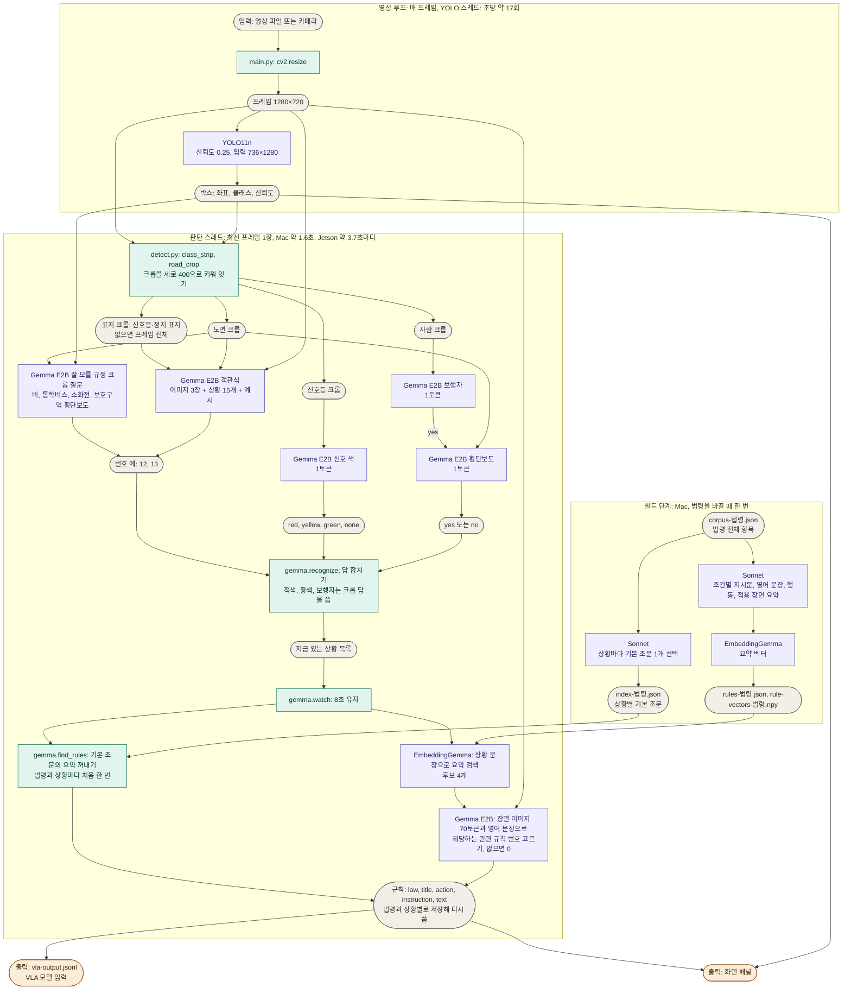
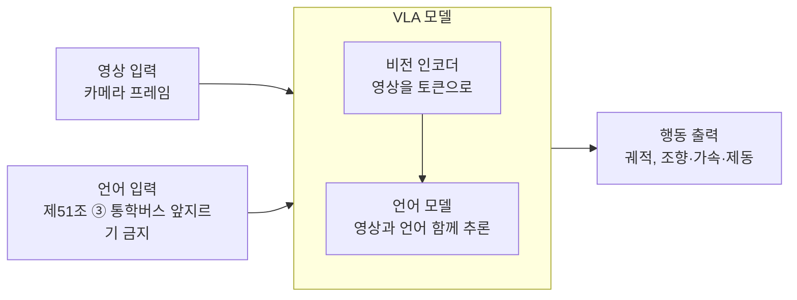

# Project03: 자율주행 VLA 모델을 위한 도로교통법 검색 및 지시문 생성 모듈

이 모듈은 주행 장면을 받아 선택한 법령에서 적용할 규칙을 검색하고, VLA(Vision-Language-Action) 모델에 넘길 근거 조항, 행동 종류, 지시문을 만듭니다. 고른 상황이 없거나 그 상황의 조문이 없으면 아무것도 내지 않습니다. 결과는 `vla-output.jsonl`에 한 줄씩 기록하고, 화면 패널은 같은 결과를 확인하는 시연 수단입니다. 실제 VLA 모델 연결은 아직 없습니다.

## 구조

온디바이스 자원이 제한되어 있으므로 장면과 상관없이 결과가 정해지는 일은 빌드 단계로 옮기고, 실행 중에는 장면에 따라 달라지는 판단만 합니다(2026-11-07 사용자 결정).

1. 빌드 단계 조문 선택(Mac, 인터넷 필요): 상황 15개마다 임베딩 검색으로 후보 조 50개를 추리고, Sonnet이 라벨을 보지 않고 기본 조문 하나를 고릅니다. 결과는 `index-<법령>.json`입니다.
2. 빌드 단계 요약: Sonnet이 법령 전체를 읽고 운전자가 따를 의무를 조건별로 나눠 한국어 지시문, 같은 뜻의 영어 문장, 행동 코드, 적용 장면 설명으로 요약합니다. EmbeddingGemma가 요약을 벡터로 만듭니다. 결과는 `rules-<법령>.json`, `rule-vectors-<법령>.npy`이고 현행 165개, 2006년 126개, 캘리포니아 299개입니다. 600자를 넘는 조문(현행 19개, 2006년 12개, 캘리포니아 500개)은 전문을 읽혀 다시 요약했습니다. 그래서 제32조는 정차·주차 금지 장소 10곳으로 나뉘고, 캘리포니아 §22454(점멸 적색등을 켠 통학버스 앞뒤 정지)가 들어갔습니다.
3. 실행 단계 인식: Gemma E2B가 전체 화면, YOLO로 자른 신호등·표지 크롭, 노면 크롭 3장을 보고 상황 15개 중 있는 것을 고릅니다. 신호 색, 횡단보도 보행자, 잘 모를 규정 4개는 YOLO로 자른 크롭을 보여 주고 따로 묻습니다.
4. 실행 단계 검색과 선택: 기본 조문의 요약을 기본 규칙으로 냅니다. 상황 문장으로 요약을 검색해 가까운 4개를 영어 문장으로 Gemma에게 보여 주고, 지금 해당하는 것을 고르게 해 덧붙입니다. 예를 들어 터널에서는 앞지르기 금지에 전조등 규칙이, 통학버스에서는 앞지르기 금지에 반대편 통학버스 점멸 시 일시정지(제51조 ②)가 붙습니다. 처음 만난 조문을 실행 중에 읽던 예전 구조보다 Jetson에서 2.8~4.7초가 줄어듭니다.

입력부터 최종 출력까지의 전체 경로입니다. 보라색은 모델, 초록색은 코드 처리, 회색은 입력과 중간 산출물, 주황색은 최종 출력입니다.



### 시도했지만 넣지 않은 검색 방법

Gemma가 이미지를 보고 쓴 영어 구절로 요약 지시문을 검색하는 방법을 시험했습니다(2026-11-07 개발용 47장, 상위 3개 검색, 크롭 질문 결과 포함). 정답 조문이 후보에 든 프레임은 34장 중 지금 질의 프롬프트가 23장으로 가장 많았습니다. 일반어를 금지한 질의는 21장, 요약의 적용 장면 문체로 쓴 질의는 20장, 규칙을 영어 명령문으로 먼저 쓰게 한 질의는 14장, 보이는 것과 규칙을 짝지어 쓰게 한 질의는 12장이었습니다. 일반어 traffic lights가 회전 금지와 공사 구간의 정답인 제5조 ①로 가는 경로였고, 2B 모델은 프롬프트의 범주 목록을 장면에 없어도 따라 썼습니다. 버스 전용차로와 앞지르기 금지 표지는 어떤 질의 방법에서도 Gemma가 처음부터 말하지 못했습니다. 이 구절만으로 규칙을 고르게 한 구조는 흔한 상황에서 틀려(신호등이 녹색인데 적색 규칙 선택) 넣지 않았고, 인식한 상황 문장을 질의로 쓰는 지금 구조를 택했습니다. 목록에서 상황을 찾지 못했을 때만 자유 구절로 검색하는 보완도 시험했지만, 규칙이 없는 장면 13장 모두에 "차로를 따라 통행하십시오", "안전거리를 확보하십시오" 같은 늘 참인 일반 규칙이 붙어(현행 잘못된 지시 5/13에서 13/13, 캘리포니아 9/19에서 17/19, 재현은 그대로) 넣지 않았습니다. 검색 순위를 합치는 RRF, YOLO 호출 간격 제한, CUDA 스트림 우선순위, 광학 흐름 박스 추적도 효과가 없거나 지금 방식보다 나빠 넣지 않았습니다.

## 잘 모를 규정 사례

조문을 찾아야 맞는 지시가 나오는 장면입니다. 모두 실제 주행 영상으로 시연합니다. 법령 탭의 `조문 없음`은 같은 상황을 조문 없이 Gemma에게 묻는 비교 모드입니다. 각 칸의 첫 줄은 빌드 때 고른 기본 조문의 요약이고, 다음 줄부터는 상황 문장으로 검색한 후보 가운데 Gemma가 장면 이미지를 보고 고른 관련 규칙입니다. 지시문은 빌드 단계에서 Sonnet이 쓴 요약입니다(2026-11-07, 영상의 한 프레임으로 실제 코드를 돌린 결과).

| 영상 탭 | 장면 | 조문 없음 | 현행 | 2006년 | 캘리포니아 |
|---|---|---|---|---|---|
| 터널 | 터널 안 주행 | 차선 변경 금지, 속도 준수.<br>헤드라이트 켜고 속도 준수하세요. | 제22조 ③ `터널 안에서는 앞지르지 마십시오.`<br>제37조 ① `터널 안에서는 전조등·차폭등·미등을 켜십시오.`<br>제37조 ① `밤에는 전조등·차폭등·미등을 켜십시오.` | 제22조 ③ `터널 안에서는 앞지르지 마십시오.` | §21752(b) `교량·터널 100피트 이내에서 시야가 막히면 왼쪽으로 주행하지 마십시오.`<br>§22500(j) `터널 안에서는 정차·주차하지 마십시오.`<br>§22405(a) `교량·고가구조물·터널에서는 안전 최고속도를 넘지 마십시오.` |
| 한강 다리 | 한강 다리 위 | 속도 준수하고 안전하게 운전하세요. | 제22조 ③ `다리 위에서는 앞지르지 마십시오.` | 제22조 ③ `다리 위에서는 앞지르지 마십시오.` | §22405(a) `교량·고가구조물·터널에서는 안전 최고속도를 넘지 마십시오.` |
| 보호구역 | 보호구역 안 신호 없는 횡단보도 | 정지선에서 안전하게 멈추세요. | 제27조 ⑦ `어린이 보호구역의 신호 없는 횡단보도 앞에서는 항상 일시정지하십시오.`<br>제32조 `어린이 보호구역에서는 정차·주차하지 마십시오.`<br>제27조 ⑤ `횡단보도 없는 도로를 보행자가 건너면 안전거리를 두고 일시정지하십시오.`<br>제12조 ③ `어린이 보호구역에서는 제한속도(시속 30킬로미터 이내)를 지키십시오.` | 제12조 ③ `어린이 보호구역에서는 제한 조치를 지키고 어린이 안전에 유의하십시오.`<br>제27조 ⑤ `횡단보도 없는 곳에서 보행자가 횡단하면 안전거리를 두고 일시정지하십시오.`<br>제27조 ③ `신호 없는 교차로와 그 부근에서는 횡단하는 보행자를 방해하지 마십시오.` | §21950(a) `횡단보도(교차로의 비표시 포함)를 건너는 보행자에게 양보하십시오.`<br>§22358.4(b) `학교 구역 500~1,000피트 전부터 시속 25마일을 넘지 마십시오.` |
| 비 | 비 오는 서울 도로 | 감속하고 안전거리를 확보하세요. | 제37조 ① `안개가 끼거나 비·눈이 올 때는 전조등·차폭등·미등을 켜십시오.` | 제37조 ① `안개·폭우·강설로 전방 100미터 이내를 볼 수 없으면 등화를 켜십시오.`<br>제49조 ① `물이 고인 곳에서는 물을 튀기지 않게 운행하십시오.` | §22350 `날씨·시야·교통·노면에 맞는 안전한 속도로 주행하십시오.` |
| 통학버스 | 앞서가는 노란 통학버스 | 정차하고 멈춰 서세요. | 제51조 ③ `어린이 표시를 한 통학버스는 앞지르지 마십시오.`<br>제51조 ② `편도 1차로에서 반대편 통학버스가 점멸 중이면 일시정지 후 서행하십시오.` | 제51조 ③ `어린이를 태운 표시를 한 통학버스는 앞지르지 마십시오.`<br>제19조 ① `앞차를 따를 때는 급정지에도 충돌을 피할 안전거리를 확보하십시오.` | 맞는 조문 없음, 지시 없음 |
| 소화전 | 길가의 소화전 | 정지하고 안전하게 통과하세요. | 제32조 `소방용수시설·비상소화장치 5미터 이내에는 정차·주차하지 마십시오.`<br>제32조 `대통령령으로 정한 소방시설 5미터 이내에는 정차·주차하지 마십시오.` | 제33조 `소방기구·소화전으로부터 5미터 이내에는 주차하지 마십시오.` | §22514 `소화전 15피트 이내에는 정차·주차하지 마십시오.` |

장면 인식은 프레임을 사람이 나눈 표본에서 쟀습니다. 개발용 세트가 아니고 호출마다 한 프레임 값입니다. 영상에서는 3.5초 유지 안에 여러 번 묻습니다. 다리 위는 객관식 상황이라 이 표에 없고, 시험용 측정에서 8장 중 5장을 알아봤습니다.

| 사례 | 입력 | 양성 | 음성 오탐 |
|---|---|---|---|
| 비 | 프레임 | 비 라벨 27/80 | 맑음 0/100, 안개 0/24 |
| 통학버스 | YOLO 버스·트럭 크롭 | 사람이 고른 노란 버스 14/17 | 다른 버스·트럭 10/71 |
| 보호구역 횡단보도 | 노면 크롭 | 횡단보도 라벨 30/78 | 횡단보도 라벨 없음 13/80 |
| 소화전 | YOLO 소화전 크롭 | 샌프란시스코 박스 19/34(모두 실제 소화전) | 71784 박스 13/66이 yes이고 실제 소화전이 일부 섞임 |

빨간 연석, 안전지대, 신호 없는 교차로, 자전거 차로는 후보에서 뺐습니다. 빨간 연석은 현행과 2006년 법에 맞는 조문이 없고, 신호 없는 교차로는 Sonnet이 서행 조문(제31조 ①)을 골라 양보 순서가 나오지 않으며, 자전거 차로는 지시문이 `차선 변경 시`로 틀립니다. 안전지대는 조문 읽기만 확인했고 장면 인식을 재지 않았습니다.

## 개발용 측정

조항과 행동이 모두 맞으면 맞은 것으로 셉니다. 화면 값은 실제 `watch`를 돌리며 영상을 1배속으로 재생해 정답 시각에 유지 중인 규칙으로 잰 값이고, 같은 코드를 세 번 재생한 범위입니다. 두 사이클 값은 정답 시각과 3.5초 전 프레임을 판단해 합친 값입니다. 베벌리힐스를 뺀 47장 기준입니다(2026-11-07).

| 항목 | 현행 | 캘리포니아 |
|---|---:|---:|
| 상황 재현, 화면 값 | 18~22/48 | 15~16/38 |
| 잘못된 지시, 화면 값 | 3~6/13 | 6~9/19 |
| 위험 오발령, 화면 값 | 3~6 | 5~7 |
| 상황 재현, 두 사이클 값 | 31/48 | 24/38 |
| 잘못된 지시, 두 사이클 값 | 5/13 | 8/19 |
| 위험 오발령, 두 사이클 값 | 4 | 6 |
| 인식이 완벽하다고 가정한 상황 재현(베벌리힐스 포함) | 50/53 | 40/43 |

잘 모를 규정 크롭 질문을 넣어도 개발용 94사이클에서 기존 상황의 답은 바뀌지 않았습니다. 고인 물과 노면 젖음 호출을 뺀 뒤 두 사이클 값은 그대로이고, 화면 값 3회 범위는 현행 잘못된 지시와 위험 오발령의 상한이 조금 올랐습니다. 이 3회에 비 판정은 없었습니다. 늘어난 잘못된 지시는 정답에 없는 실제 소화전과 원주의 통학버스 1건입니다. 이 사이에 표지 크롭의 대체 입력을 왼쪽 위 영역에서 프레임 전체로 바꿔 5사이클의 답이 바뀌었고, 현행 31/48은 그대로, 캘리포니아 잘못된 지시는 9/19에서 8/19가 되었습니다.

## 음성 지시와 질문 답변

지시문을 Piper로 읽고, 질문을 받아 고른 법령에서 조문을 찾아 답합니다. 06 노트북의 whisper.cpp와 Piper를 그대로 씁니다.

- **소리:** 강의실에서 소리가 나지 않도록 `voice.py`의 `PLAY_SOUND`가 `False`입니다. `True`로 바꾸면 새 지시와 답을 읽습니다.
- **키보드 질문:** 실행한 터미널에 한글로 입력하고 Enter를 누릅니다. OpenCV 창은 한글 조합 입력을 받지 못합니다.
- **음성 질문:** 창의 `음성 질문` 버튼이나 `m` 키로 녹음을 시작하고, 한 번 더 누르면 멈추고 바로 질문합니다. 누르지 않으면 10초에 끝납니다. 녹음 중에는 패널에 깜빡이는 빨간 점과 경과 시간, 영상 왼쪽 위에 `녹음 중`이 나옵니다. 영상을 바꾸면 이전 영상의 남은 질문을 건너뛰고, 그동안 패널에 `이전 영상 판단을 마치는 중입니다`가 나옵니다. Jetson은 `MIC_DEVICE`를 `arecord -l` 결과에 맞춥니다.
- **답변:** 질문, 답, 근거 후보 조문이 15초 동안 화면에 나옵니다. 법령 탭을 바꾸면 그 법령에서 찾고, `조문 없음`은 조문 없이 답합니다.

개발용 질문 18개(`tests/question_labels_dev.json`)로 상위 3개 항목에 정답 조문이 든 비율을 쟀습니다. 라벨은 Claude가 조문을 찾아 붙였고, 이 세트로 방법을 골랐으므로 성능값이 아닙니다(2026-11-07).

| 검색 방법 | 현행 | 2006년 | 캘리포니아 |
|---|---:|---:|---:|
| BM25 글자 2-gram | 12/17 | 11/16 | 0/11 |
| BM25 + Gemma 조문체 문장 | 12/17 | 12/16 | 6/11 |
| EmbeddingGemma(채택) | 14/17 | 14/16 | 8/11 |

조문 유무의 차이는 소화전 질문에서 뚜렷합니다. `소화전 앞에 잠깐 차를 세워도 돼요?`에 조문 없음은 `잠시 정차는 괜찮습니다`로 틀리게 답하고, 캘리포니아 조문을 읽으면 15피트 이내 정차 금지를 답합니다. 현행의 같은 질문은 검색이 제32조를 놓쳐 `해당 조문을 찾지 못했습니다`로 답합니다.

## 시험용 측정

코드를 확정한 뒤 시험용 세트를 한 번 쟀습니다(2026-11-07, `ca82c65`, 라벨 v2, 베벌리힐스를 뺀 46장, 두 사이클 값). 시험용 라벨 v2는 Claude가 만들었고 사용자 검토 전입니다.

| 항목 | 현행 | 캘리포니아 |
|---|---:|---:|
| 상황 재현 | 6/31 | 6/23 |
| 잘못된 지시 | 9/20 | 14/28 |
| 위험 오발령 | 9 | 8 |

개발용보다 크게 낮습니다. 유형별로 보면 원인이 둘입니다.

| 유형 | 현행 재현 | 조항까지 맞음 | 원인 |
|---|---:|---:|---|
| 적색 신호 | 4/4 | 4/4 | 없음 |
| 선로 전용차로 | 2/3 | 2/3 | 인식 |
| 버스 전용차로 | 0/9 | 0/9 | 표지와 노면 글자 인식 |
| 회전 금지 표지 | 0/5 | 0/5 | 표지 인식 |
| 다리 위 | 0/8 | 5/8 | 행동 코드. 지시문은 맞고 코드만 `CAUTION`이며 정답은 앞지르기 금지 |
| 앞지르기 금지 표지, 황색 신호 | 0/2 | 0/2 | 인식 |

조항만 맞으면 맞은 것으로 치면 현행은 11/31입니다. 재현을 올릴 방법은 두 가지입니다. 다리 위는 행동을 고르는 호출이 조문의 앞지르기 금지를 읽지 못해서 생긴 손실이므로, 행동 예시나 행동을 지시문과 함께 고르는 방식을 개발용 세트에서 고칠 수 있습니다. 버스와 회전 금지는 COCO에 없어 YOLO로 자르지 못하는 표지라 표지 전용 탐지가 필요하고, 복잡성 때문에 도입하지 않기로 했습니다(2026-11-05). 시험용 46장 중 45장이 샌프란시스코이고 이 유형이 많습니다.

당시 잘 모를 규정 5건은 시험용 라벨에 없어 재현에 들어가지 않고, 잘못된 지시를 현행 2건(7에서 9), 캘리포니아 2건(12에서 14) 늘렸습니다. 측정 뒤 사용자 판단으로 고인 물 호출과 노면 젖음 호출을 뺐습니다(2026-11-07). 시험 결과를 보고 한 변경이 아니고 개발용 값으로만 확인했지만, 위 값은 이전 코드(`ca82c65`)의 값입니다. 시험용 세트는 한 번 썼으므로 다시 잰 값은 성능값이 아닙니다. 측정에 쓴 라벨은 `tests/edge_labels_test.json`이고, 측정 뒤 옛 판을 이 v2로 바꿨습니다.

## 시간

Mac 단독 측정 중앙값은 YOLO 0.04초이고, 조문 읽기는 처음 한 번 약 0.5초입니다. 판단 한 번은 개발용 재생에서 1.6초입니다. 사례 영상의 판단 중앙값은 빗길, 통학버스, 금문교가 약 1.9초, 호출이 많은 소화전이 약 2.3초입니다(다른 작업과 겹쳐 재서 조금 높을 수 있습니다). 창을 띄운 실제 실행은 Gemma를 켠 상태로 27.7~29.4 FPS이고, 음성 재생과 질문을 함께 넣은 실행은 26.6~27.5 FPS입니다(2026-11-07, 다른 프로그램이 함께 실행 중). 예전 구조는 YOLO 약 45ms와 `cv2.waitKey` 약 14ms가 프레임마다 들어 같은 조건에서 12~14 FPS였습니다. YOLO를 별도 스레드로 옮기고, 화면을 늦춰 앞뒤 탐지 결과로 박스를 보간하고, 대기를 재생 시각 기준으로 계산해 올렸습니다. YOLO를 MPS로 돌리면 Gemma와 GPU를 나눠 쓰느라 9~10 FPS로 떨어져 쓰지 않습니다. Jetson 값은 「Jetson 시연」 절에 있습니다.

## VLA 출력

패널이 바뀔 때마다 `Project03/vla-output.jsonl`에 한 줄을 이어 씁니다. 한 줄은 그 순간의 규칙 전체입니다. 마지막 줄이 현재 상태이고, `rules`가 비면 지금 적용할 규칙이 없습니다.

```json
{"time": 1793800000.12, "rules": [{"law": "시행규칙 별표 2", "action": "STOP", "instruction": "정지선, 횡단보도 및 교차로 직전에서 정지해야 합니다.", "text": "차량신호등 적색의등화: ..."}]}
```

| 필드 | 뜻 |
|---|---|
| `time` | 패널에 나온 시각(유닉스 초). 판단한 프레임의 시각이 아닙니다 |
| `law` | 근거 조항 번호 |
| `action` | 행동 코드. 지시문 언어가 바뀌어도 그대로입니다 |
| `instruction` | VLA 모델에 넘길 짧은 한국어 지시문 |
| `title` | 근거 조문의 제목 |
| `text` | 근거 조문 앞 240자 |

| `action` | 뜻 |
|---|---|
| `STOP` | 정지 |
| `YIELD` | 양보 |
| `SLOW_DOWN` | 서행 |
| `KEEP_OUT` | 진입·회전 금지 |
| `NO_OVERTAKING` | 앞지르기·차로 변경 금지 |
| `CAUTION` | 주의 |

- 궤적과 제어값은 VLA 모델의 몫입니다. 이 모듈은 닫힌 행동 집합과 짧은 지시문, 근거 조항만 냅니다.
- 실행할 때마다 파일에 이어 쓰고, 실행의 첫 줄은 `rules`가 비어 있습니다.
- 영상이나 법령 버튼을 누르면 규칙이 같아도 한 줄 더 나옵니다.

## 파일 구조

```text
Project03/
├── main.py              영상 재생, YOLO 탐지, 버튼, 패널 갱신, 질문 입력, VLA 출력 기록
├── voice.py             음성 질문을 글로, 글을 음성으로 바꾸기
├── vectors-*.npy        법령 항목 벡터(EmbeddingGemma)
├── detect.py            Gemma 입력 크롭
├── hud.py               박스, 버튼, 지시문, 근거 조항 그리기
├── gemma.py             상황 인식과 조문 읽기
├── build_corpus.py      코퍼스 생성
├── setup.sh             장비 셋업(패키지, 모델, 글꼴, 엔진, 점검, 시험 실행)
├── corpus-current.json  현행 도로교통법과 시행규칙 별표 2 (빌드 입력)
├── corpus-2006.json     2006년 6월 1일 시행 도로교통법과 시행규칙 별표 2 (빌드 입력)
├── corpus-california.json  캘리포니아 차량법 제11편 (빌드 입력)
├── index-current.json   현행 법령의 상황별 조문 내용 (빌드 결과, 실행 때 읽음)
├── index-2006.json      2006년 법령의 상황별 조문 내용 (빌드 결과, 실행 때 읽음)
├── index-california.json  캘리포니아 법령의 상황별 조문 내용 (빌드 결과, 실행 때 읽음)
├── rules-*.json         법령별 조건별 요약 지시문 (빌드 결과, 실행 때 읽음)
├── rule-vectors-*.npy   요약 지시문 벡터 (빌드 결과, 실행 때 읽음)
├── vla-output.jsonl     VLA 모델에 넘길 규칙 기록 (실행 때 생기고 git이 무시함)
├── setup-report.txt     셋업 출력 기록 (실행 때 생기고 git이 무시함)
├── tests/               단위 테스트, 개발용·시험용 라벨, Jetson 시간 측정
├── EXPLAIN.md           코드 설명
├── READING-GUIDE.md     코드 읽는 순서, 한 프레임 따라가기, 함수와 라이브러리 색인, 발표 질문
└── videos/, data/       git이 무시하는 영상과 원본 자료
```

## 실행 방식

### 준비

`setup.sh` 하나로 장비를 맞춥니다. Python 3.10이 필요하고 Windows는 지원하지 않습니다.

코드와 AI Hub 영상의 원본이 개발 Mac에만 있으므로 다른 장비는 Mac에서 보냅니다. 저장소 루트에서 실행합니다.

```bash
bash Project03/setup.sh <사용자>@<주소>
```

`Project03/`이 이미 있는 장비에서는 그 폴더에서 실행합니다.

```bash
bash setup.sh
```

두 명령 모두 여러 번 실행해도 됩니다. 있는 패키지와 파일은 그대로 두고 빠진 것만 맞춥니다.

- **전송:** 코드, 조문 JSON, 시연 영상 6개, `yolo11n.pt`를 `~/Documents/git/Vision-LLM-202035152/`로 보냅니다(약 280MB). 비밀번호를 여러 번 묻지 않게 하려면 `ssh-copy-id <사용자>@<주소>`를 먼저 실행합니다.
- **Python:** 활성화된 가상환경, `../.venv-project03` 순서로 씁니다. Jetson에서는 `$HOME` 아래의 수업 `.venv`를 찾아 쓰고, 없으면 `../.venv`를 만듭니다.
- **패키지:** import가 안 되는 패키지만 아래 표의 버전으로 설치합니다. Jetson은 03, 04, 05 노트북과 같은 명령입니다.
- **모델:** 없으면 `$HOME` 아래에서 이름과 크기가 같은 파일을 찾아 연결하고, 그래도 없으면 Hugging Face에서 받습니다. 장비가 접속하지 못하면 Mac이 Gemma 파일(4.45GB)을 보냅니다.
- **글꼴과 엔진:** 한글 글꼴이 없으면 `fonts-noto-cjk`를 설치합니다. Jetson에서는 TensorRT 엔진이 없으면 만듭니다.
- **점검:** 항목별 통과와 실패를 출력한 뒤 터널 영상 한 프레임을 YOLO와 Gemma로 판단합니다. 마지막에 실행 명령을 출력하고, 출력 전체를 `setup-report.txt`에 남깁니다.

| 패키지 | Jetson 수업 환경 | Mac 개발 환경 (`.venv-project03`) |
|---|---|---|
| Python | 3.10 | 3.10 |
| numpy | 1.23.0 | 1.23.5 |
| opencv-python | JetPack 기본 | 4.10.0 |
| Pillow | 10.4.0 | 10.4.0 |
| ultralytics | 04 노트북 설치본 | 8.4.194 |
| torch | 2.8.0 | 2.14.1 |
| llama-cpp-python | 05 노트북 설치본(CUDA 빌드) | 0.3.36(Metal 빌드) |

- Gemma 모델은 05 노트북과 같은 두 파일을 씁니다(Apache 2.0). 레포에는 넣지 않습니다.
  - `../src/models/Gemma4/google_gemma-4-E2B-it-Q4_K_M.gguf`(3.46GB)
  - `../src/models/Gemma4/mmproj-google_gemma-4-E2B-it-f16.gguf`(0.99GB, 비전 모듈)
- 한글 글꼴은 Noto CJK(`fonts-noto-cjk`), 나눔고딕, Apple SD Gothic Neo 중 설치된 것을 씁니다.

### 주행 영상

영상은 모두 전방 시점이고 레포에 넣지 않습니다. 차 안에서 옆을 찍은 비벌리힐스 영상은 전방 카메라 입력이 아니어서 시연, 측정, 개발용 라벨에서 뺐습니다(2026-11-06).

**원주 영상(한국 블랙박스).** 위키미디어 공용의 [2020-04-16 원주시 도로주행](https://commons.wikimedia.org/wiki/File:2020-04-16_%EC%9B%90%EC%A3%BC%EC%8B%9C_%EB%8F%84%EB%A1%9C%EC%A3%BC%ED%96%89.webm)을 씁니다. 촬영자는 Choi Kwang-mo이고 라이선스는 CC0(퍼블릭 도메인)입니다. 원본은 1920×1080, 24 FPS, 182초, VP9(.webm), 254MB입니다.

아래 명령으로 `videos/`에 내려받습니다.

```bash
mkdir -p videos && curl -L -o videos/wonju-2020-04-16.webm "https://upload.wikimedia.org/wikipedia/commons/c/c3/2020-04-16_%EC%9B%90%EC%A3%BC%EC%8B%9C_%EB%8F%84%EB%A1%9C%EC%A3%BC%ED%96%89.webm"
```

이 영상은 개발용 평가에 씁니다. 원본의 86~118초를 다시 저장한 `videos/wonju-demo.mp4`는 시연 버튼에서 뺐고, 터널 안 구간(172~178초)이 약 6초뿐이라 터널 시연은 아래 영상으로 합니다. Mac에서 OpenCV `VideoWriter`로 만들었습니다.

**샌프란시스코 영상(미국 캘리포니아).** 위키미디어 공용의 [San Francisco Downtown Driving Tour, 2023 California, USA](https://commons.wikimedia.org/wiki/File:San_Francisco_Downtown_Driving_Tour,_2023_California,_USA._Travel_Guide,_(4K_HDR).webm)을 씁니다. 촬영자는 ZERO ONE이고 라이선스는 [CC BY 3.0](https://creativecommons.org/licenses/by/3.0)입니다.

**터널과 한강 다리 영상(실제 주행).** 과제 시연에만 쓰는 유튜브 영상입니다(2026-11-07 교체). `tunnel-seoul.mp4`는 [Driving Korea](https://www.youtube.com/watch?v=isA5Bbvjn4E)의 내곡터널 진입부터 터널 안까지 10~50초이고, `bridge-olympic.mp4`는 [Driving Korea](https://www.youtube.com/watch?v=xSUbUfKrEIQ)의 올림픽대교 52~92초를 30 FPS로 다시 저장했습니다. 예전 터널 영상은 AI Hub `교통법규 위반 상황 데이터`(71555) 프레임을 이어 붙여 사례 경계에서 장면이 끊겼습니다.

**사례 영상(실제 주행).** 과제 시연에만 쓰는 유튜브 영상 세 개와 샌프란시스코 원본의 일부를 씁니다(2026-11-07 사용자 승인). 모두 1280×720, 30 FPS, `mp4v`이고, 출처는 `videos/youtube-sources.txt`에 있습니다. `rain-seoul.mp4`는 [K Traveler](https://www.youtube.com/watch?v=rxrJj2fyOSY)의 108~144초입니다. `school-zone-busan.mp4`는 [운전마법사](https://www.youtube.com/watch?v=NMAQIOZ_lAM)의 189~202.9초와 222~234초를 이어 계기판과 자막을 잘라 냈습니다. 원본의 안내 화살표가 없는 구간입니다. `school-bus-korea.mp4`는 [한문철 TV](https://www.youtube.com/watch?v=SNDLO8CyOVo)의 12~38초에서 진행자 화면을 잘라 냈습니다. `hydrant-sf.mp4`는 샌프란시스코 원본의 619~654초를 다시 저장한 영상이고, 신호 대기 중과 출발 직후에 소화전이 보입니다. 유튜브 영상은 재배포하지 않으며 저장소와 외부 공개 자료에 넣지 않습니다.


AI Hub 자료와 프레임은 커밋하지 않습니다. 시연 사용은 사용자가 승인했습니다(2026-11-06). 번호판과 사람이 보이는 프레임은 외부 공개 자료에 넣지 않습니다.

### 실행 명령

```bash
python main.py videos/tunnel-seoul.mp4
```

Jetson에서는 TensorRT 엔진을 넘깁니다.

```bash
python main.py videos/tunnel-seoul.mp4 --model ../src/models/YOLO/yolo11n_736x1280_fp16.engine
```

YOLO 입력은 736×1280(`detect.IMAGE_SIZE`)입니다. 04 노트북의 `yolo11n_fp16.engine`은 640×640 고정 크기라서, `setup.sh`가 04 노트북과 같은 방법으로 입력 크기만 바꾼 엔진을 만듭니다. 544×960 입력은 Mac 호출이 11.8ms에서 10.5ms로만 줄고 표시 박스가 23% 줄어 쓰지 않습니다(2026-11-07).

Jetson에 연결한 USB 카메라로 시작하려면 영상 자리에 `camera`를 씁니다. 실행 중에는 `카메라` 버튼으로 바꿉니다.

```bash
python main.py camera --model ../src/models/YOLO/yolo11n_736x1280_fp16.engine
```

카메라는 `main.py`의 `CAMERA_PIPELINES`를 차례로 열어 프레임이 읽히는 첫 후보를 씁니다. 순서는 `pipeline`(실습과 같은 `/dev/video0`, YUY2, 640×480, 30 FPS), USB `/dev/video1`~`3`, CSI `nvarguscamerasrc`, `decodebin` 자동 형식입니다. 고른 후보는 `jetson-camera.txt`에 남습니다. 가운데 16:9를 잘라 1280×720으로 키우고, 모든 후보가 실패하거나 끊기면 첫 영상으로 돌아갑니다.

자동 탐지가 실패하면 `main.py`에서 `pipeline = (`를 찾아 현장 카메라에 맞게 고칩니다. `pipeline`을 가장 먼저 시도하므로 그 변수만 고치면 됩니다. 카메라 탭을 다시 눌러 확인합니다. 카메라가 지원하는 형식은 `v4l2-ctl --list-formats-ext -d /dev/video0`로 봅니다.

시작하면 먼저 로딩 화면이 나옵니다. 탐지 모델, Gemma, 임베딩 모델, 조문을 불러오고 첫 프레임으로 Gemma를 한 번 예열합니다. Jetson에서 약 80초 걸리므로 시연 전에 미리 켜 둡니다. Jetson에서는 시작 전에 `sudo jetson_clocks`로 클럭을 고정합니다. 재부팅하면 풀립니다. 패널과 조문 열은 별도 스레드에서 그려 영상 재생을 막지 않습니다. Jetson에서 그리기 한 번이 Gemma와 함께 돌 때 약 250ms라 영상 루프에서 빼자 FPS가 15.3에서 21.4로 올랐습니다(전체 탭 245초, 2026-11-07).

영상 아래에는 법령 비교 열이 있습니다. 같은 장면에서 조문 없음, 현행, 2006년, 캘리포니아가 내는 지시를 네 칸에 나란히 보여 주고, 다른 법령에도 같은 지시문이 있으면 흐리게 그립니다. 선택하지 않은 법령의 규칙은 판단 주기 끝에 찾아 채웁니다. 캘리포니아 통학버스는 빌드 때 Sonnet이 맞는 조문이 없다고 했지만(§22454는 정차해 적색 점멸등을 켠 버스에만 적용) 사용자 지시로 §22454(a)를 기본 조문으로 넣었습니다(2026-11-07). 창은 16:9 모니터에 맞는 1600×900입니다. 왼쪽 위에 영상(960×540으로 줄여 표시, 탐지와 Gemma 입력은 1280×720), 왼쪽 아래에 검색된 조문 세 칸, 오른쪽에 지시문과 처리 단계를 둡니다. 모니터가 더 작으면 창 크기를 줄일 수 있습니다.

판단 기회를 늘리려고 영상은 원래 속도의 0.9배로 재생합니다(`PLAY_SPEED`). 영상이 끝나면 다음 영상으로 넘어갑니다(카메라 탭은 건너뜁니다). 오른쪽 패널의 버튼으로 영상과 법령(현행, 2006년, 캘리포니아, 조문 없음)을 바꿉니다. 패널 위쪽에는 지시문과 근거 조문이, 아래쪽에는 보기, 인식, 조문, 읽기, 출력 단계가 한 줄로 나옵니다. 평소에는 인식 단계에서 지금 호출의 입력 이미지, 답, 확률, 입력 토큰 수, 걸린 시간을 보여 줍니다. 새 규칙이 나오면 조문, 읽기, 출력을 1초씩 보여 줍니다. 이 1초는 보는 사람을 위한 표시 시간이고 실제 처리 시간이 아닙니다. 시연 영상 파일은 판단에 쓰는 구간만 잘라 두었습니다. 법령을 바꾸면 다음 판단부터 그 법령의 조문으로 지시문이 나옵니다. `q`를 누르면 종료합니다.

### 테스트

```bash
python -m unittest discover -s tests -t .
```

## Jetson 시연

시연은 사용자의 Jetson Orin Nano 한 대에서 합니다. `setup.sh`로 셋업했고 결과는 Jetson 작업 폴더의 `setup-report.txt`에 있습니다. 작업 폴더의 코드는 `b1c9f55`와 같습니다(2026-11-07 체크섬 확인).

### 시연 전에 할 일

1. 재부팅했다면 `sudo jetson_clocks`로 클럭을 고정합니다. 전력 모드는 MAXN_SUPER로 둡니다.
2. VS Code와 노트북 커널을 닫아 사용 가능 메모리를 5GB 이상으로 만듭니다.
3. SSH로 실행하면 `DISPLAY=:1`과 `XAUTHORITY=/run/user/1000/gdm/Xauthority`를 함께 지정합니다.
4. 작업 폴더 `Project03`에서 실행합니다. 로딩에 약 80초 걸리므로 미리 켜 둡니다.

```bash
../.venv/bin/python main.py videos/tunnel-seoul.mp4 --model ../src/models/YOLO/yolo11n_736x1280_fp16.engine
```

USB 마이크는 `MIC_DEVICE = "plughw:CARD=Microphone,DEV=0"`처럼 장치 이름으로 지정해 카드 번호가 바뀌어도 동작합니다. 다른 마이크를 쓰면 `arecord -l`의 대괄호 앞 이름(`card 2: Microphone`의 `Microphone`)으로 바꿉니다. 카메라는 oCam-5CRO-U가 첫 후보 `/dev/video0`, YUY2, 640×480으로 열리는 것을 확인했습니다(2026-11-07).

### 측정값

2026-11-07에 MAXN, 클럭 고정 상태로 쟀습니다.

| 항목 | 값 |
|---|---|
| 판단 한 번 중앙값 | 5.14초, 음성 코드를 넣은 뒤 5.84초 |
| 첫 판단 | 23.6초, 로딩 중 예열로 영상 시작 전에 끝냄 |
| 조문 읽기, 처음 한 번 | 2.8~4.7초 |
| 이미지 1장 호출, 70·140·280토큰 | 0.52초, 0.78초, 1.61초 |
| 이미지 없는 객관식 호출 | 0.75~0.84초 |
| YOLO 호출, Gemma 끔 | 15.1ms, 초당 27회 |
| YOLO 호출, Gemma 켬, 전체 탭 | 중앙값 114ms, p95 715ms, 초당 4.2회 |
| FPS | 빗길 24.0, 전체 탭 21.4 |
| 최대 RAM | 6381MB |
| 사례 첫 표시, 시작부터 | 터널 14.6초, 금문교 30.8초, 보호구역 제27조 ⑦ 81.8초, 비 107.8초, 통학버스 116.0초 |

캘리포니아 소화전 §22514는 2회 중 1회, 22.3초에 나왔습니다. 판단 시간의 대부분은 이미지 인코딩입니다. 판단이 약 5초라 `HOLD_SECONDS`를 8초로 늘렸습니다.

패널과 조문 열을 영상 루프에서 그리면 Gemma와 함께 돌 때 한 번에 약 250ms가 걸렸습니다. 렌더링 스레드로 옮겨 전체 탭 FPS가 15.3에서 21.4로, 빗길 YOLO 호출 중앙값이 300ms에서 23.6ms로 바뀌었습니다.

Gemma와 YOLO가 GPU를 나눠 쓰므로 표시 지연 10프레임에서는 박스가 표시 프레임 뒤의 탐지 결과가 있는 44~53%의 시간에만 보간됐습니다. 나머지 시간에는 앞 탐지 결과를 그려 박스가 늦었습니다. 그래서 표시 지연을 20프레임으로 늘렸습니다. YOLO에 높은 CUDA 스트림 우선순위를 주면 호출 p95가 629ms에서 816ms로 나빠졌고, YOLO를 초당 1회로 제한해도 Gemma 판단(6.56초)과 FPS(23.4)가 그대로라 둘 다 넣지 않았습니다. INT8 엔진은 FP16과 어긋남이 같아 쓰지 않습니다. Gemma를 CPU 코어 4, 5에 묶으면 YOLO가 56ms로 오히려 느려졌습니다(1회 측정).

## 평가 라벨

`tests/edge_labels_dev.json`(47장)과 `tests/edge_labels_test.json`(46장, 사용자 검토 전)은 프레임마다 영상, 시각, 상황 이름, 법령별 정답 조항을 담습니다. 규칙과 프롬프트는 개발용에서만 정합니다. 시험용은 마지막에 한 번만 잽니다. 시험용은 2026-11-07에 한 번 쟀습니다.

## 법령 코퍼스

### 파일 형식

코퍼스 파일은 `{"name", "articles"}` 사전입니다. `articles`의 항목은 `id`, `title`, `text`를 가집니다.

### 생성

```bash
curl -o data/pubinfo_2025.zip https://downloads.leginfo.legislature.ca.gov/pubinfo_2025.zip
```

```bash
python build_corpus.py <국가법령정보 Open API 인증키(OC)> data/pubinfo_2025.zip
```

- 인증키는 [국가법령정보 공동활용](https://open.law.go.kr)에서 발급받은 본인 키를 씁니다. 레포에는 적지 않습니다.
- 법령은 「저작권법」 제7조에 따라 보호받지 못하는 저작물입니다. 그래서 생성한 JSON을 레포에 넣었습니다.

| 파일 | 법령 | 법령일련번호(MST) | 공포일 |
|---|---|---|---|
| `corpus-current.json` | 도로교통법 | 291133 | 2026-10-13 |
| `corpus-current.json` | 도로교통법 시행규칙 | 289009 | 2026-08-24 |

### 구성

- 도로교통법은 항마다 한 항목입니다. `id`는 `도로교통법 제27조 ①` 형식입니다.
- 시행규칙 별표 2(신호기가 표시하는 신호의 종류 및 신호의 뜻)는 신호 종류마다 한 항목입니다. 제목은 `차량신호등 적색의등화` 형식입니다.
- 캘리포니아 차량법은 제11편(Division 11, Rules of the Road) 현행 조문 567개를 항(subdivision)마다 한 항목으로 나눕니다. `id`는 `CVC §21453(b)` 형식이고, 캘리포니아 법전에는 조문 제목이 없어 `title`은 비어 있습니다.
- 항목 수는 현행 592개, 캘리포니아 1,694개입니다.

### 2006년 도로교통법 출처

- 국가법령정보센터의 연혁 본문에서 읽었습니다. 도로교통법은 법률 제7545호(2005-05-31 전부개정, 2006-06-01 시행, `lsiSeq` 68394), 시행규칙은 행정자치부령 제329호(2006-05-30 공포, `lsiSeq` 74647)입니다.
- 시행규칙 별표 2는 첨부 PDF의 차량·보행 신호 12행을 옮겼습니다. 생성 스크립트는 저장소에 없습니다.
- 인덱스는 현행과 달리 임베딩 후보를 거치지 않고 Sonnet에게 전체 421개 항목을 줘서 골랐습니다. 노면전차, 공사 구간, 터널 전조등은 운전자 의무를 정한 항목을 찾지 못해 지시문을 내지 않습니다.

### 캘리포니아 차량법 출처

- 캘리포니아 의회가 공개하는 일괄 데이터 [pubinfo_2025.zip](https://downloads.leginfo.legislature.ca.gov/)(2025–2026 회기, 2026-10-25 갱신, 1.2GB)의 `LAW_SECTION_TBL`에서 읽습니다.
- 의회 웹사이트(leginfo.legislature.ca.gov)는 스크립트 접근을 Cloudflare 확인 페이지로 막아서 쓰지 않았습니다.
- 미국 교통 법규는 주마다 다릅니다. 샌프란시스코 영상과 같은 지역인 캘리포니아주 법을 골랐습니다.

## 창의성 및 확장성

### Problem: 이 프로젝트가 해결하고자 하는 문제

지금의 자율주행 시스템에는 두 가지 핵심 한계가 있습니다. 행동이 교통법규에 그라운딩되어 있지 않고, 수시로 바뀌고 지역마다 다른 교통법규에 맞춰 행동을 바꾸지 못합니다.

**1. 교통법규에 그라운딩되지 않은 행동**

상용 자율주행 시스템도 교통법규를 어기고 있고, 규제 당국은 이를 문제로 다루기 시작했습니다.

| 사례 | 내용 |
| --- | --- |
| Tesla FSD | NHTSA가 2025년 10월 약 288만 대를 대상으로 예비 조사를 열었습니다. 빨간불에 교차로에 들어가거나 반대 차로로 차선을 바꾼 위반 신고가 58건이고, 충돌 14건과 부상 23명이 포함됩니다([NHTSA ODI PE25012](https://static.nhtsa.gov/odi/inv/2025/INOA-PE25012-19171.pdf)). |
| Waymo | 경고등을 켜고 정차한 스쿨버스를 추월해 NHTSA 조사를 받았습니다. 오스틴 교육청이 19건을 신고했고, Waymo는 2025년 12월 3,067대의 소프트웨어를 리콜했습니다([NPR](https://www.npr.org/2025/12/06/nx-s1-5635614/waymo-school-buses-recall)). |
| End-to-End 주행 모델 | CARLA에서 네 모델을 비교한 평가에서 LMDrive의 신호 위반이 km당 2.89회였습니다([arXiv 2501.12090](https://arxiv.org/abs/2501.12090)). |
| 캘리포니아 AB 1777 | 2026년 7월부터 경찰이 자율주행차 제조사에 교통법규 위반 통지를 보냅니다([FOX LA](https://www.foxla.com/news/california-robotaxi-law-ab-1777-autonomous-vehicle-citations)). |

학습 기반 주행 모델은 법 조문이 아니라 주행 데이터에서 행동을 배웁니다. 법규를 어긴 행동은 그 순간 행동이 교통법규에 그라운딩(grounding)되어 있지 않았다는 뜻입니다. 같은 장면을 법령 없이 Gemma 4 E2B에 보여 주면 그럴듯하지만 정확하지 않게 답하고, 통학버스 장면에서는 틀리게 답합니다.

| 장면 | 법령 없는 Gemma 4 E2B | 법령을 근거로 한 지시 |
| --- | --- | --- |
| 통학버스 | 정차하고 멈춰 서세요. | 제51조 ③ 어린이 표시를 한 통학버스는 앞지르지 마십시오.<br>제51조 ② 편도 1차로에서 반대편 통학버스가 점멸 중이면 일시정지 후 서행하십시오. |
| 터널 | 차선 변경 금지, 속도 준수. | 제22조 ③ 터널 안에서는 앞지르지 마십시오.<br>제37조 ① 터널 안에서는 전조등·차폭등·미등을 켜십시오. |
| 소화전(샌프란시스코) | 정지하고 안전하게 통과하세요. | CVC §22514 소화전 15피트 이내에는 정차·주차하지 마십시오. |

**2. 수시로 바뀌고 지역마다 다른 교통법규**

교통법규는 자주 바뀌고, 바뀐 뒤에는 행동도 바뀌어야 합니다. 아래 지시문은 이 프로젝트가 2006년 도로교통법과 현행 도로교통법의 조문에서 만든 문장입니다.

| 상황 | 2006년 도로교통법 | 현행 도로교통법 |
| --- | --- | --- |
| 횡단보도 보행자 | 횡단보도에 보행자가 있으면 정지선 앞에서 일시정지하십시오. | 보행자가 횡단보도를 건너려 하면 정지선 앞에서 일시정지하십시오. (제27조 ①, 2022. 7. 12. 시행) |
| 적색 신호 우회전 | 적색 신호에서 우회전할 때는 진행 중인 다른 차마를 방해하지 마십시오. | 적색 신호에 우회전하려면 정지 후 다른 교통을 방해하지 마십시오. (시행규칙 별표 2, 2023. 1. 22. 시행) |

- 우회전 일시정지 규정은 시행 초기에 사람 운전자도 거의 지키지 못했다는 보도가 있었습니다([다음 뉴스](https://v.daum.net/v/20230221215153802)).
- 지역마다도 다릅니다. 소화전 주변 정차·주차 금지 거리는 한국 현행 법이 5미터, 캘리포니아 차량법이 15피트입니다.

지금의 대응 방식은 법이 바뀔 때마다 비용이 큽니다.

| 방식 | 법이 바뀌었을 때 |
| --- | --- |
| 학습 기반 모델 | 바뀐 규정에 맞는 데이터를 다시 모으고 다시 학습해야 합니다. |
| 규칙 형식화 | 전문가가 조문을 시간 논리식으로 하나씩 옮기고, 나라마다 다시 해야 합니다. 이 작업을 LLM으로 돕는 연구(TR2MTL, IEEE IV 2024)도 수작업 형식화에는 도메인 지식과 논리 전문성이 필요해 널리 쓰이기 어렵다고 적고 있습니다([arXiv 2406.05709](https://arxiv.org/abs/2406.05709)). |

### Background: 프로젝트 관련 배경

**1. VLA(Vision-Language-Action) 모델과 자율주행**

VLA는 영상과 언어를 함께 이해하는 VLM(Vision-Language Model)에 행동 출력을 붙인 모델입니다. 이 이름은 Google DeepMind의 RT-2(2023)가 처음 썼습니다. RT-2는 로봇 행동을 텍스트 토큰으로 바꿔 학습해서, 웹에서 배운 지식을 행동 결정에 그대로 씁니다([RT-2](https://deepmind.google/discover/blog/rt-2-new-model-translates-vision-and-language-into-action)).



자율주행에서도 VLA가 쓰이기 시작했습니다.

| 모델 | 내용 |
| --- | --- |
| Waymo EMMA (2024) | Gemini를 바탕으로 카메라 영상에서 주행 궤적을 바로 만듭니다. 주행 문제를 시각 질의응답으로 바꿔 풀고, 사고 과정(chain-of-thought)을 쓰면 계획 성능이 6.7% 오릅니다. 연구용이며 실차 배포 전입니다([arXiv 2410.23262](https://arxiv.org/abs/2410.23262)). |
| NVIDIA Alpamayo-R1 (2025) | Cosmos-Reason VLM에 궤적 생성기를 붙였습니다. 본 것을 언어로 추론한 뒤 경로를 계획하고, 실차에서 99ms로 동작했습니다([arXiv 2511.00088](https://arxiv.org/abs/2511.00088)). |
| Li Auto MindVLA, XPeng VLA (2025~) | 중국 업체들이 양산차에 VLA 기반 주행 기능을 넣기 시작했습니다([CnEVPost](https://cnevpost.com/2025/03/18/li-auto-unveils-mindvla-autonomous-driving-architecture/), [Gasgoo](https://autonews.gasgoo.com/articles/ICV/xpeng-to-begin-full-scale-second-gen-vla-push-in-late-march-2028870433976193024)). |

VLA는 언어 입력을 받으므로, 법령을 근거로 한 지시문을 그대로 입력으로 쓸 수 있습니다. 위 그림의 언어 입력이 CODRIVE가 만드는 부분입니다.

**2. 자율주행 분야의 특성과 Edge AI의 필요성**

- **실시간 판단:** 시속 100km에서는 판단이 0.1초 늦으면 2.8m, 1초 늦으면 27.8m를 갑니다. 클라우드에 물으면 네트워크 왕복 지연이 여기에 더해집니다.
- **끊기는 연결:** 터널, 지하차도, 산간 도로에서는 통신이 불안정합니다. 시연 영상의 터널 장면이 그 예입니다.
- **차량 장비의 제약:** 차에 올릴 수 있는 연산은 전력과 발열 때문에 제한되고, 큰 모델은 실시간 예산을 넘깁니다.

자율주행처럼 지연이 치명적인 작업은 차 안에서 추론하고, 중앙 클라우드는 지연과 신뢰성 때문에 늘 쓸 수는 없다고 봅니다([Computer Communications, ORBilu](https://orbilu.uni.lu/handle/10993/57938), [arXiv 2607.09045](https://arxiv.org/abs/2607.09045)). 그래서 주행 판단은 연결이 끊겨도 차 안에서 끝나야 하고, 작은 모델로 장비 안에서 판단해야 합니다. CODRIVE가 Jetson Orin Nano에서 Gemma 4 E2B로 동작하는 이유입니다.

### Objective: 프로젝트 목표

| 목표 | 내용 | 대응하는 문제 |
| --- | --- | --- |
| 1. 법령에 그라운딩된 지시 | 카메라 장면에 해당하는 조문을 찾아 근거 조항과 지시문을 만들고, VLA 모델의 언어 입력으로 넘깁니다. 통학버스를 보면 제51조 ③의 앞지르기 금지가 근거와 함께 나옵니다. | Problem 1 |
| 2. 법령 교체만으로 바뀌는 지시문 | 법령을 모델 안에 넣지 않고 데이터로 둡니다. 코드와 모델을 고치지 않고 데이터만 바꾸면, 같은 소화전 장면에서 현행은 5m 이내 정차·주차 금지, 2006년 법은 5m 이내 주차 금지, 캘리포니아는 15ft 이내 정차·주차 금지로 지시가 바뀝니다. | Problem 2 |
| 3. 엣지 장비에서 실행 | 네트워크 연결 없이 Jetson Orin Nano 안에서 판단합니다. 런타임 모델은 Gemma 4 E2B(장면 인식, 규칙 선택), YOLO11n(물체 탐지), EmbeddingGemma(조문 검색)입니다. | Background 2 |

CODRIVE는 엣지 장비에서 법령에 근거한 지시문을 만들고, 법령이 바뀌면 데이터 교체만으로 따라갑니다.

## 한계

- 2006년 법에는 제27조 ⑦이 없어 Sonnet이 제12조 ③을 골랐습니다. 그래서 2006년 모드의 보호구역 횡단보도에서는 보호구역과 횡단보도가 같은 조항의 비슷한 문장을 두 줄 냅니다.
- 2006년 패널은 보호구역, 비, 통학버스 영상으로 실제 실행해 확인했습니다. 터널, 금문교, 소화전은 고인 물 호출을 빼기 전 코드로 확인했습니다. 지시문 어미는 실행에 따라 조금씩 달라 보입니다. 법령을 바꾸면 조문을 다시 읽어 만들기 때문입니다.
- 음성 기능은 Mac에서 터미널 질문, 답변 화면, Piper 합성과 재생, 합성 음성의 Whisper 인식까지 확인했습니다. Jetson에서는 음성 코드를 넣은 상태로 판단 시간을 쟀고, USB 마이크가 없어 녹음은 확인하지 않았습니다. Jetson에서는 EmbeddingGemma 334MB가 메모리에 더 올라갑니다.
- 박스를 맞추려고 화면을 20프레임 늦추므로 카메라 모드의 표시가 Mac에서 약 0.8초, Jetson에서 약 0.9초 늦습니다. Jetson에서 YOLO 호출 p95가 715ms라(Gemma 동시 실행, 전체 탭, 2026-11-07 측정) 그 구간의 박스는 어긋날 수 있습니다.
- 카메라 모드는 실제 카메라로 돌린 적이 없습니다. Mac에는 GStreamer가 없어 640×480 가짜 입력으로 시작, 영상 전환, 다시 열기, 끊김 복귀만 확인했습니다. 640×480을 키우므로 먼 신호등과 표지의 탐지는 영상보다 낮을 수 있고 재지 않았습니다.
- 시연 영상의 자른 구간은 사람이 판단 결과를 보고 골랐습니다. 평가 수치와 무관한 시연 편집입니다.
- 2006년 적색 신호 조문은 현행과 달리 정지 없는 우회전을 허용하지만, 지시문은 `정지선, 횡단보도 및 교차로 직전에서 정지해야 한다.`로 현행과 거의 같아 차이가 화면에 드러나지 않습니다. 보호구역도 2006년 법에는 속도 숫자가 없어 일반적인 지시가 나옵니다.
- `setup.sh`는 시연 장비 한 대에서만 돌렸습니다. 다른 Jetson에서는 확인하지 않았습니다.
- 실행 중에는 조문을 검색하지 않습니다. 조문 선택은 빌드 단계에서 끝나고, 그래서 같은 법령과 상황이면 지시문이 같습니다. 장면 내용은 지시문에 들어가지 않습니다.
- 상황 15개 중 14개는 개발용 라벨의 유형에서, 어린이 보호구역은 시연 자료를 본 뒤 사람이 정의했습니다. 목록 밖 상황에는 지시문이 나오지 않습니다.
- 어린이 보호구역은 현행에서 Sonnet이 제12조 ③을 골랐고, 이 항이 끌어오는 제12조 ①을 함께 읽어 지시문이 `시속 30킬로미터 이내로 운행해야 합니다.`로 나옵니다. 같은 법령과 상황이면 지시문이 같아 노면 숫자를 반영하지 못합니다. 노면이 20인 구간에서도 30을 말합니다. 캘리포니아는 `속도 제한을 준수해야 합니다.`로 숫자가 나오지 않습니다.
- 잘 모를 규정 5건의 상황 정의는 사람이 정했습니다. 비는 `rain is falling while the car is driving`일 때 지시문이 `규정된 사항을 준수해야 합니다.`로 뭉뚱그려져 결과를 본 뒤 `it is raining on the road`로 바꿨습니다.
- 새 호출의 오탐이 있습니다. 개발용 94사이클에서 원주 64초에 통학버스 1건이 나왔고, 비 호출은 고인 물과 노면 젖음을 뺀 뒤 개발용 재생 883사이클에서 0건입니다. 샌프란시스코 4사이클의 소화전은 실제 소화전이지만 개발용 정답에 없어 잘못된 지시로 셉니다.
- 화면의 지시문은 빌드 단계에서 Sonnet이 쓴 요약입니다. 지시문 품질은 Sonnet이 정하고, 법령을 바꾸려면 API로 요약을 다시 만들어야 합니다. 같은 법령과 상황이면 지시문이 같습니다.
- 요약을 조건별로 나눠 현행 소화전 지시문에 5미터가 나옵니다(`소방용수시설·비상소화장치 5미터 이내에는 정차하거나 주차하지 마십시오.`).
- 덧붙는 관련 규칙은 Gemma가 상황 문장과 70토큰 장면 이미지를 보고 법령과 상황마다 처음 한 번 고릅니다. 이미지를 넣자 시연 영상 5개에서 보행자우선도로 20킬로미터, 횡단보도 없는 도로 보행자, 도로공사 구역 주차 금지처럼 장면에 없는 규칙이 빠졌습니다. 터널에는 여전히 `밤에는 전조등을 켜십시오`가 붙습니다. 개발용 세트로는 재지 않았습니다.
- 사례 영상에서도 오탐이 나옵니다. 부산 스쿨존 영상에서는 앞을 지나는 파란 시내버스를 통학버스로 읽어 제51조 ③이 나온 실행이 있고, 빗길 영상에서는 다리, 전용차로, 앞지르기 표지 지시가 함께 나옵니다. 부산 영상의 제27조 ⑦은 3회 실행 모두 나왔지만 첫 구간에서 약 2.5초만 남습니다. 소화전 §22514는 35초 영상 3회 실행 모두 나왔고 나오는 시점은 실행마다 다릅니다. 시연 영상은 정답 라벨이 없어 인식률을 재지 않았습니다.
- 소화전의 조문 없음 답은 실행에 따라 나오지 않을 때가 있어, 백업 녹화는 두 번째 실행본을 썼습니다.
- 통학버스 조문의 조건인 어린이 탑승 표시는 카메라로 확인하지 않습니다. 노란 버스면 지시가 나옵니다. 큰 버스의 광고 글자를 버스 전용차로 표시로 잘못 읽어 제15조 ③이 함께 나오기도 합니다.
- 제27조 ⑦(신호 없는 보호구역 횡단보도 일시정지)은 객관식에 넣지 않고 크롭 질문으로 묻습니다. 예전에 객관식에 넣었을 때는 상황 목록에 없었습니다. 객관식에 넣으면 개발용 재현이 현행 35/53에서 33/53, 캘리포니아 28/43에서 25/43으로 떨어지고 횡단보도를 가르지도 못했습니다.
- 보호구역 상황은 노면 글자 `어린이 보호구역`이 보이면 고르고, 빨간 포장만 보이면 대부분 놓칩니다. 당시 개발용 57프레임의 114사이클 중 샌프란시스코 5사이클에서 잘못 고릅니다. 이 상황에는 정답 라벨이 없어 성능을 재지 않았습니다.
- 빌드 스크립트는 저장소에 없습니다. 이번 빌드는 Sonnet 서브에이전트로 했고, 법령을 바꾸려면 위 빌드 단계를 다시 하고 Sonnet 접근이 필요합니다.
- Sonnet이 학습한 법 지식이 조문 선택에 섞였는지는 재지 않았습니다.
- 터널 상황 정의 `the car is inside a tunnel, where overtaking is prohibited`는 개발용 오류를 본 뒤 고른 문구이고 조문의 의무를 담고 있습니다.
- 캘리포니아에는 터널 안 앞지르기를 직접 금지한 항이 후보에 없습니다. Sonnet이 고른 §21752(b)는 시야가 가린 터널 접근 구간의 왼쪽 주행 금지이고, 지시문은 `지시문은 `터널 진입 시 좌측 차선 주행 금지.`이고 행동 코드는 `KEEP_OUT`입니다. 조문은 시야가 가린 경우만 정하므로 터널 앞지르기 지시로는 맞지 않습니다.
- 캘리포니아의 터널 등화 상황은 맞는 조문을 찾지 못해 지시문을 내지 않습니다.
- 행동 코드와 지시문은 조문을 따로 읽어 만들므로 어긋날 수 있습니다. 현행 황색은 코드가 `YIELD`이고 문장은 정지를 말합니다. 다리 위는 코드가 `CAUTION`이고 문장은 앞지르기 금지를 말합니다. 전조등을 켜는 행동 코드는 없어 터널 등화는 `CAUTION`입니다.
- 지시문 어미는 `합니다`, `하십시오`, `하세요`가 섞입니다. 틀린 문장도 있습니다. 현행 노면전차는 `전용도로 또는 전용차로로 통행해야 합니다.`로 조문과 반대입니다.
- 패널에는 지시문을 모두 같은 크기로 최신 순으로 그립니다. 한 지시문이 더 중요해 보이지 않게 하려는 것입니다. 조문은 규칙이 하나일 때만 2줄까지 그리고, 줄이 모자라면 `외 N개`로 줄입니다. VLA 출력에는 모두 남습니다. 규칙은 마지막으로 나온 뒤 3.5초 동안 남습니다. 그래서 적색 규칙은 신호가 바뀐 뒤에도 최대 약 4.8초 남습니다. 영상을 바꾸면 패널을 바로 비웁니다.
- 화면 값은 실행 간 차이가 커서 작은 변경의 효과를 구별하지 못합니다. 베벌리힐스를 포함한 도로 크롭 확인 전 6회는 현행 4~8/18, 확인 뒤 4회는 5~7/18이었습니다. 보호구역 상황을 뺀 같은 코드의 대조 실행은 현행 4/18, 캘리포니아 7/24입니다. 객관식에 상황을 더하면 샌프란시스코 1890초의 다리, 원주 14초와 64초의 공사처럼 다른 상황의 오인식이 생깁니다.
- 보호구역을 객관식에서 빼고 `road_crop` 예/아니오 질문으로 분리하면 오인식은 없어지지만(개발용 0/114사이클), 노면 글자가 보이는 7장 중 2장만 고르므로 넣지 않았습니다.
- 터널 영상의 붉은 보닛 반사 장면에서 보호구역 지시가 나옵니다. 예전 AI Hub 터널 영상(`tunnel-korea.mp4`) 68사이클 중 3사이클, 패널에 남는 시간 10%입니다. 비벌리힐스와 샌프란시스코에서는 나오지 않았습니다. 15번을 고른 때만 예시를 주고 다시 묻는 확인 호출은 항상 `yes`로 답해 줄지 않았으므로 넣지 않았습니다.
- 횡단보도 호출은 사람 크롭과 도로 크롭을 차례로 물어 횡단보도가 있는지 확인하지만, 사람이 횡단보도 위에 있는지는 확인하지 못합니다. 횡단보도 옆을 지나는 사람에게도 제27조 ① 지시가 나옵니다(`clip` 7, 11번).
- 회전 금지, 앞지르기 금지, 버스 전용차로 표지는 COCO에 없어 YOLO로 자르지 못하고 재현이 낮습니다.
- YOLO 박스는 COCO 클래스(사람, 자전거, 승용차, 버스, 트럭, 신호등, 소화전, 정지 표지)만 나타냅니다. 횡단보도, 차선, 한국 교통안전표지는 찾지 못합니다.
- 별표 2는 선 문자 표에서 글자를 읽습니다. 칸 안 줄바꿈이 낱말 중간에서 일어나 일부 띄어쓰기(`교통을방해하지`)는 복원하지 못합니다.
- 출력 줄에는 유지 중인 규칙이 얼마나 오래됐는지 없습니다. 규칙은 상황이 사라진 뒤에도 유지 시간 동안 줄에 남습니다.
- `cap.get(cv2.CAP_PROP_FPS)`가 0을 돌려주면 `main.py`가 0으로 나눕니다. Jetson에서 아직 확인하지 않았습니다.
- `../src/models/YOLO/yolo11n.pt`는 레포에 넣지 않습니다. 04 노트북 순서대로 준비합니다.

## 수업 내용과 연결

| 수업 내용 | 이 프로젝트에서 쓴 곳 |
|---|---|
| 04 노트북 YOLO 추론과 클래스 선택 | `main.py`: `model.predict(source=frame, conf, iou, verbose=False, classes=CLASSES)` |
| 04 노트북 FPS 측정 | `main.py`: `time.perf_counter()`와 지수 이동 평균(0.9, 0.1) |
| 04 노트북 TensorRT 엔진 | Jetson 실행 시 `--model ../src/models/YOLO/yolo11n_736x1280_fp16.engine`. 같은 방법으로 입력 크기만 바꿔 만듭니다 |
| 05 노트북 로컬 Gemma 로드 | `gemma.load_gemma`: `Llama(n_gpu_layers=-1, …)`. 이미지 토큰 때문에 `n_ctx=4096`, `n_batch=512`로 늘림 |
