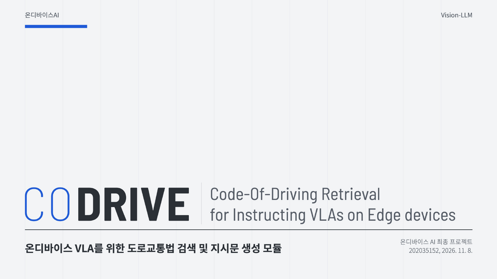

# Project03: CODRIVE - 온디바이스 VLA를 위한 도로교통법 검색 및 지시문 생성 모듈

CODRIVE(Code-Of-Driving Retrieval for Instructing VLAs on Edge devices)는 주행 장면에 맞는 도로교통법 조문을 찾아, VLA(Vision-Language-Action) 모델에 넘길 조항, 행동 코드, 지시문을 만드는 모듈입니다. 카메라 프레임에서 YOLO11n으로 물체를 탐지하고, Gemma 4 E2B로 장면의 상황을 인식한 뒤, EmbeddingGemma로 선택한 법령에서 관련 규칙을 검색하도록 구성했습니다. 해당 모듈이 검색할 법령 데이터로 현행 도로교통법, 2006년 도로교통법, 캘리포니아 차량법 세 가지를 준비하였고, 선택한 법령을 바꾸면 같은 장면에서도 해당 법령에 맞는 지시문이 나타납니다. 

> 발표 자료는 [docs/codrive-presentation.pdf](docs/codrive-presentation.pdf)에 있습니다.

## 파일 구조

- main.py: 메인 실행 파일입니다. 영상 재생, YOLO 탐지 스레드, 화면 버튼, 질문 입력, VLA 출력 기록을 담당합니다.
- gemma.py: Gemma 4 E2B를 이용한 장면 인식, 규칙 검색과 선택, 질문 답변을 처리하는 판단 스레드입니다.
- detect.py: YOLO 박스로 신호등, 사람, 버스, 소화전, 노면 크롭을 만들어 Gemma 입력으로 넘깁니다.
- hud.py: 화면 패널, 법령 비교 열, 로딩 화면을 그립니다.
- voice.py: whisper.cpp로 음성 질문을 텍스트로 변환하고, Piper로 지시문과 답변을 음성으로 출력합니다.
- setup.sh: 패키지, 모델, 글꼴, TensorRT 엔진을 맞추고 시험 실행까지 하는 장비 셋업 스크립트입니다.

> 법령별 조문, 상황별 기본 조문, 요약 지시문과 임베딩된 벡터 등은 laws 폴더에 적재했습니다.

## 실행 방식

setup.sh 스크립트를 실행하면 필요한 패키지와 모델을 확인하고 빠진 것들을 자동으로 설치합니다.

```bash
bash setup.sh
python main.py
```

Jetson에서는 TensorRT 엔진을 넘겨 실행합니다. 

```bash
python main.py --model ../src/models/YOLO/yolo11n_736x1280_fp16.engine
```

실행 시 모델을 불러오고 Gemma를 한 턴 생성시켜 예열하는 로딩 화면이 나타납니다. Jetson 기준으로 80초 가량 걸렸습니다. 

### 화면 구성과 기능
화면 왼쪽 위에는 주행 영상과 YOLO 박스가, 그 아래에는 같은 장면에서 법령마다 어떤 지시가 나오는지 비교하는 열이 나옵니다. 

오른쪽 패널의 버튼으로 영상과 법령을 바꿀 수 있고, 지금 적용되는 지시문과 근거 조문, 그리고 Gemma가 어떤 이미지를 보고 무엇을 답했는지가 표시됩니다. 

음성 모달리티 활용을 위해 새 지시문이 나오면 Piper로 TTS를 적용해 소리내 읽도록 하였으며, 터미널에 질문을 입력하거나 m 키를 눌러 음성으로 질문하면 선택한 법령에서 관련 조문을 검색하고 그 조문을 근거로 한 답변을 화면과 음성으로 보여 주도록 구현했습니다.

## 창의성 및 확장성

### Problem: 이 프로젝트가 해결하고자 하는 문제

**1. 교통법규에 그라운딩되지 않은 행동**

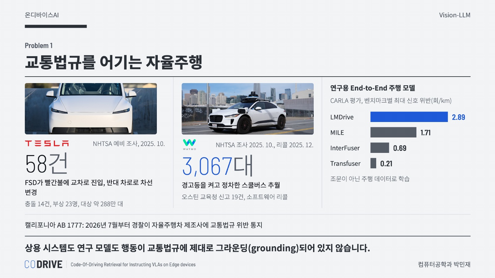

상용 자율주행 시스템도 교통법규를 어기고 있습니다. NHTSA는 2025년 10월 빨간불 교차로 진입 등 58건의 위반 신고를 근거로 Tesla FSD 약 288만 대에 대한 예비 조사를 열었고([NHTSA](https://static.nhtsa.gov/odi/inv/2025/INOA-PE25012-19171.pdf)), Waymo는 경고등을 켜고 정차한 스쿨버스를 추월한 문제로 2025년 12월 3,067대의 소프트웨어를 리콜했습니다([NPR](https://www.npr.org/2025/12/06/nx-s1-5635614/waymo-school-buses-recall)). 연구용 End-to-End 주행 모델도 CARLA 평가에서 km당 최대 2.89회의 신호 위반을 보였습니다([arXiv 2501.12090](https://arxiv.org/abs/2501.12090)). 이 모델들은 법 조문이 아니라 주행 데이터에서 행동을 배우기 때문에, 행동이 교통법규에 그라운딩되어 있지 않습니다.

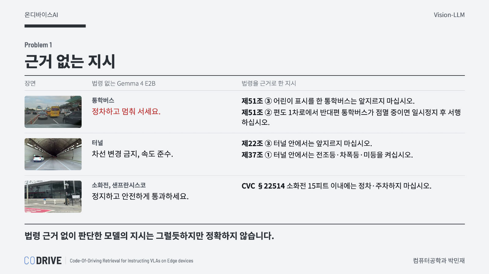

같은 장면을 법령 없이 Gemma 4 E2B에 보여 주었을 때도 마찬가지였습니다. 통학버스 장면에서 모델은 "정차하고 멈춰 서세요"라고 답했지만, 법이 요구하는 것은 앞지르기 금지(제51조 ③)입니다. 터널에서는 "차선 변경 금지, 속도 준수"처럼 그럴듯하게 답했지만, 터널 안에서 전조등을 켜야 한다는 규정(제37조 ①)은 나오지 않았습니다.

**2. 수시로 바뀌고 지역마다 다른 교통법규**

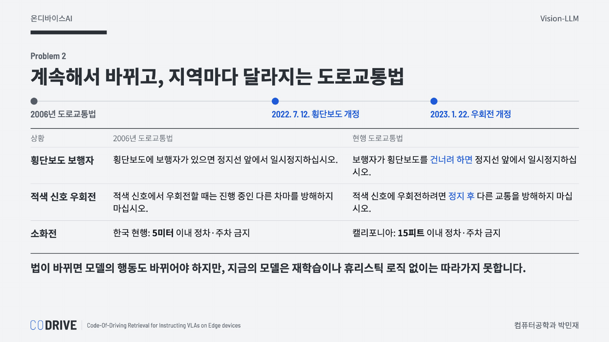

교통법규는 자주 바뀝니다. 2006년 도로교통법은 보행자가 횡단보도를 건너고 있을 때만 일시정지하게 했지만, 2022년 7월부터는 건너려고 할 때도 멈춰야 합니다. 지역마다도 달라서, 소화전 주변 정차 금지 거리는 한국이 5미터, 캘리포니아가 15피트입니다. 학습 기반 모델은 법이 바뀔 때마다 데이터를 다시 모으고 재학습해야 하고, 규칙을 논리식으로 옮기는 방식은 전문가가 조문을 하나씩 형식화해야 해서 비용이 큽니다.

### Background: 프로젝트 관련 배경

**1. VLA 모델과 자율주행**

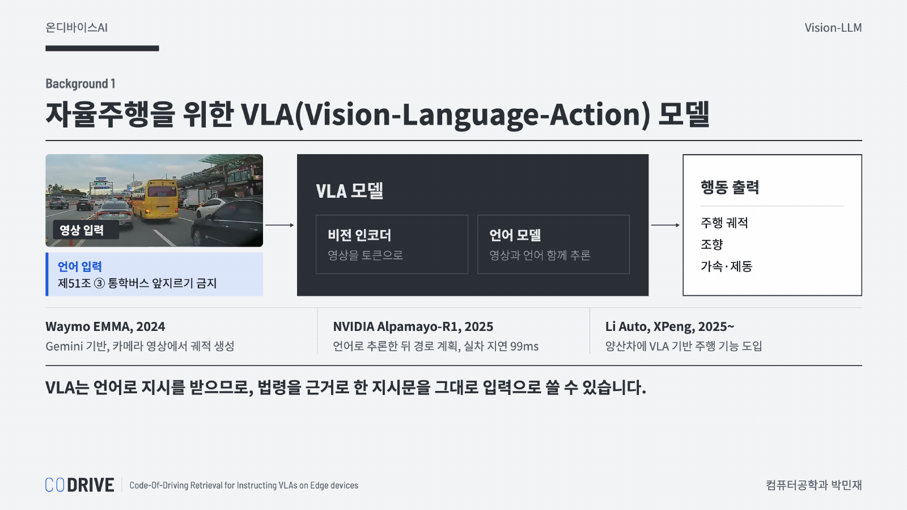

VLA는 영상과 언어를 함께 이해하는 VLM에 행동 출력을 붙인 모델로, Google DeepMind의 RT-2가 처음 이 이름을 썼습니다. 자율주행에서도 Waymo EMMA, NVIDIA Alpamayo-R1 같은 VLA 기반 모델이 나왔고, 중국의 Li Auto와 XPeng은 양산차에 VLA 기반 주행 기능을 넣기 시작했습니다. VLA는 언어 입력을 받기 때문에, 법령을 근거로 한 지시문을 VLA의 입력으로 그대로 넘길 수 있다고 생각했습니다.

**2. 자율주행에서의 Edge AI 필요성**

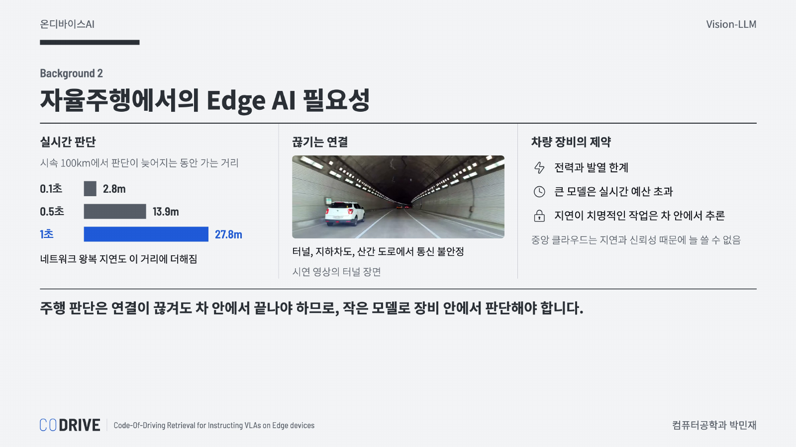

시속 100km에서는 판단이 1초 늦어질 때마다 27.8m를 지나가고, 클라우드에 물어보면 네트워크 왕복 지연이 더해집니다. 터널이나 지하차도에서는 통신이 끊기기도 합니다. 이런 이유로 주행 판단은 인터넷 연결 없이 차량 안의 장비에서 처리해야 하며, 전력과 발열이 제한된 장비에서 실행하려면 작은 모델을 써야 합니다.

### Objective: 프로젝트 목표

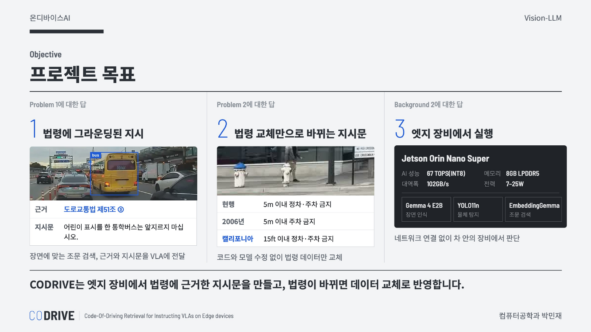

프로젝트 목표는 세 가지로 정했습니다. 먼저 카메라 장면에 해당하는 조문을 찾아 근거 조항과 지시문을 만들고, 이를 VLA 모델의 언어 입력으로 넘기는 모듈을 만드는 것입니다. 다음으로 코드와 모델은 그대로 두고 법령 데이터만 바꿔도 같은 장면에서 법령에 맞는 지시가 나오도록 하는 것입니다. 마지막으로 이 모든 판단을 인터넷 연결 없이 Jetson Orin Nano에서 Gemma 4 E2B, YOLO11n, EmbeddingGemma만으로 처리하는 것을 목표로 했습니다.

### Method: CODRIVE 아키텍처

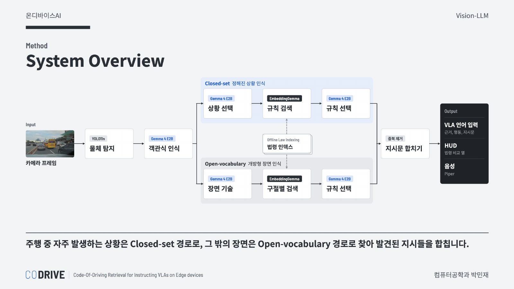

주행 중 자주 만나는 상황은 Closed-set 경로로, 그 밖의 장면은 Open-vocabulary 경로로 찾은 뒤, 두 경로에서 찾은 지시를 합칩니다. Closed-set 경로는 미리 정해 둔 상황 19개 중 지금 장면에 있는 것을 고르고, 상황마다 빌드 때 정해 둔 기본 조문의 지시문을 냅니다. 그다음 상황 문장으로 관련 규칙 후보를 검색하고, Gemma가 작은 장면 이미지와 후보를 함께 보고 지금 해당하는 규칙을 골라 덧붙입니다. 예를 들어 통학버스 장면에서는 기본 규칙인 앞지르기 금지에 더해, 반대편 통학버스가 점멸 중일 때 일시정지해야 한다는 규칙이 함께 출력됩니다. Open-vocabulary 경로는 목록에 없는 장면을 위해 Gemma가 장면을 짧은 영어 구절로 적고, 그 구절로 규칙을 검색합니다.

**Offline Law Indexing**

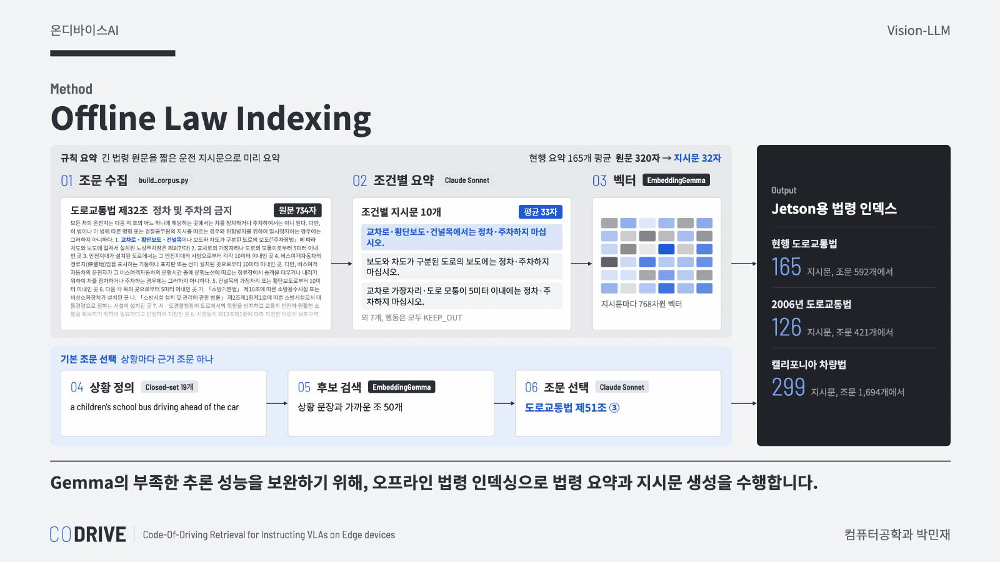

처음에는 Gemma가 실행 중에 조문을 직접 읽고 지시문을 쓰게 했지만, 2B 모델로는 긴 조문에서 지금 장면에 맞는 의무를 골라내기 어려웠고 Jetson에서 조문을 처음 읽는 데만 2.8~4.7초가 걸렸습니다. 그래서 장면과 상관없이 결과가 정해지는 조문 해석은 빌드 단계로 옮겼습니다. 빌드 단계에서는 Claude Sonnet이 조문을 읽어 조건별 운전 지시문으로 요약하고, EmbeddingGemma가 이를 벡터로 만들어 둡니다. 그 결과 현행 도로교통법 조문 592개에서 지시문 165개를, 캘리포니아 차량법 조문 1,694개에서 지시문 299개를 만들었고, 평균 길이는 원문 320자에서 지시문 32자로 줄었습니다. Jetson에는 이 결과 파일만 옮기므로, 법령을 바꾸려면 이 파일만 바꾸면 됩니다.

**Online Scene Recognition**

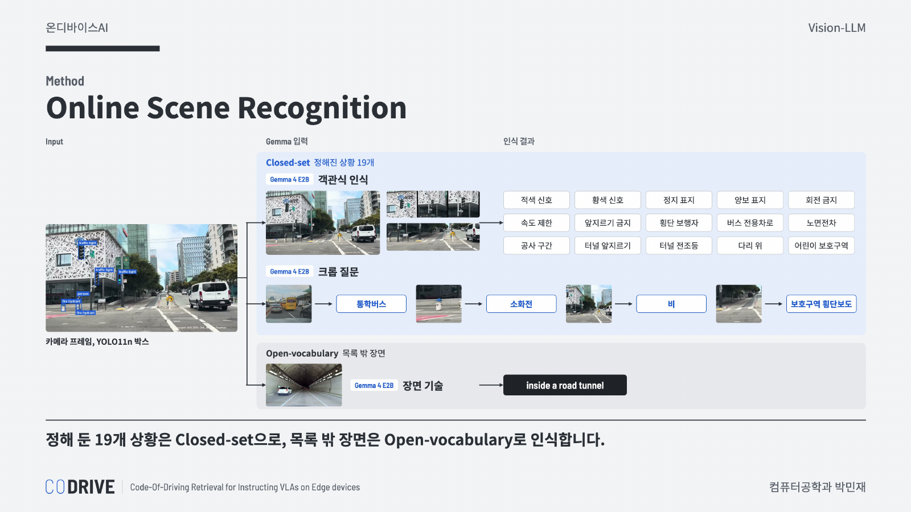

Jetson에서는 판단 주기마다 가장 최신 프레임 한 장으로 장면을 인식합니다. Gemma에게 전체 프레임, 표지 크롭, 노면 크롭 세 장을 한 번에 보여 주고 상황 15개 중 해당하는 것을 고르게 합니다. 처음에는 모든 상황을 이 객관식 목록 하나로 물었는데, 목록에 상황을 더할 때마다 다른 상황의 답까지 바뀌었습니다. 그래서 비, 통학버스, 소화전, 보호구역 횡단보도처럼 객관식이 약한 상황은 YOLO로 대상을 잘라 따로 묻도록 나눴고, 이렇게 정해 둔 상황이 모두 19개입니다.

**Voice Interface**

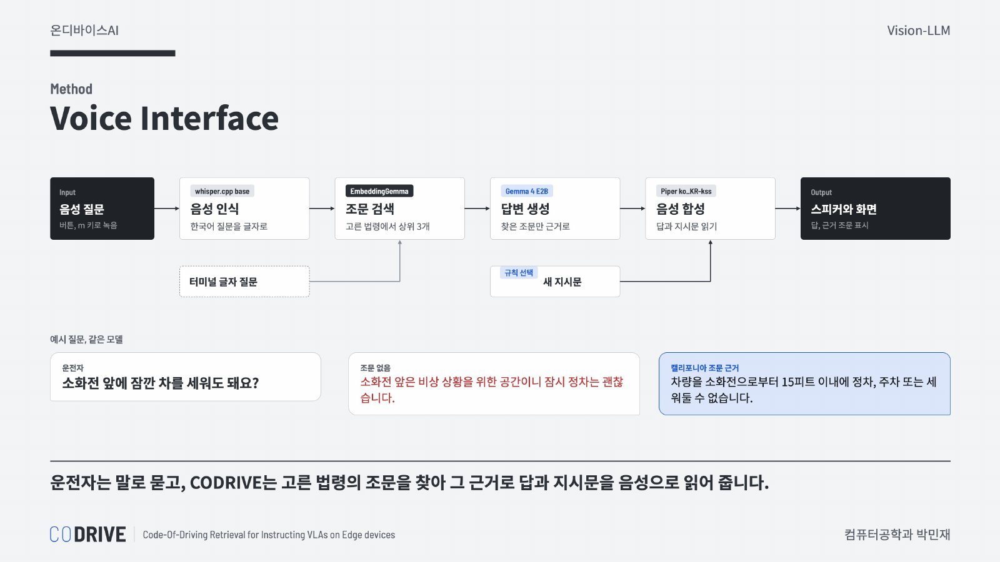

06 노트북의 whisper.cpp와 Piper를 그대로 활용했습니다. 운전자의 음성 질문은 whisper.cpp로 텍스트로 변환하고, EmbeddingGemma로 선택한 법령에서 가까운 조문 3개를 검색합니다. Gemma는 검색한 조문만 근거로 답변을 생성하고, 생성한 답변은 Piper로 음성 출력합니다. 예를 들어 "소화전 앞에 잠깐 차를 세워도 돼요?"라는 질문에 조문 없이 답변을 생성하면 잠시 정차는 괜찮다는 틀린 답이 나오지만, 캘리포니아 조문을 근거로 하면 15피트 이내 정차 금지라는 답이 나옵니다.

**Inference Optimization**

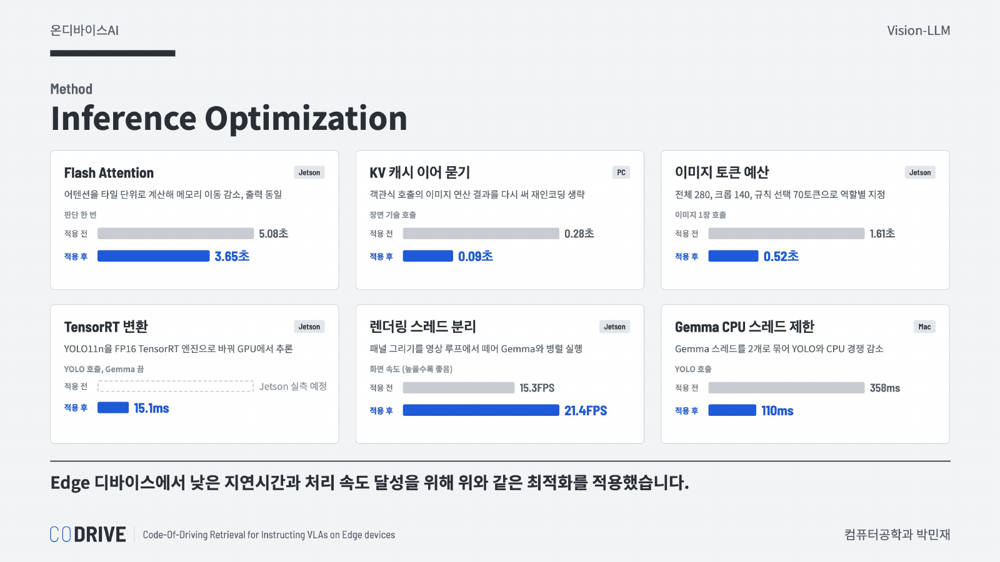

온디바이스 환경에서 돌리기 위해 Gemma 판단 시간과 화면 속도를 함께 줄였습니다. Flash Attention을 적용해 Jetson에서 판단 한 번이 5.08초에서 3.65초로 줄었고, 이미지 토큰 수를 역할마다 다르게 정해 이미지 한 장 호출을 1.61초에서 0.52초로 줄였습니다. 장면 기술 호출은 앞선 객관식 호출의 KV 캐시에 이어 물어 이미지를 다시 인코딩하지 않도록 했습니다. 화면 쪽에서는 패널 그리기를 별도 렌더링 스레드로 옮겨 Jetson FPS를 15.3에서 21.4로 올렸습니다. YOLO11n은 04 노트북에서 실습한 FP16 TensorRT 엔진으로 바꿔 Jetson에서 한 번에 15.1ms가 걸리며, 변환 전 시간은 아직 재지 못해 다시 측정할 예정입니다.

### Result: 프로젝트 결과

**지시문 생성 결과**

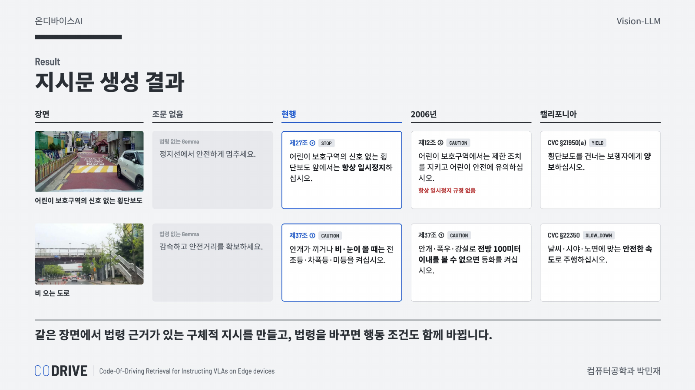

시연 영상의 한 프레임으로 실제 코드를 돌린 결과입니다. 법령 없이 생성한 지시는 멈추거나 감속하라는 일반적인 조언에 그쳤지만, 법령 조문을 근거로 하면 같은 장면에서도 조항이 붙은 구체적인 지시가 나왔습니다. 코드와 모델은 그대로 두고 법령 데이터만 바꿨을 때, 2006년 법에서는 보호구역 횡단보도의 항상 일시정지 지시가 나오지 않았고 비 오는 날의 등화 의무도 시야가 100미터 이내일 때로 좁아졌습니다.

**실행 성능**

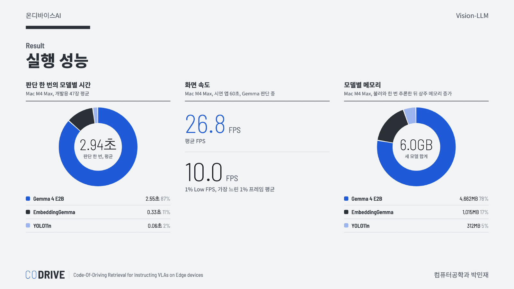

Mac M4 Max에서 판단 한 번은 평균 2.94초였고, 그중 87%를 Gemma 4 E2B가 차지했습니다. 화면은 평균 26.8 FPS로 그려졌지만, Gemma 판단과 YOLO가 겹치는 순간에는 느려져 1% Low FPS는 10.0이었습니다. 세 모델이 쓰는 메모리는 합계 6.0GB이고, 그중 Gemma가 4.7GB입니다. Jetson Orin Nano에서는 판단 한 번에 3.65초, 화면 속도는 21.4 FPS, 최대 RAM은 6.4GB였습니다. Jetson 값은 Open-vocabulary 경로를 넣기 전에 잰 값이라 다시 측정할 예정입니다.

**인식 평가**

규칙과 프롬프트는 개발용 47장에서만 정하고, 성능은 그 과정에서 보지 않은 시험용 46장으로 한 번만 쟀습니다. 현행 법령 기준 상황 재현은 개발용에서 31/48이었지만 시험용에서는 6/31로 크게 낮았습니다. 시험용 프레임 대부분이 샌프란시스코였고, 버스 전용차로(0/9)와 회전 금지(0/5)처럼 COCO에 없어 YOLO로 자를 수 없는 표지가 많았던 것이 주된 원인이었습니다.

### Discussion: 프로젝트 의의와 개발 과정에서 얻은 깨달음

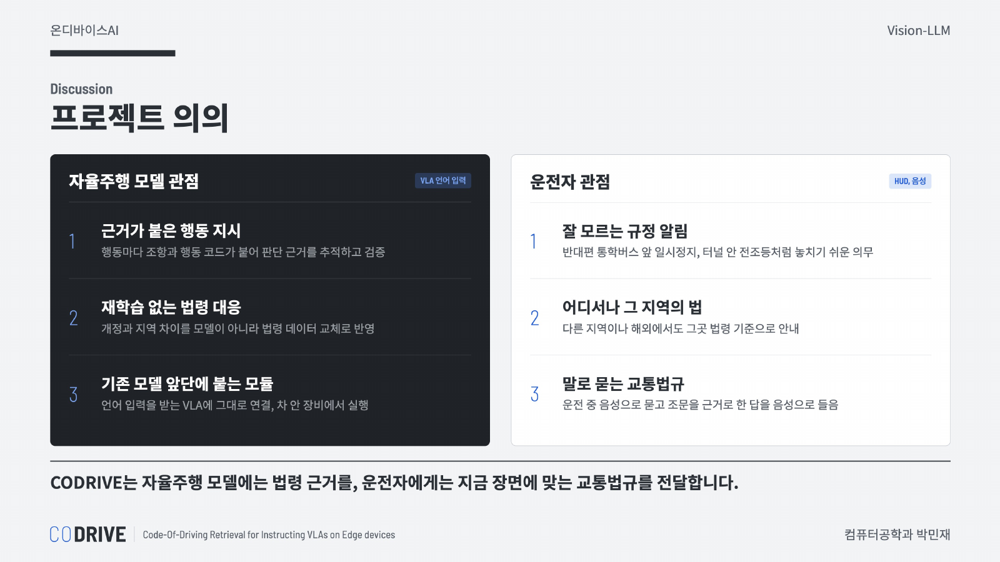

이 프로젝트의 의의는 자율주행 모델과 운전자 두 관점에서 정리할 수 있습니다. 자율주행 모델 관점에서는 행동마다 근거 조문이 붙기 때문에 판단 근거를 추적하고 검증할 수 있고, 법이 바뀌거나 지역이 달라져도 재학습 없이 법령 데이터 교체만으로 대응할 수 있습니다. 운전자 관점에서는 반대편 통학버스 앞 일시정지나 터널 안 전조등처럼 잘 알려지지 않은 규정을 해당 장면에서 안내받을 수 있고, 운전 중에도 음성으로 교통법규를 질문할 수 있습니다.

**1. 온디바이스 환경에서는 실행 중 처리를 줄이는 구조 설계가 가장 효과적인 최적화였음**

조문을 해석해 지시문으로 요약하는 일을 빌드 단계로 옮기자 조문 읽기 시간이 실행 경로에서 빠졌고, Gemma의 역할도 이미 만들어진 지시문 중에서 선택하는 것으로 줄었습니다. 온디바이스 환경에서는 모델을 빠르게 만드는 것만큼, 런타임에 꼭 필요한 일만 남기도록 구조를 나누는 것이 중요하다는 것을 느꼈습니다.

**2. KV 캐시를 쓰기 위해 입력 순서를 바꾸자 인식 성능이 떨어짐**

객관식 인식 호출에는 매번 같은 상황 목록과 질문 문장이 들어갑니다. 이 고정 텍스트를 이미지보다 앞에 두면 텍스트 부분의 KV 캐시를 저장해 두고 호출마다 다시 쓸 수 있어, 순서를 바꿔 보았습니다. 그 결과 객관식 호출은 27% 빨라졌지만, 개발용 평가에서 상황 재현이 떨어지고 이미지에 없는 상황까지 고르는 경우가 늘었습니다. 이전에 이미지 뒤에 붙는 글의 길이를 바꿔 가며 재 본 결과에서도, 이미지 뒤의 글이 길어질수록 이미지가 답에 주는 영향이 크게 줄었습니다. 질문과 선택지가 이미지 바로 뒤에 와야 모델이 이미지를 제대로 보고 답한다는 것을 알게 되었고, 속도보다 인식 성능이 중요하다고 판단해 원래 순서를 유지했습니다. 그래서 KV 캐시 재사용은 입력 순서를 바꾸지 않는 이어 묻기 방식만 적용했습니다.

**3. 엣지 장비에서는 모델보다 파이프라인이 병목이 되기도 함**

Jetson에서 화면이 끊긴 원인은 모델이 아니라 패널 그리기였습니다. Gemma와 함께 돌 때 패널을 한 번 그리는 데 약 250ms가 걸렸고, 이를 렌더링 스레드로 옮기자 FPS가 크게 올랐습니다. 여러 모델이 하나의 GPU와 CPU를 함께 쓰는 환경에서는, 모델들을 동시에 실행했을 때 어디서 지연이 생기는지 측정해 보아야 한다는 것을 배웠습니다.

### Limitation: 아직 해결되지 않은 문제들

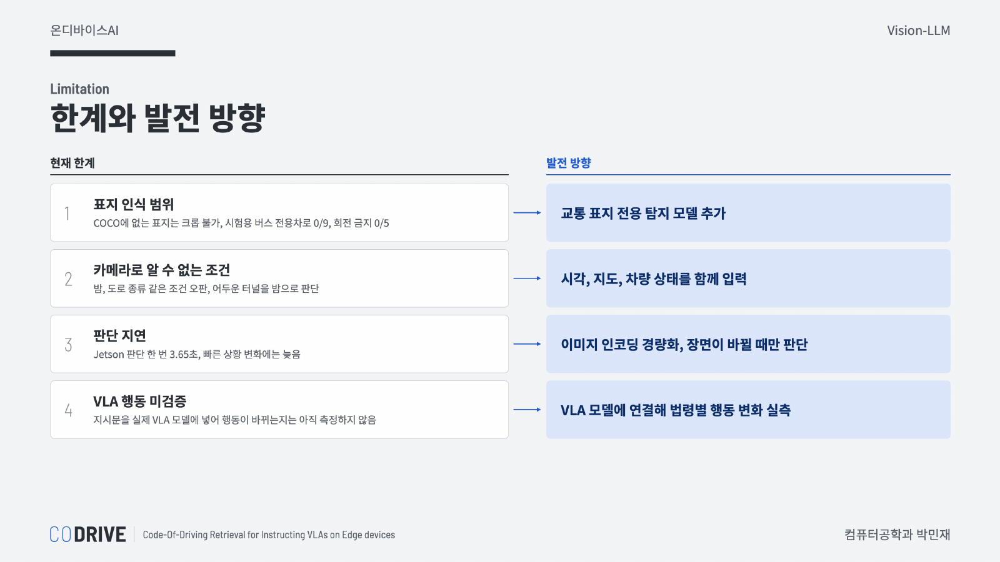

가장 큰 한계는 표지 인식입니다. YOLO11n은 COCO 클래스만 찾기 때문에 버스 전용차로나 회전 금지 같은 교통 표지는 크롭으로 확인할 수 없고, 교통 표지 전용 탐지 모델을 더해야 합니다. 또한 밤이나 도로 종류처럼 카메라만으로는 알 수 없는 조건이 있어, 어두운 터널을 밤으로 보고 밤 등화 규칙을 붙이는 경우가 남아 있습니다. 시각, 지도, 차량 상태를 함께 입력하면 이런 오판을 줄일 수 있을 것입니다. Jetson에서 판단 한 번에 3.65초가 걸리는 것도 빠르게 바뀌는 상황에는 늦기 때문에, 이미지 인코딩을 더 줄이고 장면이 바뀔 때만 판단하는 방식을 고려하고 있습니다. 마지막으로 CODRIVE가 만든 지시문을 실제 VLA 모델에 넣었을 때 주행 행동이 바뀌는지는 아직 측정하지 못했습니다. VLA 모델에 직접 연결해 법령에 따라 행동이 달라지는지 확인하는 것이 다음 단계에서 가장 먼저 해야 할 일이라고 생각합니다.

### Conclusion: 프로젝트 성과

카메라 프레임 하나에서 지금 장면에 맞는 도로교통법 조문을 찾아 근거 조항, 행동 코드, 지시문을 만드는 모듈을 Jetson Orin Nano 위에서 구현했습니다. 세 법령을 같은 코드와 모델로 다루며, 법령 데이터만 바꾸면 같은 장면에서 법령에 맞는 다른 지시가 나옵니다. 언어 입력을 받는 VLA 모델의 앞단에 연결하면 재학습 없이 행동의 법적 근거를 제공할 수 있고, 사람 운전자에게도 잘 알려지지 않은 규정을 안내하는 보조 장치로 활용할 수 있을 것으로 기대합니다.

### Contribution: AI 활용과 본인 기여도

**본인 기여**: 프로젝트 기획과 문제 정의, 아키텍처의 방향 설정, 시연 시나리오 구성, Jetson 실기기 테스트, 발표를 진행했습니다. 자율주행 모델의 행동이 교통법규에 그라운딩되어 있지 않다는 문제와 법이 바뀔 때 모델이 따라가지 못한다는 문제를 정의하고, 이를 법령을 데이터로 두는 검색 기반 구조로 풀겠다는 방향을 정했습니다. 개발 과정에서는 장면과 상관없이 정해지는 일은 빌드 단계로 옮기고 실행 중에는 장면에 따른 판단만 한다는 설계 원칙, 탐지 모델을 YOLO11n 하나로 제한하는 결정, 정확도가 부족할 때 휴리스틱 규칙을 쌓지 않고 개발용과 시험용 평가를 나누는 원칙을 세웠습니다. 사람들이 잘 모르는 규정이 적용되는 장면을 찾아 시연 사례로 고르고, 실제 주행 영상과 Jetson에서 결과를 확인하며 개선 방향을 정했습니다.

에이전트 기반 개발(Agent-Driven Development)을 수행하더라도 작성한 코드의 책임은 사람에게 있기 때문에, 코드에 대한 인지 부채 코드에 쓰인 모든 라이브러리와 함수, 세부 로직을 이해하기 위해 노력했습니다.

**AI 활용**: 참조 구현의 소스 코드 작성, 측정과 로그 분석, 사람이 제안한 개선안의 구현, 코드 단순화와 문서화에 AI 도구를 활용했습니다. 빌드 단계의 조문 요약과 기본 조문 선택을 위해 Claude Sonnet을 파이프라인의 한 단계(Offline Law )로 사용했습니다.

