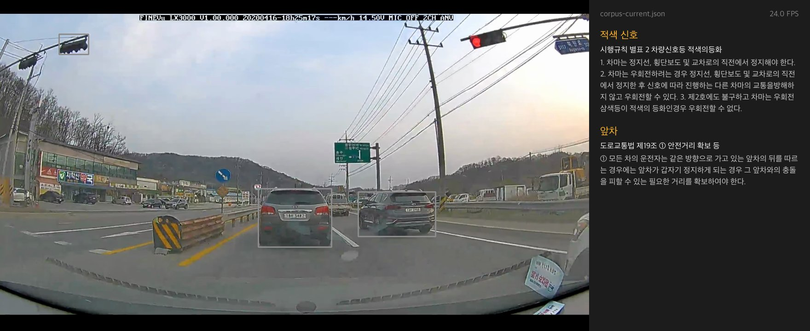
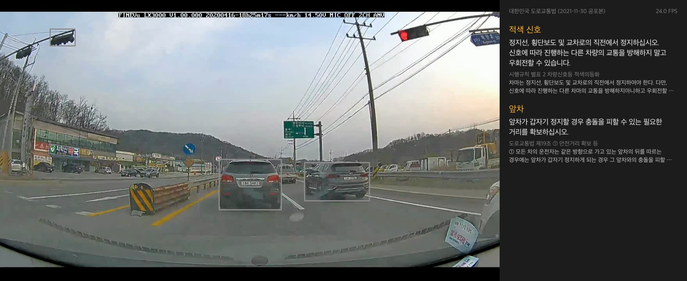

# Project03: 주행 영상 기반 도로교통법 검색 HUD

주행 영상에서 YOLO로 차량, 보행자, 신호등을 찾습니다. 찾은 객체를 "적색 신호", "앞차" 같은 장면 상태로 바꿉니다. 장면 상태마다 도로교통법 코퍼스를 BM25로 검색하고, 근거 조문을 화면 오른쪽에 보여 줍니다.

모델이 학습한 지식 대신 실제 법령 문서를 근거로 판단을 보여 주는 Retrieval-Augmented 구조입니다. 법령이 개정되면 모델을 다시 학습하지 않습니다. 코퍼스 파일만 바꾸면 같은 영상에서 다른 조문이 나옵니다.

| 현행 코퍼스 (`corpus-current.json`) | 2021년 코퍼스 (`corpus-2021.json`) |
|---|---|
|  |  |

같은 적색 신호 장면입니다. 현행 시행규칙 별표 2는 우회전하기 전에 정지선 직전에서 정지하라고 정합니다. 2021년 판은 정지 없이 우회전할 수 있다고 정합니다. 두 화면은 영상 110.5초 프레임을 저장한 것입니다. 화면 오른쪽 위 FPS 값은 저장용 스크립트가 넣은 고정값이며 측정값이 아닙니다.

## 파일 구조

```
Project03/
├── main.py              실행 파일: 영상 → 탐지 → 장면 상태 → 검색 → 화면
├── detect.py            YOLO 탐지 결과를 장면 상태로 바꿈, 신호등 색 판정(HSV)
├── retrieve.py          BM25 검색기와 장면 상태별 검색 문장
├── hud.py               탐지 박스와 근거 조문 패널 그리기
├── build_corpus.py      국가법령정보 Open API로 코퍼스 JSON 생성 (Mac에서 한 번 실행)
├── corpus-current.json  현행 도로교통법(항 단위)과 시행규칙 별표 2(신호 종류 단위)
├── corpus-2021.json     2022년 1월 개정 직전 공포본으로 만든 같은 구성의 코퍼스
├── tests/
│   └── test_retrieve.py 장면 상태별 정답 조문 검색 평가
├── docs/                README 그림
└── videos/              주행 영상 (git에 올리지 않음)
```

## 실행 방식

### 준비

- 모든 명령은 `Project03/` 폴더에서 실행합니다. `--model` 기본값이 상대 경로 `../src/models/YOLO/yolo11n.pt`이기 때문입니다.
- Jetson에서는 수업 노트북 `00`, `03`, `04`에서 설치한 환경을 그대로 씁니다. 추가로 설치할 패키지는 없습니다.

| 패키지 | Jetson 수업 환경 | Mac 개발 환경 (`.venv-project03`) |
|---|---|---|
| Python | 3.10 | 3.10 |
| numpy | 1.23.0 | 1.23.5 |
| opencv-python | JetPack 기본 | 4.10.0 |
| Pillow | 10.4.0 | 10.4.0 |
| ultralytics | 04 노트북 설치본 | 8.4.194 |
| torch | 2.8.0 | 2.14.1 |

- 한글 글꼴은 Noto CJK(`fonts-noto-cjk`), 나눔고딕, Apple SD Gothic Neo 중 설치된 것을 씁니다.

### 주행 영상

영상은 위키미디어 공용의 [2020-04-16 원주시 도로주행](https://commons.wikimedia.org/wiki/File:2020-04-16_%EC%9B%90%EC%A3%BC%EC%8B%9C_%EB%8F%84%EB%A1%9C%EC%A3%BC%ED%96%89.webm)을 씁니다. 촬영자는 Choi Kwang-mo이고 라이선스는 CC0(퍼블릭 도메인)입니다. 원본은 1920×1080, 24 FPS, 182초, VP9(.webm), 254MB입니다.

영상 파일은 레포에 넣지 않습니다. 아래 명령으로 `videos/`에 내려받습니다.

```bash
mkdir -p videos && curl -L -o videos/wonju-2020-04-16.webm "https://upload.wikimedia.org/wikipedia/commons/c/c3/2020-04-16_%EC%9B%90%EC%A3%BC%EC%8B%9C_%EB%8F%84%EB%A1%9C%EC%A3%BC%ED%96%89.webm"
```

시연에는 원본의 86~118초를 1280×720 mp4(`mp4v` 코덱)로 다시 저장한 `videos/wonju-demo.mp4`를 씁니다. 이 구간에서 앞차는 시연 영상 4.7초와 24초 부근에, 적색 신호는 24.5~27.4초(원본 110.5초)에 패널에 나옵니다. 원본 90초의 적색 신호는 이 파일에서 5프레임 연속 탐지가 되지 않아 패널에 나오지 않습니다. Jetson의 OpenCV가 VP9을 읽지 못할 경우에 대비한 파일입니다. Mac에서 OpenCV `VideoWriter`로 만들었습니다.

### 실행 명령

```bash
python main.py videos/wonju-demo.mp4
```

```bash
python main.py videos/wonju-demo.mp4 --corpus corpus-2021.json
```

Jetson에서는 04 노트북에서 만든 TensorRT 엔진을 넘깁니다.

```bash
python main.py videos/wonju-demo.mp4 --model ../src/models/YOLO/yolo11n_fp16.engine
```

`q`를 누르면 종료합니다.

### 화면

- 왼쪽: 영상과 탐지 박스. 장면 상태를 만든 박스는 주황색 박스와 상태 이름으로, 나머지 탐지는 회색 박스로 그립니다.
- 오른쪽 패널 위: 사용 중인 코퍼스 파일 이름과 처리 FPS
- 오른쪽 패널: 장면 상태마다 상태 이름, 근거 조문 번호와 제목, 본문 앞 다섯 줄

### 처리 과정 (한 프레임)

1. 프레임을 1280×720으로 줄이고 YOLO(`conf=0.4`, `iou=0.5`)로 6개 클래스를 탐지합니다.
2. 박스마다 장면 상태를 정합니다.
   - 신호등: 박스 안 HSV 색 픽셀 수로 적색·황색·녹색을 고릅니다.
   - 사람, 자전거, 정지 표지: 화면의 0.2% 이상 크기일 때만 씁니다.
   - 승용차, 트럭: 화면의 3% 이상이고 화면 가운데 3분의 1에 있을 때 앞차가 됩니다.
   - 화면 아래 20%에 중심이 있는 박스는 버립니다. 이 영역에는 보닛과 유리창 스티커가 있어 정지 표지 오탐이 생깁니다.
3. 상태마다 5프레임 연속 탐지되면 확정하고, 확정이 끊긴 뒤에도 2초 동안 패널에 남깁니다.
4. 패널의 상태 목록이 바뀐 프레임에서만 상태마다 BM25 1위 항목을 검색합니다.
5. 처리가 영상보다 빠르면 남는 시간만큼 기다려 원래 속도로 재생합니다.

### 테스트와 평가

```bash
python -m unittest discover -s tests -t .
```

- 두 코퍼스 모두에서 장면 상태 7개(적색·황색·녹색 신호, 보행자, 자전거, 앞차, 정지 표지)의 BM25 1위가 정답 항목과 같은지 확인합니다.
- 적색 신호(별표 2)와 보행자(제27조 ①)의 1위 본문이 두 판에서 다른지 확인합니다.
- 2026-10-31 Mac에서 2개 테스트가 모두 통과했습니다. Mac(Apple Silicon, CPU)의 프레임당 처리 시간은 약 21ms였습니다.

## 법령 코퍼스

### 생성

```bash
python build_corpus.py <국가법령정보 Open API 인증키(OC)>
```

- 인증키는 [국가법령정보 공동활용](https://open.law.go.kr)에서 발급받은 본인 키를 씁니다. 레포에는 적지 않습니다.
- 법령은 「저작권법」 제7조에 따라 보호받지 못하는 저작물입니다. 그래서 생성한 JSON을 레포에 넣었습니다.

| 파일 | 법령 | 법령일련번호(MST) | 공포일 |
|---|---|---|---|
| `corpus-current.json` | 도로교통법 | 291133 | 2026-10-13 |
| `corpus-current.json` | 도로교통법 시행규칙 | 289009 | 2026-08-24 |
| `corpus-2021.json` | 도로교통법 | 237009 | 2021-11-30 |
| `corpus-2021.json` | 도로교통법 시행규칙 | 239101 | 2021-12-31 |

`corpus-2021.json`은 아래 두 개정이 공포되기 직전의 공포본으로 만들었습니다. Open API의 법령 본문은 공포 시점 조문을 담고 시행 예정 개정분을 포함하기 때문에, 시행일이 아니라 공포일로 판을 골랐습니다.

- 2022-01-11 공포 도로교통법 제27조 ① 개정: 횡단보도를 "통행하려고 하는 때"에도 일시정지해야 함
- 2022-01-21 공포 시행규칙 별표 2 개정(2023-01-22 시행): 적색 신호에서 우회전하려면 정지선 직전에서 먼저 정지해야 함

### 구성

- 도로교통법은 항마다 한 항목입니다. `id`는 `도로교통법 제27조 ①` 형식입니다.
- 시행규칙 별표 2(신호기가 표시하는 신호의 종류 및 신호의 뜻)는 신호 종류마다 한 항목입니다. 제목은 `차량신호등 적색의등화` 형식입니다.
- 항목 수는 현행 592개, 2021년 536개입니다.

## 한계

- 영상에 보행자 장면이 없습니다. 보행자 규정은 단위 테스트로만 확인했습니다.
- COCO 모델은 횡단보도, 차선, 한국 교통안전표지를 찾지 못합니다. 장면 상태는 6개 클래스와 신호등 색으로 만들 수 있는 7개뿐입니다.
- 별표 2는 선 문자 표에서 글자를 읽습니다. 칸 안 줄바꿈이 낱말 중간에서 일어나 일부 띄어쓰기(`교통을방해하지`)는 복원하지 못합니다.
- 패널은 장면 상태 3개까지 화면 안에 들어갑니다. 4개 이상이면 아래 항목이 잘립니다.
- Jetson 실행, TensorRT 엔진 사용, mp4 시연 영상 읽기는 아직 확인하지 않았습니다.
- `../src/models/YOLO/yolo11n.pt`는 레포에 넣지 않습니다. 04 노트북 순서대로 준비합니다.

## 수업 내용과 연결

| 수업 내용 | 이 프로젝트에서 쓴 곳 |
|---|---|
| 02 노트북 색공간 변환과 색 기반 분할 | `detect.light_color`: HSV 변환, `cv2.inRange`, 빨강 두 범위 합치기 |
| 04 노트북 YOLO 추론과 클래스 선택 | `main.py`: `model.predict(source=frame, conf, iou, verbose=False, classes=CLASSES)` |
| 04 노트북 FPS 측정 | `main.py`: `time.perf_counter()`와 지수 이동 평균(0.9, 0.1) |
| 04 노트북 TensorRT 엔진 | Jetson 실행 시 `--model ../src/models/YOLO/yolo11n_fp16.engine` |
