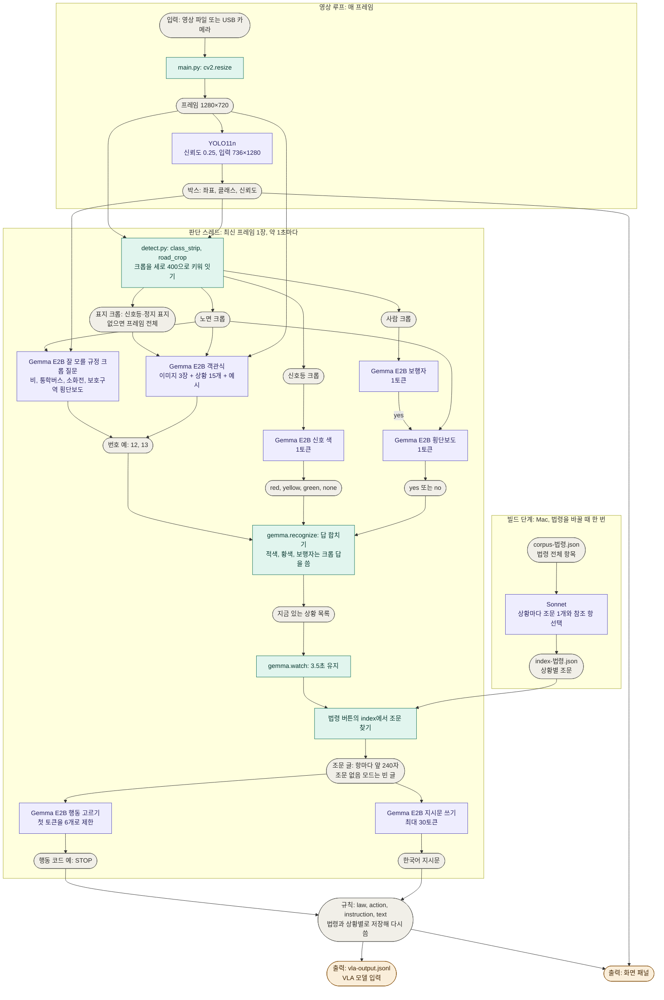

# Project03: 자율주행 VLA 모델을 위한 도로교통법 검색 및 지시문 생성 모듈

이 모듈은 주행 장면을 받아 선택한 법령의 조문을 읽고, VLA(Vision-Language-Action) 모델에 넘길 근거 조항, 행동 종류, 지시문을 만듭니다. 고른 상황이 없거나 그 상황의 조문이 없으면 아무것도 내지 않습니다. 결과는 `vla-output.jsonl`에 한 줄씩 기록하고, 화면 패널은 같은 결과를 확인하는 시연 수단입니다. 실제 VLA 모델 연결은 아직 없습니다.

## 구조

조문 선택은 빌드 단계에서 끝나고, 지시문은 실행 중에 조문을 읽어 만듭니다.

1. 빌드 단계(Mac, 인터넷 필요): 상황 15개마다 임베딩 검색으로 후보 조 50개를 추리고, Sonnet이 라벨을 보지 않고 조문 하나를 고르고, 그 조문이 다른 항의 내용을 끌어오면 그 항 번호도 저장합니다. 결과는 `index-current.json`, `index-california.json`입니다.
2. 실행 단계 인식: Gemma E2B가 전체 화면, YOLO로 자른 신호등·표지 크롭, 노면 크롭 3장을 보고 상황 15개 중 있는 것을 고릅니다. 신호 색과 횡단보도 보행자는 YOLO로 자른 크롭을 보여 주고 따로 묻습니다.
3. 실행 단계 읽기: Gemma E2B가 고른 상황의 조문과 그 조문이 끌어오는 항을 항마다 앞 240자씩 읽고 행동 6개 중 하나를 고른 뒤, 같은 조문으로 한국어 지시문을 씁니다.

입력부터 최종 출력까지의 전체 경로입니다. 보라색은 모델, 초록색은 코드 처리, 회색은 입력과 중간 산출물, 주황색은 최종 출력입니다.



## 잘 모를 규정 사례

조문을 읽어야 맞는 지시가 나오는 장면 5건입니다. 모두 실제 주행 영상으로 시연합니다. 법령 탭의 `조문 없음`은 같은 상황을 조문 없이 묻는 비교 모드입니다. 아래 지시문은 Mac에서 E2B가 낸 그대로이고, 조문은 Sonnet이 고른 항입니다(2026-11-07).

| 영상 탭 | 장면 | 조문 없음 | 현행 | 2006년 | 캘리포니아 |
|---|---|---|---|---|---|
| 비 | 비 오는 서울 도로 | 감속하고 안전거리를 확보하세요. | 제37조 ① `비가 오면 전조등, 차폭등, 미등을 켜야 합니다.` | 제37조 ① `안개, 폭우, 강설 시 전방 100미터 확인.` | §22350 `비가 오면 안전 속도를 유지하세요.` |
| 금문교 | 다리 위 | 속도 준수하고 안전하게 운전하세요. | 제22조 ③ `다리 위에서는 앞지르지 마십시오.` | 제22조 ③ `다리 위에서는 앞지르지 마십시오.` | §22405(a) `안전 속도를 준수하고 서행하세요.` |
| 통학버스 | 앞서가는 노란 통학버스 | 정차하고 기다리세요. | 제51조 ③ `어린이통학버스를 앞지르지 마시오.` | 제51조 ③ `어린이통학버스를 앞지르지 마시오.` | 맞는 조문 없음, 이 상황의 지시 없음 |
| 보호구역 | 보호구역 안 신호 없는 횡단보도 | 정지선에서 안전하게 멈추세요. | 제27조 ⑦ `보행자 횡단 여부와 관계없이 일시정지해야 합니다.` | 제12조 ③ `어린이 보호구역 규정을 준수하고 안전 운전하라.` | §21950(a) `보행자에게 양보하고 주의하세요.` |
| 소화전 | 길가의 소화전 | 정지하고 안전하게 통과하세요. | 제32조 `소방용수시설 근처에서 정차 및 주차 금지.` | 제33조 `소화전이나 흡수관을 넣는 구멍에 주차하지 마시오.` | §22514 `소화전에서 15피트 이내 정차 금지.` |

장면 인식은 프레임을 사람이 나눈 표본에서 쟀습니다. 개발용 세트가 아니고 호출마다 한 프레임 값입니다. 영상에서는 3.5초 유지 안에 여러 번 묻습니다. 다리 위는 객관식 상황이라 이 표에 없고, 시험용 측정에서 8장 중 5장을 알아봤습니다.

| 사례 | 입력 | 양성 | 음성 오탐 |
|---|---|---|---|
| 비 | 프레임 | 비 라벨 27/80 | 맑음 0/100, 안개 0/24 |
| 통학버스 | YOLO 버스·트럭 크롭 | 사람이 고른 노란 버스 14/17 | 다른 버스·트럭 10/71 |
| 보호구역 횡단보도 | 노면 크롭 | 횡단보도 라벨 30/78 | 횡단보도 라벨 없음 13/80 |
| 소화전 | YOLO 소화전 크롭 | 샌프란시스코 박스 19/34(모두 실제 소화전) | 71784 박스 13/66이 yes이고 실제 소화전이 일부 섞임 |

빨간 연석, 안전지대, 신호 없는 교차로, 자전거 차로는 후보에서 뺐습니다. 빨간 연석은 현행과 2006년 법에 맞는 조문이 없고, 신호 없는 교차로는 Sonnet이 서행 조문(제31조 ①)을 골라 양보 순서가 나오지 않으며, 자전거 차로는 지시문이 `차선 변경 시`로 틀립니다. 안전지대는 조문 읽기만 확인했고 장면 인식을 재지 않았습니다.

## 개발용 측정

조항과 행동이 모두 맞으면 맞은 것으로 셉니다. 화면 값은 실제 `watch`를 돌리며 영상을 1배속으로 재생해 정답 시각에 유지 중인 규칙으로 잰 값이고, 같은 코드를 세 번 재생한 범위입니다. 두 사이클 값은 정답 시각과 3.5초 전 프레임을 판단해 합친 값입니다. 베벌리힐스를 뺀 47장 기준입니다(2026-11-07).

| 항목 | 현행 | 캘리포니아 |
|---|---:|---:|
| 상황 재현, 화면 값 | 18~22/48 | 15~16/38 |
| 잘못된 지시, 화면 값 | 3~6/13 | 6~9/19 |
| 위험 오발령, 화면 값 | 3~6 | 5~7 |
| 상황 재현, 두 사이클 값 | 31/48 | 24/38 |
| 잘못된 지시, 두 사이클 값 | 5/13 | 8/19 |
| 위험 오발령, 두 사이클 값 | 4 | 6 |
| 인식이 완벽하다고 가정한 상황 재현(베벌리힐스 포함) | 50/53 | 40/43 |

잘 모를 규정 크롭 질문을 넣어도 개발용 94사이클에서 기존 상황의 답은 바뀌지 않았습니다. 고인 물과 노면 젖음 호출을 뺀 뒤 두 사이클 값은 그대로이고, 화면 값 3회 범위는 현행 잘못된 지시와 위험 오발령의 상한이 조금 올랐습니다. 이 3회에 비 판정은 없었습니다. 늘어난 잘못된 지시는 정답에 없는 실제 소화전과 원주의 통학버스 1건입니다. 이 사이에 표지 크롭의 대체 입력을 왼쪽 위 영역에서 프레임 전체로 바꿔 5사이클의 답이 바뀌었고, 현행 31/48은 그대로, 캘리포니아 잘못된 지시는 9/19에서 8/19가 되었습니다.

## 시험용 측정

코드를 확정한 뒤 시험용 세트를 한 번 쟀습니다(2026-11-07, `ca82c65`, 라벨 v2, 베벌리힐스를 뺀 46장, 두 사이클 값). 시험용 라벨 v2는 Claude가 만들었고 사용자 검토 전입니다.

| 항목 | 현행 | 캘리포니아 |
|---|---:|---:|
| 상황 재현 | 6/31 | 6/23 |
| 잘못된 지시 | 9/20 | 14/28 |
| 위험 오발령 | 9 | 8 |

개발용보다 크게 낮습니다. 유형별로 보면 원인이 둘입니다.

| 유형 | 현행 재현 | 조항까지 맞음 | 원인 |
|---|---:|---:|---|
| 적색 신호 | 4/4 | 4/4 | 없음 |
| 선로 전용차로 | 2/3 | 2/3 | 인식 |
| 버스 전용차로 | 0/9 | 0/9 | 표지와 노면 글자 인식 |
| 회전 금지 표지 | 0/5 | 0/5 | 표지 인식 |
| 다리 위 | 0/8 | 5/8 | 행동 코드. 지시문은 맞고 코드만 `CAUTION`이며 정답은 앞지르기 금지 |
| 앞지르기 금지 표지, 황색 신호 | 0/2 | 0/2 | 인식 |

조항만 맞으면 맞은 것으로 치면 현행은 11/31입니다. 재현을 올릴 방법은 두 가지입니다. 다리 위는 행동을 고르는 호출이 조문의 앞지르기 금지를 읽지 못해서 생긴 손실이므로, 행동 예시나 행동을 지시문과 함께 고르는 방식을 개발용 세트에서 고칠 수 있습니다. 버스와 회전 금지는 COCO에 없어 YOLO로 자르지 못하는 표지라 표지 전용 탐지가 필요하고, 복잡성 때문에 도입하지 않기로 했습니다(2026-11-05). 시험용 46장 중 45장이 샌프란시스코이고 이 유형이 많습니다.

당시 잘 모를 규정 5건은 시험용 라벨에 없어 재현에 들어가지 않고, 잘못된 지시를 현행 2건(7에서 9), 캘리포니아 2건(12에서 14) 늘렸습니다. 측정 뒤 사용자 판단으로 고인 물 호출과 노면 젖음 호출을 뺐습니다(2026-11-07). 시험 결과를 보고 한 변경이 아니고 개발용 값으로만 확인했지만, 위 값은 이전 코드(`ca82c65`)의 값입니다. 시험용 세트는 한 번 썼으므로 다시 잰 값은 성능값이 아닙니다. 측정에 쓴 라벨은 `tests/edge_labels_test.json`이고, 측정 뒤 옛 판을 이 v2로 바꿨습니다.

## 시간

Mac 단독 측정 중앙값은 YOLO 0.04초이고, 조문 읽기는 처음 한 번 약 0.5초입니다. 판단 한 번은 개발용 재생에서 1.6초입니다. 사례 영상의 판단 중앙값은 빗길, 통학버스, 금문교가 약 1.9초, 호출이 많은 소화전이 약 2.3초입니다(다른 작업과 겹쳐 재서 조금 높을 수 있습니다). 창을 띄운 실제 실행은 보호구역과 금문교 14~15 FPS, 비 11 FPS, 통학버스와 소화전 9 FPS이고, 영상은 원래 속도의 절반 정도로 재생됩니다(2026-11-07, 다른 프로그램이 함께 실행 중). Gemma를 꺼도 17~18 FPS입니다. 프레임마다 YOLO 약 41ms와 `cv2.waitKey` 약 14ms가 들기 때문입니다. 25 FPS 목표는 Mac에서 아직 달성하지 못했습니다. YOLO를 MPS로 돌리면 Gemma를 껐을 때 25.8 FPS이지만, Gemma와 함께 돌면 GPU 경쟁으로 9~10 FPS로 떨어집니다. Jetson은 아직 재지 않았습니다.

## VLA 출력

패널이 바뀔 때마다 `Project03/vla-output.jsonl`에 한 줄을 이어 씁니다. 한 줄은 그 순간의 규칙 전체입니다. 마지막 줄이 현재 상태이고, `rules`가 비면 지금 적용할 규칙이 없습니다.

```json
{"time": 1793800000.12, "rules": [{"law": "시행규칙 별표 2", "action": "STOP", "instruction": "정지선, 횡단보도 및 교차로 직전에서 정지해야 합니다.", "text": "차량신호등 적색의등화: ..."}]}
```

| 필드 | 뜻 |
|---|---|
| `time` | 패널에 나온 시각(유닉스 초). 판단한 프레임의 시각이 아닙니다 |
| `law` | 근거 조항 번호 |
| `action` | 행동 코드. 지시문 언어가 바뀌어도 그대로입니다 |
| `instruction` | VLA 모델에 넘길 짧은 한국어 지시문 |
| `text` | Gemma가 읽은 조문. 고른 항 앞 240자 뒤에 참조한 항 앞 240자를 잇습니다 |

| `action` | 뜻 |
|---|---|
| `STOP` | 정지 |
| `YIELD` | 양보 |
| `SLOW_DOWN` | 서행 |
| `KEEP_OUT` | 진입·회전 금지 |
| `NO_OVERTAKING` | 앞지르기·차로 변경 금지 |
| `CAUTION` | 주의 |

- 궤적과 제어값은 VLA 모델의 몫입니다. 이 모듈은 닫힌 행동 집합과 짧은 지시문, 근거 조항만 냅니다.
- 실행할 때마다 파일에 이어 쓰고, 실행의 첫 줄은 `rules`가 비어 있습니다.
- 영상이나 법령 버튼을 누르면 규칙이 같아도 한 줄 더 나옵니다.

## 파일 구조

```text
Project03/
├── main.py              영상 재생, YOLO 탐지, 버튼, 패널 갱신, VLA 출력 기록
├── detect.py            Gemma 입력 크롭
├── hud.py               박스, 버튼, 지시문, 근거 조항 그리기
├── gemma.py             상황 인식과 조문 읽기
├── build_corpus.py      코퍼스 생성
├── setup.sh             장비 셋업(패키지, 모델, 글꼴, 엔진, 점검, 시험 실행)
├── corpus-current.json  현행 도로교통법과 시행규칙 별표 2 (빌드 입력)
├── corpus-2006.json     2006년 6월 1일 시행 도로교통법과 시행규칙 별표 2 (빌드 입력)
├── corpus-california.json  캘리포니아 차량법 제11편 (빌드 입력)
├── index-current.json   현행 법령의 상황별 조문 내용 (빌드 결과, 실행 때 읽음)
├── index-2006.json      2006년 법령의 상황별 조문 내용 (빌드 결과, 실행 때 읽음)
├── index-california.json  캘리포니아 법령의 상황별 조문 내용 (빌드 결과, 실행 때 읽음)
├── vla-output.jsonl     VLA 모델에 넘길 규칙 기록 (실행 때 생기고 git이 무시함)
├── setup-report.txt     셋업 출력 기록 (실행 때 생기고 git이 무시함)
├── tests/               단위 테스트, 개발용·시험용 라벨, Jetson 시간 측정
├── EXPLAIN.md           코드 설명
├── READING-GUIDE.md     코드 읽는 순서, 한 프레임 따라가기, 함수와 라이브러리 색인, 발표 질문
└── videos/, data/       git이 무시하는 영상과 원본 자료
```

## 실행 방식

### 준비

`setup.sh` 하나로 장비를 맞춥니다. Python 3.10이 필요하고 Windows는 지원하지 않습니다.

코드와 AI Hub 영상의 원본이 개발 Mac에만 있으므로 다른 장비는 Mac에서 보냅니다. 저장소 루트에서 실행합니다.

```bash
bash Project03/setup.sh <사용자>@<주소>
```

`Project03/`이 이미 있는 장비에서는 그 폴더에서 실행합니다.

```bash
bash setup.sh
```

두 명령 모두 여러 번 실행해도 됩니다. 있는 패키지와 파일은 그대로 두고 빠진 것만 맞춥니다.

- **전송:** 코드, 조문 JSON, 시연 영상 8개, `yolo11n.pt`를 `vision-llm/`로 보냅니다(약 280MB). 비밀번호를 여러 번 묻지 않게 하려면 `ssh-copy-id <사용자>@<주소>`를 먼저 실행합니다.
- **Python:** 활성화된 가상환경, `../.venv-project03` 순서로 씁니다. Jetson에서는 `$HOME` 아래의 수업 `.venv`를 찾아 쓰고, 없으면 `../.venv`를 만듭니다.
- **패키지:** import가 안 되는 패키지만 아래 표의 버전으로 설치합니다. Jetson은 03, 04, 05 노트북과 같은 명령입니다.
- **모델:** 없으면 `$HOME` 아래에서 이름과 크기가 같은 파일을 찾아 연결하고, 그래도 없으면 Hugging Face에서 받습니다. 장비가 접속하지 못하면 Mac이 Gemma 파일(4.45GB)을 보냅니다.
- **글꼴과 엔진:** 한글 글꼴이 없으면 `fonts-noto-cjk`를 설치합니다. Jetson에서는 TensorRT 엔진이 없으면 만듭니다.
- **점검:** 항목별 통과와 실패를 출력한 뒤 터널 영상 한 프레임을 YOLO와 Gemma로 판단합니다. 마지막에 실행 명령을 출력하고, 출력 전체를 `setup-report.txt`에 남깁니다.

| 패키지 | Jetson 수업 환경 | Mac 개발 환경 (`.venv-project03`) |
|---|---|---|
| Python | 3.10 | 3.10 |
| numpy | 1.23.0 | 1.23.5 |
| opencv-python | JetPack 기본 | 4.10.0 |
| Pillow | 10.4.0 | 10.4.0 |
| ultralytics | 04 노트북 설치본 | 8.4.194 |
| torch | 2.8.0 | 2.14.1 |
| llama-cpp-python | 05 노트북 설치본(CUDA 빌드) | 0.3.36(Metal 빌드) |

- Gemma 모델은 05 노트북과 같은 두 파일을 씁니다(Apache 2.0). 레포에는 넣지 않습니다.
  - `../src/models/Gemma4/google_gemma-4-E2B-it-Q4_K_M.gguf`(3.46GB)
  - `../src/models/Gemma4/mmproj-google_gemma-4-E2B-it-f16.gguf`(0.99GB, 비전 모듈)
- 한글 글꼴은 Noto CJK(`fonts-noto-cjk`), 나눔고딕, Apple SD Gothic Neo 중 설치된 것을 씁니다.

### 주행 영상

영상은 모두 전방 시점이고 레포에 넣지 않습니다. 차 안에서 옆을 찍은 비벌리힐스 영상은 전방 카메라 입력이 아니어서 시연, 측정, 개발용 라벨에서 뺐습니다(2026-11-06).

**원주 영상(한국 블랙박스).** 위키미디어 공용의 [2020-04-16 원주시 도로주행](https://commons.wikimedia.org/wiki/File:2020-04-16_%EC%9B%90%EC%A3%BC%EC%8B%9C_%EB%8F%84%EB%A1%9C%EC%A3%BC%ED%96%89.webm)을 씁니다. 촬영자는 Choi Kwang-mo이고 라이선스는 CC0(퍼블릭 도메인)입니다. 원본은 1920×1080, 24 FPS, 182초, VP9(.webm), 254MB입니다.

아래 명령으로 `videos/`에 내려받습니다.

```bash
mkdir -p videos && curl -L -o videos/wonju-2020-04-16.webm "https://upload.wikimedia.org/wikipedia/commons/c/c3/2020-04-16_%EC%9B%90%EC%A3%BC%EC%8B%9C_%EB%8F%84%EB%A1%9C%EC%A3%BC%ED%96%89.webm"
```

이 영상은 개발용 평가에 씁니다. 원본의 86~118초를 다시 저장한 `videos/wonju-demo.mp4`는 시연 버튼에서 뺐고, 터널 안 구간(172~178초)이 약 6초뿐이라 터널 시연은 아래 영상으로 합니다. Mac에서 OpenCV `VideoWriter`로 만들었습니다.

**샌프란시스코 영상(미국 캘리포니아).** 위키미디어 공용의 [San Francisco Downtown Driving Tour, 2023 California, USA](https://commons.wikimedia.org/wiki/File:San_Francisco_Downtown_Driving_Tour,_2023_California,_USA._Travel_Guide,_(4K_HDR).webm)을 씁니다. 촬영자는 ZERO ONE이고 라이선스는 [CC BY 3.0](https://creativecommons.org/licenses/by/3.0)입니다. 같은 원본의 1904~1952초를 `videos/golden-gate.mp4`(48초, 30 FPS, `mpeg4`)로 저장했습니다. 금문교를 건너는 구간이고, 같은 장면에서 법령을 바꾸면 현행은 앞지르기 금지, 캘리포니아는 구조물에 안전한 속도로 지시가 달라집니다.

**터널 영상(한국 블랙박스).** AI Hub `교통법규 위반 상황 데이터`(71555) 검증 데이터의 터널 진로변경 사례 10개의 프레임을 이어 `videos/tunnel-korea.mp4`(약 42초, 10 FPS, 1280×720, 앞부분 44초를 잘라 냄)를 만들었습니다. 쓴 사례는 `data/aihub-71555/tunnel/_clip-cases.json`에 있습니다. 사례 경계에서 장면이 끊깁니다. 번호판이 보이는 프레임이 있어 외부 공개 자료에 넣지 않습니다.

**사례 영상(실제 주행).** 과제 시연에만 쓰는 유튜브 영상 세 개와 샌프란시스코 원본의 일부를 씁니다(2026-11-07 사용자 승인). 모두 1280×720, 30 FPS, `mp4v`이고, 출처는 `videos/youtube-sources.txt`에 있습니다. `rain-seoul.mp4`는 [K Traveler](https://www.youtube.com/watch?v=rxrJj2fyOSY)의 108~144초입니다. `school-zone-busan.mp4`는 [운전마법사](https://www.youtube.com/watch?v=NMAQIOZ_lAM)의 189~202초에서 계기판과 자막을 잘라 냈습니다. 원본의 안내 화살표가 없는 구간입니다. `school-bus-korea.mp4`는 [한문철 TV](https://www.youtube.com/watch?v=SNDLO8CyOVo)의 12~38초에서 진행자 화면을 잘라 냈습니다. `hydrant-sf.mp4`는 샌프란시스코 원본의 628~650초를 다시 저장한 영상이고, 신호 대기 중과 출발 직후에 소화전이 보입니다. 다리 위 사례는 `golden-gate.mp4`를 씁니다. 유튜브 영상은 재배포하지 않으며 저장소와 외부 공개 자료에 넣지 않습니다.


AI Hub 자료와 프레임은 커밋하지 않습니다. 시연 사용은 사용자가 승인했습니다(2026-11-06). 번호판과 사람이 보이는 프레임은 외부 공개 자료에 넣지 않습니다.

### 실행 명령

```bash
python main.py videos/tunnel-korea.mp4
```

Jetson에서는 TensorRT 엔진을 넘깁니다.

```bash
python main.py videos/tunnel-korea.mp4 --model ../src/models/YOLO/yolo11n_736x1280_fp16.engine
```

YOLO 입력은 736×1280(`detect.IMAGE_SIZE`)입니다. 04 노트북의 `yolo11n_fp16.engine`은 640×640 고정 크기라서, 아래 Jetson 측정 절차대로 엔진을 새로 만들어 넘깁니다. 아직 만들지 않았습니다.

Jetson에 연결한 USB 카메라로 시작하려면 영상 자리에 `camera`를 씁니다. 실행 중에는 `카메라` 버튼으로 바꿉니다.

```bash
python main.py camera --model ../src/models/YOLO/yolo11n_736x1280_fp16.engine
```

카메라는 실습과 같은 `/dev/video0`, YUY2, 640×480, 30 FPS로 열고, 가운데 640×360을 잘라 1280×720으로 키웁니다. 카메라가 없거나 끊기면 첫 영상으로 돌아갑니다.

영상이 끝나면 다음 영상으로 넘어갑니다(카메라 탭은 건너뜁니다). 오른쪽 패널의 버튼으로 영상과 법령(현행, 2006년, 캘리포니아, 조문 없음)을 바꿉니다. 패널 위쪽에는 지시문과 근거 조문이, 아래쪽에는 보기, 인식, 조문, 읽기, 출력 단계가 한 줄로 나옵니다. 평소에는 인식 단계에서 지금 호출의 입력 이미지, 답, 확률, 입력 토큰 수, 걸린 시간을 보여 줍니다. 새 규칙이 나오면 조문, 읽기, 출력을 1초씩 보여 줍니다. 이 1초는 보는 사람을 위한 표시 시간이고 실제 처리 시간이 아닙니다. 시연 영상은 지정한 구간만 원래 속도로 재생하고 나머지는 8배속으로 건너뜁니다. 배속 중에는 규칙을 비우고 YOLO와 Gemma를 돌리지 않습니다. 법령을 바꾸면 다음 판단부터 그 법령의 조문으로 지시문이 나옵니다. `q`를 누르면 종료합니다.

### 테스트

```bash
python -m unittest discover -s tests -t .
```

## Jetson 측정 절차 (11/07)

측정 기회는 한 번이고 Jetson에서 돌린 적이 없습니다. 아래 순서대로 진행하고 결과를 표에 적습니다. 판단 시간이 3.5초를 넘을 때의 선택은 6단계 표로 정합니다.

### 1. 전날까지 셋업하기

Mac의 저장소 루트에서 실행합니다.

```bash
bash Project03/setup.sh <사용자>@<Jetson 주소>
```

마지막 줄에 `모든 점검 통과`와 실행 명령이 나오면 끝입니다. 출력의 `Python:` 줄이 수업 가상환경인지 먼저 확인합니다. `llama-cpp-python`을 새로 빌드하면 수십 분 걸릴 수 있습니다.

| 출력 | 할 일 |
|---|---|
| `경고: Jetson Linux R36.4.7` | 05 노트북에 CUDA 메모리 할당 오류 보고가 있습니다. 4단계에서 메모리를 먼저 보고, 오류가 나면 05 노트북의 R36.5 업그레이드 절차를 따릅니다 |
| `경고: 전력 모드`, `확인 못 함: 전력 모드` | `sudo nvpmodel -q`로 2번(MAXN)인지 보고, 아니면 `sudo nvpmodel -m 2`로 바꿔 04 노트북 안내대로 진행합니다 |
| `실패: torch CUDA` | 04 노트북 설치를 확인합니다 |
| `실패: tensorrt, onnx, onnxslim` | 04 노트북의 ONNX 패키지 설치를 확인합니다 |
| `실패: Gemma4ChatHandler`, `실패: llama-cpp-python GPU 빌드` | `gemma.py`가 실행되지 않거나 CPU로 돕니다. 측정을 멈추고 판단합니다 |
| `실패: 한글 글꼴` | 글꼴 파일을 `hud.FONT_PATHS`의 경로에 복사합니다 |
| `실패:` 영상 이름 | 그 영상을 다시 보냅니다 |
| `실패: yolo11n_736x1280_fp16.engine` | 3단계 끝의 640 엔진으로 바꿉니다 |
| `실패: OpenCV GStreamer` | 카메라를 열 수 없습니다. 가상환경이 pip의 `opencv-python`이 아니라 JetPack의 OpenCV를 쓰는지 봅니다 |
| `경고: /dev/video0이 없습니다` | USB 카메라를 연결합니다. 영상 재생에는 영향이 없습니다 |
| `실패: 시험 실행` | `setup-report.txt`의 오류를 봅니다. `cudaMalloc failed`면 4단계를 봅니다 |

이후 명령은 모두 Jetson의 `vision-llm/Project03/`에서 실행합니다. 먼저 `Python:` 줄의 가상환경을 활성화합니다.

```bash
source <가상환경>/bin/activate
```

### 2. 환경 기록

판을 표에 기록합니다. JetPack 6.2.1은 36.4.4입니다.

```bash
cat /etc/nv_tegra_release
```

```bash
ls -l ../src/models/Gemma4 && df -h . && free -m
```

### 3. TensorRT 엔진 확인

`setup.sh`가 04 노트북의 ONNX 내보내기와 `trtexec --fp16` 순서로 `yolo11n_736x1280_fp16.engine`을 만듭니다. 입력 크기만 04 노트북과 다릅니다.

YOLO 단독 속도를 잽니다.

```bash
/usr/src/tensorrt/bin/trtexec --loadEngine=$HOME/vision-llm/src/models/YOLO/yolo11n_736x1280_fp16.engine --warmUp=500 --duration=10
```

엔진이 `main.py`와 같은 인자로 도는지 첫 프레임으로 봅니다. 두 줄의 박스 수가 비슷해야 합니다.

```bash
python -c "import cv2; from ultralytics import YOLO; from detect import CLASSES, DETECT_CONF, IMAGE_SIZE; f = cv2.resize(cv2.VideoCapture('videos/tunnel-korea.mp4').read()[1], (1280, 720)); [print(p, len(YOLO(p).predict(source=f, conf=DETECT_CONF, iou=0.5, verbose=False, classes=CLASSES, imgsz=IMAGE_SIZE)[0].boxes)) for p in ['../src/models/YOLO/yolo11n.pt', '../src/models/YOLO/yolo11n_736x1280_fp16.engine']]"
```

엔진을 만들지 못하면 640 엔진으로 바꿉니다. `detect.IMAGE_SIZE`를 `640`으로 고치고 `--model ../src/models/YOLO/yolo11n_fp16.engine`을 넘깁니다. 손실은 6단계 표에 있습니다.

### 4. Gemma 메모리 확인

메모리 기록을 켜고 Gemma만 불러옵니다. 기록은 측정이 끝날 때까지 끄지 않습니다.

```bash
tegrastats --interval 1000 --logfile jetson-tegrastats.log &
```

```bash
python -c "from gemma import load_gemma; load_gemma(); input('free -m을 본 뒤 Enter')"
```

`cudaMalloc failed`가 나면 브라우저 같은 다른 프로그램을 닫고 다시 합니다. 그래도 안 되면 `gemma.load_gemma`의 `n_gpu_layers`를 줄입니다. 줄인 뒤의 속도와 출력은 미측정입니다. `CUDA_VISIBLE_DEVICES=""`는 보고된 우회 방법이지만 TensorRT도 GPU를 쓰지 못합니다.

### 5. 실행 측정

`tests/jetson_timing.py`는 `main.py`를 그대로 실행하면서 시간을 잽니다. `cv2.imshow`와 버튼을 쓰므로 Jetson 화면의 터미널에서 실행합니다. 영상이 끝나면 다음 탭으로 넘어가므로 한 번의 실행 값에는 여러 영상이 섞입니다. 120초쯤 돌리고 `q`로 끝냅니다. 결과는 `jetson-timing.txt`에 이어 쓰고, 멈추면 오류도 같은 파일에 남습니다. `vla-output.jsonl`에 규칙이 쌓이는지도 봅니다.

```bash
python tests/jetson_timing.py videos/tunnel-korea.mp4 --model ../src/models/YOLO/yolo11n_736x1280_fp16.engine
```

금문교 영상은 실행 후 법령 버튼을 캘리포니아로 눌러 돌립니다. 이 클릭이 지연 값 1개에 섞일 수 있습니다.

```bash
python tests/jetson_timing.py videos/golden-gate.mp4 --model ../src/models/YOLO/yolo11n_736x1280_fp16.engine
```

카메라로도 같은 시간을 잽니다. 첫 영상으로 돌아가면 카메라가 열리지 않은 것이므로 아래 명령으로 형식을 봅니다.

```bash
python tests/jetson_timing.py camera --model ../src/models/YOLO/yolo11n_736x1280_fp16.engine
```

```bash
v4l2-ctl --list-formats-ext -d /dev/video0
```

```bash
tegrastats --stop
```

```bash
grep -o 'RAM [0-9]*' jetson-tegrastats.log | awk '{print $2}' | sort -n | tail -1
```

| 항목 | 얻는 곳 | Mac 값 | Jetson 값 |
|---|---|---|---|
| 판단 전체 중앙값 | `jetson-timing.txt` | 1.16초 | 미측정 |
| 객관식 호출 | 같은 파일 | 1.15초 | 미측정 |
| 신호 색 호출 | 같은 파일 | 0.31초 | 미측정 |
| 횡단보도 호출 | 같은 파일 | 0.23초 | 미측정 |
| 조문 읽기(법령과 상황마다 처음 한 번) | 같은 파일 | 0.39초 | 미측정 |
| Gemma가 도는 중 YOLO 프레임 시간 | 같은 파일 | 0.057초 | 미측정 |
| 실제 FPS | 같은 파일 | 12.3 | 미측정 |
| 프레임에서 패널까지 지연 | 같은 파일 | 1.71초 | 미측정 |
| YOLO 단독 FPS | `trtexec` | 해당 없음 | 미측정 |
| 최대 RAM(MB) | `jetson-tegrastats.log` | 해당 없음 | 미측정 |
| GPU 사용률, 온도 | 같은 로그의 `GR3D_FREQ`, `gpu@` | 해당 없음 | 미측정 |

Mac 값은 2026-11-06 당시 시연 영상이던 비벌리힐스 90초 실행이고 값의 표본이 작습니다(호출 3~5번, 지연 2번). 위 개발용 측정 절의 단독 측정값(조문 읽기 0.11초)과 달리 YOLO와 함께 돈 값입니다. 화면의 FPS 숫자는 `draw`, `imshow`, `waitKey` 전에 계산해 실제보다 높으므로 `jetson-timing.txt`의 값을 적습니다.

### 6. 느릴 때 뺄 호출

판단 중앙값이 3.5초 이하면 그대로 둡니다. 3.5초를 넘으면 직전 판단의 상황이 다음 판단 때 바로 만료되어 유지 효과가 사라지고, 화면은 유지 없음과 같아집니다. 그때 아래 표를 보고 고릅니다. 코드 위치는 모두 `gemma.recognize`와 `detect.py`입니다.

값은 재현, 잘못된 지시, 위험 오발령입니다. 두 사이클 값이고 Mac 개발용 측정입니다(2026-11-06, `4f8b315` 이전 코드, 호출별 답을 저장해 재조합, 기준은 실제 경로와 114사이클 모두 일치). 화면 값은 재지 않았습니다. 현재 화면 값은 현행 22~30/53, 캘리포니아 17~24/43입니다.

| 선택 | 현행 | 캘리포니아 | 줄어드는 Mac 시간 | 고칠 곳 |
|---|---|---|---|---|
| 기준 | 34/53, 4/18, 3 | 27/43, 7/24, 5 | | |
| 횡단보도 호출 제거 | 30/53, 3/18, 2 | 23/43, 6/24, 5 | 0.26초(사이클의 43%에서) | `people` 줄부터 네 줄을 지우고 `(RED, YELLOW, PEDESTRIAN)`을 `(RED, YELLOW)`로 바꿉니다 |
| 신호 색 호출 제거 | 35/53, 5/18, 4 | 28/43, 8/24, 6 | 0.27초(사이클의 39%에서) | `lights`부터 `found.append(YELLOW)`까지 지우고 `(RED, YELLOW, PEDESTRIAN)`을 `(PEDESTRIAN,)`로 바꿉니다 |
| 둘 다 제거 | 31/53, 4/18, 3 | 24/43, 7/24, 6 | 위 둘의 합 | 위 둘을 지우고 `for` 조건을 없애 객관식 답을 모두 넣습니다 |
| 객관식 제거, 두 호출만 남김 | 12/53, 3/18, 3 | 12/43, 3/24, 2 | 1.54초(모든 사이클에서) | `signs`, `content`, `response`와 객관식 `for`를 지웁니다 |
| 비 호출 제거 | 미측정 | 미측정 | 약 0.25초(모든 사이클에서) | `recognize`의 `rain` 호출을 지웁니다. 비 사례가 사라집니다 |
| 입력 이미지 줄이기(노면 크롭 제거, 토큰 축소) | 미측정 | 미측정 | 미측정 | `recognize`의 `content` |
| YOLO 640 엔진 | 전체 경로 미측정 | 전체 경로 미측정 | 미측정 | 3단계 끝. 신호등·정지 표지 장면 13개 중 탐지가 12개에서 7개로 줍니다(2026-11-03) |
| `HOLD_SECONDS`를 판단 시간보다 길게 | 미측정 | 미측정 | 판단 시간은 그대로입니다 | `gemma.py`. 규칙이 더 오래 남습니다 |

- 신호 색 호출을 빼면 재현이 1건씩 오르지만 잘못된 지시와 위험 오발령이 1건씩 늘어납니다. 개선으로 읽지 않습니다.
- 두 크롭 호출은 박스가 있을 때만 돌고 Mac에서 판단의 대부분은 객관식입니다. Jetson 판단이 3.5초를 크게 넘으면 두 호출을 빼도 3.5초 아래로 내려가지 못할 수 있습니다.
- 표의 재현 값은 Mac Metal 빌드의 출력입니다. Jetson CUDA 빌드에서 같은 답이 나오는지는 미측정입니다.

### 영상 재생과 판단 지연

코드를 읽어 확인한 동작입니다.

- `main.py`는 `cap.read()`로 프레임을 건너뛰지 않습니다. 처리가 영상보다 느리면 영상이 `실제 FPS ÷ 영상 FPS` 배속으로 느려집니다. 처리가 빠르면 `waitKey`로 기다려 1배속이 됩니다.
- `shared["input"]`은 칸 하나를 덮어쓰고 `watch`는 사이클을 시작할 때 최신 프레임을 읽습니다. 대기열이 없어 지연이 쌓이지 않습니다.
- 벽시계 지연은 재생 속도와 상관없이 판단 시간에 최대 2프레임 간격을 더한 값입니다.
- 영상 시간으로 본 지연과 유지 시간은 배속만큼 줄어듭니다. 12 FPS로 30 FPS 영상을 틀면 유지 3.5초가 영상 약 1.4초입니다. Jetson에서 FPS가 낮을수록 영상이 느려지고 패널은 영상과 더 맞아 보입니다. 그래서 지연은 벽시계 값으로 적습니다. 실시간 카메라에서는 벽시계 값이 그대로 지연입니다.
- 화면 값은 프레임을 건너뛰며 1배속으로 잰 값이라 느려진 `main.py` 재생과 조건이 다릅니다.

### 끝나고 할 일

표를 채우고 `jetson-timing.txt`, `jetson-tegrastats.log`, `vla-output.jsonl`을 보관합니다. 세 파일은 git이 무시합니다.

## 평가 라벨

`tests/edge_labels_dev.json`(47장)과 `tests/edge_labels_test.json`(46장, 사용자 검토 전)은 프레임마다 영상, 시각, 상황 이름, 법령별 정답 조항을 담습니다. 규칙과 프롬프트는 개발용에서만 정합니다. 시험용은 마지막에 한 번만 잽니다. 시험용은 2026-11-07에 한 번 쟀습니다.

## 법령 코퍼스

### 파일 형식

코퍼스 파일은 `{"name", "articles"}` 사전입니다. `articles`의 항목은 `id`, `title`, `text`를 가집니다.

### 생성

```bash
curl -o data/pubinfo_2025.zip https://downloads.leginfo.legislature.ca.gov/pubinfo_2025.zip
```

```bash
python build_corpus.py <국가법령정보 Open API 인증키(OC)> data/pubinfo_2025.zip
```

- 인증키는 [국가법령정보 공동활용](https://open.law.go.kr)에서 발급받은 본인 키를 씁니다. 레포에는 적지 않습니다.
- 법령은 「저작권법」 제7조에 따라 보호받지 못하는 저작물입니다. 그래서 생성한 JSON을 레포에 넣었습니다.

| 파일 | 법령 | 법령일련번호(MST) | 공포일 |
|---|---|---|---|
| `corpus-current.json` | 도로교통법 | 291133 | 2026-10-13 |
| `corpus-current.json` | 도로교통법 시행규칙 | 289009 | 2026-08-24 |

### 구성

- 도로교통법은 항마다 한 항목입니다. `id`는 `도로교통법 제27조 ①` 형식입니다.
- 시행규칙 별표 2(신호기가 표시하는 신호의 종류 및 신호의 뜻)는 신호 종류마다 한 항목입니다. 제목은 `차량신호등 적색의등화` 형식입니다.
- 캘리포니아 차량법은 제11편(Division 11, Rules of the Road) 현행 조문 567개를 항(subdivision)마다 한 항목으로 나눕니다. `id`는 `CVC §21453(b)` 형식이고, 캘리포니아 법전에는 조문 제목이 없어 `title`은 비어 있습니다.
- 항목 수는 현행 592개, 캘리포니아 1,694개입니다.

### 2006년 도로교통법 출처

- 국가법령정보센터의 연혁 본문에서 읽었습니다. 도로교통법은 법률 제7545호(2005-05-31 전부개정, 2006-06-01 시행, `lsiSeq` 68394), 시행규칙은 행정자치부령 제329호(2006-05-30 공포, `lsiSeq` 74647)입니다.
- 시행규칙 별표 2는 첨부 PDF의 차량·보행 신호 12행을 옮겼습니다. 생성 스크립트는 저장소에 없습니다.
- 인덱스는 현행과 달리 임베딩 후보를 거치지 않고 Sonnet에게 전체 421개 항목을 줘서 골랐습니다. 노면전차, 공사 구간, 터널 전조등은 운전자 의무를 정한 항목을 찾지 못해 지시문을 내지 않습니다.

### 캘리포니아 차량법 출처

- 캘리포니아 의회가 공개하는 일괄 데이터 [pubinfo_2025.zip](https://downloads.leginfo.legislature.ca.gov/)(2025–2026 회기, 2026-10-25 갱신, 1.2GB)의 `LAW_SECTION_TBL`에서 읽습니다.
- 의회 웹사이트(leginfo.legislature.ca.gov)는 스크립트 접근을 Cloudflare 확인 페이지로 막아서 쓰지 않았습니다.
- 미국 교통 법규는 주마다 다릅니다. 샌프란시스코 영상과 같은 지역인 캘리포니아주 법을 골랐습니다.

## 한계

- 2006년 법에는 제27조 ⑦이 없어 Sonnet이 제12조 ③을 골랐습니다. 그래서 2006년 모드의 보호구역 횡단보도에서는 보호구역과 횡단보도가 같은 조항의 비슷한 문장을 두 줄 냅니다.
- 2006년 패널은 보호구역, 비, 통학버스 영상으로 실제 실행해 확인했습니다. 터널, 금문교, 소화전은 고인 물 호출을 빼기 전 코드로 확인했습니다. 지시문 어미는 실행에 따라 조금씩 달라 보입니다. 법령을 바꾸면 조문을 다시 읽어 만들기 때문입니다.
- 카메라 모드는 실제 카메라로 돌린 적이 없습니다. Mac에는 GStreamer가 없어 640×480 가짜 입력으로 시작, 영상 전환, 다시 열기, 끊김 복귀만 확인했습니다. 640×480을 키우므로 먼 신호등과 표지의 탐지는 영상보다 낮을 수 있고 재지 않았습니다.
- 배속 구간은 사람이 시연 영상의 판단 결과를 보고 골랐습니다. 평가 수치와 무관한 시연 편집입니다.
- 2006년 적색 신호 조문은 현행과 달리 정지 없는 우회전을 허용하지만, 지시문은 `정지선, 횡단보도 및 교차로 직전에서 정지해야 한다.`로 현행과 거의 같아 차이가 화면에 드러나지 않습니다. 보호구역도 2006년 법에는 속도 숫자가 없어 일반적인 지시가 나옵니다.
- `setup.sh`는 Jetson 실물에서 돌린 적이 없습니다. Mac과 Docker Ubuntu 22.04 arm64에서 전송, 빈 환경 설치, 모델 재사용, 인터넷 차단, 재실행을 확인했고, Jetson 분기는 가짜 `trtexec`로 명령 순서만 확인했습니다. CUDA 빌드, 실제 엔진 생성, GPU 실행은 측정일에 처음 돕니다.
- 실행 중에는 조문을 검색하지 않습니다. 조문 선택은 빌드 단계에서 끝나고, 그래서 같은 법령과 상황이면 지시문이 같습니다. 장면 내용은 지시문에 들어가지 않습니다.
- 상황 15개 중 14개는 개발용 라벨의 유형에서, 어린이 보호구역은 시연 자료를 본 뒤 사람이 정의했습니다. 목록 밖 상황에는 지시문이 나오지 않습니다.
- 어린이 보호구역은 현행에서 Sonnet이 제12조 ③을 골랐고, 이 항이 끌어오는 제12조 ①을 함께 읽어 지시문이 `시속 30킬로미터 이내로 운행해야 합니다.`로 나옵니다. 같은 법령과 상황이면 지시문이 같아 노면 숫자를 반영하지 못합니다. 노면이 20인 구간에서도 30을 말합니다. 캘리포니아는 `속도 제한을 준수해야 합니다.`로 숫자가 나오지 않습니다.
- 잘 모를 규정 5건의 상황 정의는 사람이 정했습니다. 비는 `rain is falling while the car is driving`일 때 지시문이 `규정된 사항을 준수해야 합니다.`로 뭉뚱그려져 결과를 본 뒤 `it is raining on the road`로 바꿨습니다.
- 새 호출의 오탐이 있습니다. 개발용 94사이클에서 원주 64초에 통학버스 1건이 나왔고, 비 호출은 고인 물과 노면 젖음을 뺀 뒤 개발용 재생 883사이클에서 0건입니다. 샌프란시스코 4사이클의 소화전은 실제 소화전이지만 개발용 정답에 없어 잘못된 지시로 셉니다.
- 현행 소화전 지시문에는 조문의 5미터가 나오지 않습니다. 긴 조문은 앞 240자만 읽으므로 인덱스에 제32조 머리 문장과 제6호만 남겼고, 그래도 Gemma가 거리를 쓰지 않았습니다.
- 사례 영상에서도 오탐이 나옵니다. 부산 스쿨존 영상에서는 앞을 지나는 파란 시내버스를 통학버스로 읽어 제51조 ③이 나온 실행이 있고, 빗길 영상에서는 다리, 전용차로, 앞지르기 표지 지시가 함께 나옵니다. 부산 영상은 13초로 짧아 제27조 ⑦이 지시문 제목으로 약 2.5초 나옵니다. 시연 영상은 정답 라벨이 없어 인식률을 재지 않았습니다.
- 소화전의 조문 없음 답은 실행에 따라 나오지 않을 때가 있어, 백업 녹화는 두 번째 실행본을 썼습니다.
- 통학버스 조문의 조건인 어린이 탑승 표시는 카메라로 확인하지 않습니다. 노란 버스면 지시가 나옵니다. 큰 버스의 광고 글자를 버스 전용차로 표시로 잘못 읽어 제15조 ③이 함께 나오기도 합니다.
- 제27조 ⑦(신호 없는 보호구역 횡단보도 일시정지)은 객관식에 넣지 않고 크롭 질문으로 묻습니다. 예전에 객관식에 넣었을 때는 상황 목록에 없었습니다. 객관식에 넣으면 개발용 재현이 현행 35/53에서 33/53, 캘리포니아 28/43에서 25/43으로 떨어지고 횡단보도를 가르지도 못했습니다.
- 보호구역 상황은 노면 글자 `어린이 보호구역`이 보이면 고르고, 빨간 포장만 보이면 대부분 놓칩니다. 당시 개발용 57프레임의 114사이클 중 샌프란시스코 5사이클에서 잘못 고릅니다. 이 상황에는 정답 라벨이 없어 성능을 재지 않았습니다.
- 빌드 스크립트는 저장소에 없습니다. 이번 빌드는 Sonnet 서브에이전트로 했고, 법령을 바꾸려면 위 빌드 단계를 다시 하고 Sonnet 접근이 필요합니다.
- Sonnet이 학습한 법 지식이 조문 선택에 섞였는지는 재지 않았습니다.
- 터널 상황 정의 `the car is inside a tunnel, where overtaking is prohibited`는 개발용 오류를 본 뒤 고른 문구이고 조문의 의무를 담고 있습니다.
- 캘리포니아에는 터널 안 앞지르기를 직접 금지한 항이 후보에 없습니다. Sonnet이 고른 §21752(b)는 시야가 가린 터널 접근 구간의 왼쪽 주행 금지이고, 지시문은 `지시문은 `터널 진입 시 좌측 차선 주행 금지.`이고 행동 코드는 `KEEP_OUT`입니다. 조문은 시야가 가린 경우만 정하므로 터널 앞지르기 지시로는 맞지 않습니다.
- 캘리포니아의 터널 등화 상황은 맞는 조문을 찾지 못해 지시문을 내지 않습니다.
- 행동 코드와 지시문은 조문을 따로 읽어 만들므로 어긋날 수 있습니다. 현행 황색은 코드가 `YIELD`이고 문장은 정지를 말합니다. 다리 위는 코드가 `CAUTION`이고 문장은 앞지르기 금지를 말합니다. 전조등을 켜는 행동 코드는 없어 터널 등화는 `CAUTION`입니다.
- 지시문 어미는 `합니다`, `하십시오`, `하세요`가 섞입니다. 틀린 문장도 있습니다. 현행 노면전차는 `전용도로 또는 전용차로로 통행해야 합니다.`로 조문과 반대입니다.
- 패널에는 가장 새로 나온 규칙을 크게, 그 앞 규칙을 작게 그리고 조문은 2줄까지 그립니다. VLA 출력에는 모두 남습니다. 규칙은 마지막으로 나온 뒤 3.5초 동안 남습니다. 그래서 적색 규칙은 신호가 바뀐 뒤에도 최대 약 4.8초 남습니다. 영상을 바꾸면 패널을 바로 비웁니다.
- 화면 값은 실행 간 차이가 커서 작은 변경의 효과를 구별하지 못합니다. 베벌리힐스를 포함한 도로 크롭 확인 전 6회는 현행 4~8/18, 확인 뒤 4회는 5~7/18이었습니다. 보호구역 상황을 뺀 같은 코드의 대조 실행은 현행 4/18, 캘리포니아 7/24입니다. 객관식에 상황을 더하면 샌프란시스코 1890초의 다리, 원주 14초와 64초의 공사처럼 다른 상황의 오인식이 생깁니다.
- 보호구역을 객관식에서 빼고 `road_crop` 예/아니오 질문으로 분리하면 오인식은 없어지지만(개발용 0/114사이클), 노면 글자가 보이는 7장 중 2장만 고르므로 넣지 않았습니다.
- 터널 영상의 붉은 보닛 반사 장면에서 보호구역 지시가 나옵니다. `tunnel-korea.mp4` 68사이클 중 3사이클, 패널에 남는 시간 10%입니다. 비벌리힐스와 샌프란시스코에서는 나오지 않았습니다. 15번을 고른 때만 예시를 주고 다시 묻는 확인 호출은 항상 `yes`로 답해 줄지 않았으므로 넣지 않았습니다.
- 횡단보도 호출은 사람 크롭과 도로 크롭을 차례로 물어 횡단보도가 있는지 확인하지만, 사람이 횡단보도 위에 있는지는 확인하지 못합니다. 횡단보도 옆을 지나는 사람에게도 제27조 ① 지시가 나옵니다(`clip` 7, 11번).
- 회전 금지, 앞지르기 금지, 버스 전용차로 표지는 COCO에 없어 YOLO로 자르지 못하고 재현이 낮습니다.
- YOLO 박스는 COCO 클래스(사람, 자전거, 승용차, 버스, 트럭, 신호등, 소화전, 정지 표지)만 나타냅니다. 횡단보도, 차선, 한국 교통안전표지는 찾지 못합니다.
- 별표 2는 선 문자 표에서 글자를 읽습니다. 칸 안 줄바꿈이 낱말 중간에서 일어나 일부 띄어쓰기(`교통을방해하지`)는 복원하지 못합니다.
- 출력 줄에는 유지 중인 규칙이 얼마나 오래됐는지 없습니다. 규칙은 상황이 사라진 뒤에도 유지 시간 동안 줄에 남습니다.
- `cap.get(cv2.CAP_PROP_FPS)`가 0을 돌려주면 `main.py`가 0으로 나눕니다. Jetson에서 아직 확인하지 않았습니다.
- `../src/models/YOLO/yolo11n.pt`는 레포에 넣지 않습니다. 04 노트북 순서대로 준비합니다.

## 수업 내용과 연결

| 수업 내용 | 이 프로젝트에서 쓴 곳 |
|---|---|
| 04 노트북 YOLO 추론과 클래스 선택 | `main.py`: `model.predict(source=frame, conf, iou, verbose=False, classes=CLASSES)` |
| 04 노트북 FPS 측정 | `main.py`: `time.perf_counter()`와 지수 이동 평균(0.9, 0.1) |
| 04 노트북 TensorRT 엔진 | Jetson 실행 시 `--model ../src/models/YOLO/yolo11n_736x1280_fp16.engine`. 같은 방법으로 입력 크기만 바꿔 만듭니다 |
| 05 노트북 로컬 Gemma 로드 | `gemma.load_gemma`: `Llama(n_gpu_layers=-1, …)`. 이미지 토큰 때문에 `n_ctx=4096`, `n_batch=512`로 늘림 |
