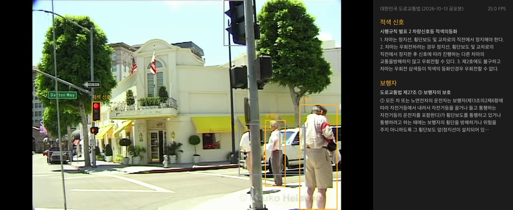
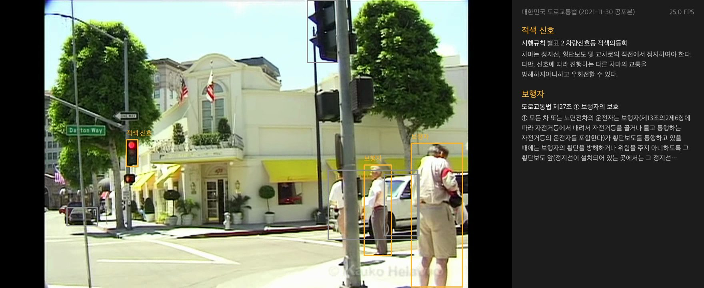
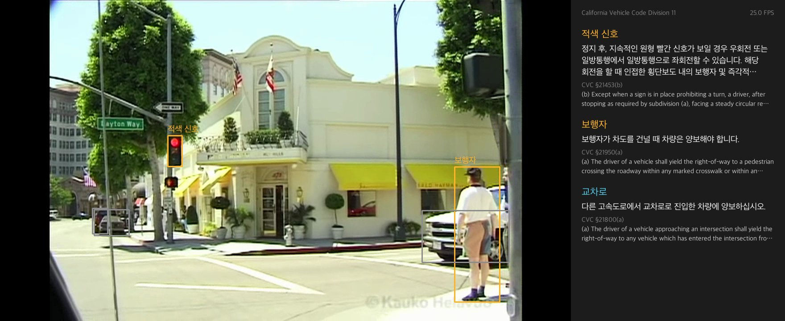

# Project03: 주행 영상 기반 도로교통법 검색 HUD

주행 영상에서 두 채널로 장면 맥락을 읽습니다. YOLO11n은 매 프레임 신호등, 보행자, 정지 표지를 찾아 "적색 신호" 같은 장면 상태로 바꿉니다. 로컬 Gemma 4 비전은 별도 스레드에서 최신 프레임을 보고 터널, 노면전차 선로, 버스 전용차로 같은 맥락과 표지판 글자를 읽습니다. 두 채널의 사실로 법 조문이 필요한 엣지 케이스(17개)를 판정합니다. 엣지 케이스가 나타나면 그때 법령 코퍼스를 BM25로 검색하고, Gemma가 조문에서 해당 문장을 골라 한국어 주행 지시문을 만듭니다. 화면 오른쪽에 지시문과 근거 조문을 함께 보여 줍니다.

지시문은 입력 영상이나 카메라를 처리하는 중에 만듭니다. 미리 만든 지시문은 세 법령을 한 화면에서 비교하는 비교 모드에서만 씁니다.

모델이 학습한 지식 대신 실제 법령 문서를 근거로 판단을 보여 주는 Retrieval-Augmented 구조입니다. 법령이 개정되거나 다른 나라에서 달리면 모델을 다시 학습하지 않습니다. 코퍼스 파일만 바꾸면 같은 영상에서 그 판, 그 나라의 조문이 나옵니다. 코퍼스는 한국 도로교통법 현행판, 2021년판, 캘리포니아 차량법(California Vehicle Code) 세 개입니다.

**같은 장면, 다른 판.** 원주 영상의 적색 신호 장면입니다.

| 현행 코퍼스 (`corpus-current.json`) | 2021년 코퍼스 (`corpus-2021.json`) |
|---|---|
|  |  |

현행 시행규칙 별표 2는 우회전하기 전에 정지선 직전에서 정지하라고 정합니다. 2021년 판은 정지 없이 우회전할 수 있다고 정합니다.

**같은 장면, 다른 나라.** 비벌리힐스 영상의 적색 신호와 보행자 장면입니다.

| 현행 코퍼스 | 2021년 코퍼스 | 캘리포니아 코퍼스 (`corpus-california.json`) |
|---|---|---|
|  |  |  |

보행자 패널은 현행 제27조 ①("통행하려고 하는 때"를 포함), 2021년 제27조 ①, 캘리포니아 차량법 21950조 (a)를 보여 줍니다. 적색 신호 패널은 캘리포니아에서 21453조 (b)("after stopping … may turn right")를 보여 줍니다. 하늘색 "교차로"는 Gemma 비전이 두 번 연속 교차로로 판단해 더한 상태입니다. 2021년 코퍼스 화면은 이 시점에 아직 두 번째 판단이 끝나지 않아 교차로가 없습니다.

그림 다섯 장은 원주 시연 영상 25.5초(원본 111.5초)와 비벌리힐스 시연 영상 47초(원본 487초) 프레임을 저장한 것입니다. 화면 오른쪽 위 FPS 값은 저장용 스크립트가 넣은 영상 FPS이며 처리 속도 측정값이 아닙니다.

## 파일 구조

```
Project03/
├── main.py              실행 파일: 영상 → 탐지 → 엣지 케이스 → 화면, 버튼
├── detect.py            YOLO 탐지 결과를 장면 상태로 바꿈, 신호등 색 판정(HSV)
├── edge.py              엣지 케이스 17개와 발동 판정, 조문 문장 나누기
├── retrieve.py          BM25 검색기
├── hud.py               탐지 박스, 버튼, 기본 패널, 비교 패널 그리기
├── gemma.py             로컬 Gemma: 지시문 만들기, 장면 맥락 판단, 표지판 조항 검증, 맥락 스레드
├── build_corpus.py      코퍼스 JSON 세 개 생성 (Mac에서 한 번 실행)
├── build_compare.py     비교 모드용 지시문 51개 생성 (Mac에서 한 번 실행)
├── compare-instructions.json  build_compare.py가 만든 세 법령 × 엣지 케이스 17개의 조항과 지시문
├── corpus-current.json  현행 도로교통법(항 단위)과 시행규칙 별표 2(신호 종류 단위)
├── corpus-2021.json     2022년 1월 개정 직전 공포본으로 만든 같은 구성의 코퍼스
├── corpus-california.json  캘리포니아 차량법 제11편 Rules of the Road(항 단위, 영어)
├── tests/
│   ├── test_retrieve.py 장면 상태별 정답 조문 검색, 토큰화
│   └── test_gemma.py    Gemma 답 줄 읽기
├── docs/                README 그림
├── data/                캘리포니아 의회 일괄 파일 (git에 올리지 않음)
└── videos/              주행 영상 (git에 올리지 않음)
```

## 실행 방식

### 준비

- 모든 명령은 `Project03/` 폴더에서 실행합니다. `--model` 기본값이 상대 경로 `../src/models/YOLO/yolo11n.pt`이기 때문입니다.
- Jetson에서는 수업 노트북 `00`, `03`, `04`에서 설치한 환경을 그대로 씁니다. 추가로 설치할 패키지는 없습니다.

| 패키지 | Jetson 수업 환경 | Mac 개발 환경 (`.venv-project03`) |
|---|---|---|
| Python | 3.10 | 3.10 |
| numpy | 1.23.0 | 1.23.5 |
| opencv-python | JetPack 기본 | 4.10.0 |
| Pillow | 10.4.0 | 10.4.0 |
| ultralytics | 04 노트북 설치본 | 8.4.194 |
| torch | 2.8.0 | 2.14.1 |
| llama-cpp-python | 05 노트북 설치본(CUDA 빌드) | 0.3.36(Metal 빌드) |

- Gemma 모델은 05 노트북과 같은 두 파일을 씁니다. 레포에는 넣지 않습니다. 05 노트북의 `hf_hub_download` 셀로 받거나 아래 명령으로 받습니다.
  - `../src/models/Gemma4/google_gemma-4-E2B-it-Q4_K_M.gguf`(3.46GB, Apache 2.0)
  - `../src/models/Gemma4/mmproj-google_gemma-4-E2B-it-f16.gguf`(0.99GB, 비전 모듈)

```bash
mkdir -p ../src/models/Gemma4 && curl -L -o ../src/models/Gemma4/google_gemma-4-E2B-it-Q4_K_M.gguf "https://huggingface.co/bartowski/google_gemma-4-E2B-it-GGUF/resolve/main/google_gemma-4-E2B-it-Q4_K_M.gguf"
```

```bash
curl -L -o ../src/models/Gemma4/mmproj-google_gemma-4-E2B-it-f16.gguf "https://huggingface.co/bartowski/google_gemma-4-E2B-it-GGUF/resolve/main/mmproj-google_gemma-4-E2B-it-f16.gguf"
```

- 한글 글꼴은 Noto CJK(`fonts-noto-cjk`), 나눔고딕, Apple SD Gothic Neo 중 설치된 것을 씁니다.

### 주행 영상

영상은 두 개를 씁니다. 두 영상 모두 레포에 넣지 않습니다.

**원주 영상(한국 블랙박스).** 위키미디어 공용의 [2020-04-16 원주시 도로주행](https://commons.wikimedia.org/wiki/File:2020-04-16_%EC%9B%90%EC%A3%BC%EC%8B%9C_%EB%8F%84%EB%A1%9C%EC%A3%BC%ED%96%89.webm)을 씁니다. 촬영자는 Choi Kwang-mo이고 라이선스는 CC0(퍼블릭 도메인)입니다. 원본은 1920×1080, 24 FPS, 182초, VP9(.webm), 254MB입니다.

아래 명령으로 `videos/`에 내려받습니다.

```bash
mkdir -p videos && curl -L -o videos/wonju-2020-04-16.webm "https://upload.wikimedia.org/wikipedia/commons/c/c3/2020-04-16_%EC%9B%90%EC%A3%BC%EC%8B%9C_%EB%8F%84%EB%A1%9C%EC%A3%BC%ED%96%89.webm"
```

시연에는 원본의 86~118초를 1280×720 mp4(`mp4v` 코덱)로 다시 저장한 `videos/wonju-demo.mp4`를 씁니다. 이 구간에서 앞차는 시연 영상 4.7초와 24초 부근에, 적색 신호는 24.5~27.4초(원본 110.5초)에 패널에 나옵니다. 원본 90초의 적색 신호는 이 파일에서 5프레임 연속 탐지가 되지 않아 패널에 나오지 않습니다. Jetson의 OpenCV가 VP9을 읽지 못할 경우에 대비한 파일입니다. Mac에서 OpenCV `VideoWriter`로 만들었습니다.

**비벌리힐스 영상(미국 캘리포니아).** 위키미디어 공용의 [Driving through BEVERLY HILLS, Los Angeles, California (HD)](https://commons.wikimedia.org/wiki/File:Driving_through_BEVERLY_HILLS,_Los_Angeles,_California_(HD).webm)을 씁니다. 촬영자는 Kauko Helavuo이고 라이선스는 [CC BY 3.0](https://creativecommons.org/licenses/by/3.0)입니다. 원본은 2014-07-09 촬영, 1920×1080(4:3 화면에 좌우 검은 띠), 25 FPS, 500초, 172MB입니다. 원본을 자르고 크기를 바꿔 시연 영상을 만들었습니다.

```bash
curl -L -o videos/beverly-hills.webm "https://upload.wikimedia.org/wikipedia/commons/9/92/Driving_through_BEVERLY_HILLS%2C_Los_Angeles%2C_California_%28HD%29.webm"
```

시연에는 원본의 440~497초를 1280×720 mp4로 다시 저장한 `videos/beverly-demo.mp4`를 씁니다. 이 구간에는 STOP 표지, 황색·적색·녹색 신호, 횡단보도 앞 보행자가 나옵니다.

### 실행 명령

```bash
python main.py videos/wonju-demo.mp4
```

```bash
python main.py videos/wonju-demo.mp4 --corpus corpus-2021.json
```

```bash
python main.py videos/beverly-demo.mp4 --corpus corpus-california.json
```

Jetson에서는 04 노트북에서 만든 TensorRT 엔진을 넘깁니다.

```bash
python main.py videos/wonju-demo.mp4 --model ../src/models/YOLO/yolo11n_fp16.engine
```

YOLO 입력은 1280이고 1280×720 영상에서는 1280×736으로 추론합니다. 04 노트북의 `yolo11n_fp16.engine`은 640×640 고정 크기라서, Jetson에서는 같은 방식으로 `imgsz=[736, 1280]` 엔진을 새로 만들어 넘겨야 합니다. 아직 만들지 않았습니다.

`--interval`은 Gemma가 판단 하나를 끝낸 뒤 쉬는 초입니다. 기본값은 0초입니다. Jetson에서 간격 없이 FPS가 모자랄 때만 `--interval 2`, `--interval 4`와 비교합니다.

비교 모드용 지시문 파일은 `build_compare.py`로 만듭니다. `gemma.py`의 프롬프트나 코퍼스를 바꾼 뒤에는 다시 실행해야 비교 모드에 반영됩니다. Mac에서 약 80초 걸립니다.

```bash
python build_compare.py
```

`q`를 누르면 종료합니다. 비전 라이브러리(`libmtmd`)가 이미지 처리마다 디버그 로그를 표준 오류로 찍습니다. 콘솔을 깨끗하게 보려면 명령 끝에 `2>/dev/null`을 붙입니다.

### 화면

- 왼쪽: 영상과 탐지 박스. 장면 상태를 만든 박스는 주황색 박스와 상태 이름으로, 나머지 탐지는 회색 박스로 그립니다.
- 오른쪽 패널 위: 영상 버튼 줄(원주, 비벌리힐스, 샌프란시스코)과 법령 버튼 줄(현행, 2021년, 캘리포니아, 비교). 오른쪽 아래에 처리 FPS가 있습니다.
- 기본 모드(현행, 2021년, 캘리포니아): 엣지 케이스마다 왼쪽 열에 이름, 행동 종류, 지시문(의무마다 최대 3줄), 오른쪽 열에 근거 조문 번호와 고른 원문 문장(최대 7줄). 지시문을 만드는 동안에는 이름만 보입니다. 같은 조항은 한 번만, 최대 3개까지 보여 줍니다.
- 비교 모드: 엣지 케이스마다 세 법령의 행동 종류(크게)와 지시문을 위아래로 쌓습니다. 지시문 줄은 자르지 않습니다. 표지판 지시문은 보여 주지 않습니다.

### 처리 과정

시작할 때 한 번:

1. 비전 모듈을 붙인 Gemma(`llama-cpp-python`, GPU)를 불러옵니다. 이미지 토큰은 560개로 고정합니다.
2. 코퍼스 세 개와 비교 모드용 `compare-instructions.json`을 읽습니다. 기본 모드 지시문은 만들지 않습니다.
3. 맥락 스레드를 시작하고 YOLO11n을 불러옵니다. Gemma는 영상 내내 메모리에 남습니다.

맥락 스레드(Gemma, 반복):

1. 메인 루프가 넘긴 엣지 케이스 목록에서 사라진 엣지 케이스의 지시문을 버립니다. 법령 버튼이 바뀌어도 버립니다.
2. 지시문이 없는 엣지 케이스마다 BM25 1위 조항을 찾고 지시문을 만들어 넘깁니다. 비교 모드에서는 만들지 않습니다.
3. 최신 프레임을 Gemma 비전에 넣어 맥락 항목 7개의 예/아니오와 표지판 글자를 받습니다. 이번 판단과 직전 판단의 합집합을 채택합니다.
4. 같은 표지판 글자가 두 번 이어서 읽히면, 그 글자로 BM25 상위 3개를 찾고 Gemma가 관련 조항 번호 하나 또는 "없음"을 고릅니다. 고른 조항이 있으면 지시문을 만듭니다. 그 글자가 이어지는 동안만 결과를 유지합니다.
5. 결과를 새 사전으로 만들어 한 번에 넘깁니다.

2026-11-03 Mac에서 시연 영상 세 개를 재생했을 때, 엣지 케이스가 나타나고 지시문이 나오기까지 9번 중 중앙값 3.0초, 최대 8.8초였습니다. 최대값은 엣지 케이스 4개가 한꺼번에 나타난 경우입니다. 간격 0초에서 장면 판단 주기는 중앙값 약 3.2초였습니다.

프레임마다:

1. 프레임을 1280×720으로 줄이고 YOLO(`conf=0.4`, `iou=0.5`)로 6개 클래스를 탐지합니다.
2. 박스마다 장면 상태를 정합니다.
   - 신호등: 박스 안 HSV 색 픽셀 수로 적색·황색·녹색을 고릅니다.
   - 사람, 자전거, 정지 표지: 화면의 0.2% 이상 크기일 때만 씁니다.
   - 승용차, 트럭: 화면의 3% 이상이고 화면 가운데 3분의 1에 있을 때 앞차가 됩니다.
   - 위쪽 끝이 화면 아래 20%에 있는 박스는 버립니다. 이 영역에는 보닛과 유리창 스티커가 있어 정지 표지 오탐이 생깁니다.
3. 상태마다 5프레임 연속 탐지되면 확정하고, 확정이 끊긴 뒤에도 2초 동안 유지합니다.
4. YOLO 상태와 맥락 스레드가 마지막으로 채택한 맥락을 합쳐 엣지 케이스를 판정하고, 그 목록을 맥락 스레드에 넘깁니다.
5. 기본 모드는 맥락 스레드가 만든 지시문으로, 비교 모드는 `compare-instructions.json`으로 패널을 그립니다. 패널은 내용이 바뀔 때만 다시 그립니다. 메인 루프는 Gemma를 직접 부르지 않습니다.
6. 처리가 영상보다 빠르면 남는 시간만큼 기다려 원래 속도로 재생합니다.

### 테스트와 평가

```bash
python -m unittest discover -s tests -t .
```

- 세 코퍼스 모두에서 장면 상태 9개(적색·황색·녹색 신호, 보행자, 횡단보도, 교차로, 자전거, 앞차, 정지 표지)의 BM25 1위가 정답 항목과 같은지 확인합니다. 캘리포니아 정답은 21453(b), 21452(a), 21451(a), 21950(a), 21950(c), 21800(a), 21760(c), 21703, 22450(a)입니다.
- 토큰화가 영어 낱말을 낱말 그대로, 한국어를 바이그램으로 나누는지 확인합니다. Gemma의 "항목: 값" 답을 사전으로 읽는지 확인합니다.
- 적색 신호(별표 2)와 보행자(제27조 ①)의 1위 본문이 두 판에서 다른지 확인합니다.
- 2026-11-02 Mac에서 5개 테스트가 모두 통과했습니다. 맥락 스레드가 도는 동안 메인 루프의 프레임당 처리 시간은 평균 29~34ms였습니다. 첫 프레임은 YOLO 준비로 약 1.9초가 걸립니다.
- `llama-cpp-python`이 추론 중 GIL을 놓으므로 영상 루프가 멈추지 않습니다. 그래도 Gemma와 YOLO가 같은 GPU를 써서 Gemma가 판단하는 동안 YOLO가 느려집니다. 아래 "Gemma 판단 간격" 표가 2026-11-03 측정값입니다.

### Gemma 판단 간격

Gemma는 판단 하나를 끝낼 때마다 `GEMMA_INTERVAL`초 동안 쉽니다. 그동안 YOLO가 GPU를 혼자 씁니다. 간격 후보는 0, 2, 4초이고, 고르는 기준은 측정 전에 정했습니다. 개발용 세트 판정 재현율이 간격 0초보다 한 장면 넘게 떨어지지 않는 간격 중 가장 긴 값을 고릅니다.

평가 스크립트는 Mac의 판단 한 번을 2.5초로 보고, 두 번의 판단을 정답 시각과 (2.5 + 간격)초 앞 프레임으로 잽니다.

```bash
python tests/evaluate_edge_cases.py dev 4
```

| 간격 | 개발용 판정 재현율 | 정밀도 | 음성 프레임 오판율 | Mac YOLO 1280 프레임 시간 평균 | 최대 |
|---|---|---|---|---|---|
| Gemma 없음 | | | | 37.6 ms (26.6 FPS) | 48.8 ms |
| 0초 | 33/51 = 65% | 33/38 = 87% | 2/18 = 11% | 46.8 ms (21.4 FPS) | 116.0 ms |
| 2초 | 34/51 = 67% | 34/41 = 83% | 1/18 = 6% | 43.9 ms (22.8 FPS) | 176.5 ms |
| 4초 | 33/51 = 65% | 33/38 = 87% | 1/18 = 6% | 39.5 ms (25.3 FPS) | 67.4 ms |

프레임 시간은 원주 시연 영상 600프레임(처음 30프레임 제외)에서 `model.predict`와 `scene_state`만 잰 값입니다. 기준에 따라 4초를 골랐습니다. 개발용 세트에서는 4초까지 재현율이 떨어지지 않아, 4초보다 긴 간격은 재지 않았습니다.

시험용 세트는 입력 1280, 간격 4초로 한 번 쟀습니다. 시험용 세트를 쓴 것은 세 번째입니다.

| 설정 | 시험용 판정 재현율 | 정밀도 | 음성 프레임 오판율 |
|---|---|---|---|
| 이전: 입력 640, 앞선 판단 2.5초 전 | 19/39 = 49% | 19/23 = 83% | 2/33 = 6% |
| 이번: 입력 1280, 앞선 판단 6.5초 전 | 17/39 = 44% | 17/25 = 68% | 2/33 = 6% |

Gemma의 정답 시각 판단은 두 실행에서 61장 모두 같았습니다. 그래서 차이는 YOLO 입력 크기와 앞선 판단 프레임의 시각에서만 생겼습니다. 두 결과를 섞어 원인을 나눴습니다.

- YOLO 입력 1280: 이전 Gemma 판단과 합치면 재현율이 19개에서 21개로 오르고 오판이 4개에서 7개로 늘었습니다. 적색 신호 교차로를 4개 중 1개에서 3개 맞혔습니다. 자전거 근접 2개와 황색 신호 1개가 새 오판입니다.
- 간격 4초: 샌프란시스코 1447초와 1477초에서 노면전차 선로와 회전 금지 표지 4개를 놓쳤습니다. 2.5초 전 프레임에는 보였지만 6.5초 전 프레임에는 보이지 않았습니다. 샌프란시스코 1627초와 비벌리힐스 407초에서는 6.5초 전 프레임의 회전 금지 표지가 남아 오판 2개가 생겼습니다.

개발용 세트에서는 간격의 비용이 나타나지 않았습니다. 시험용 세트의 샌프란시스코 도심 장면처럼 장면이 몇 초 안에 바뀌는 곳에서는 간격이 길수록 Gemma 판단이 낡습니다. Mac에서 `main.py`를 간격 4초로 돌렸을 때 판단 한 번은 약 3.7초였고 판단 사이는 7.6~7.8초였습니다. 평가가 가정한 6.5초보다 길어서 실제 실행의 손해는 더 클 수 있습니다.

이 결과를 보고 기본 간격을 0초로 되돌렸습니다(2026-11-03). 이 결정은 시험용 결과를 보고 내린 것입니다. 그래서 입력 1280, 간격 0초 설정에는 보지 않은 데이터로 잰 성능이 없습니다. 이번 실행의 YOLO 결과와 이전 실행의 Gemma 판단(2.5초 간격)을 합쳐 계산하면 시험용 재현율 21/39 = 54%, 정밀도 21/28 = 75%입니다. 이 값은 시험용 세트를 보고 고른 설정의 값이라 성능이 아니라 참고값입니다. 간격을 다시 정하려면 Jetson 측정값과 장면이 빨리 바뀌는 새 개발용 장면이 필요합니다.
- 비벌리힐스 시연 영상에서 정지 표지(2초), 앞차, 보행자(12.1초, 44.3초), 황색 신호(33.8초), 적색 신호(44.6초), 녹색 신호(49.3초)가 패널에 나왔습니다.

## 로컬 Gemma 주행 지시문

### 프롬프트

- system: 주어진 조항을 근거로 지금 장면에서 할 행동을 한국어 명령문 두 문장 이내로 쓰고, 조항의 행동 조건을 모두 담고, 조항에 없는 내용은 쓰지 않습니다.
- user: 상태 이름, 조항 번호와 제목, 조항 본문
- `temperature=0`, `max_tokens=120`. 같은 조항에는 같은 지시문이 나옵니다.
- 처음 시험한 "40자 이내 한 문장" 프롬프트에서는 현행판과 2021년판 지시문이 똑같았습니다. Gemma가 조항의 첫 문장만 요약해 개정된 뒷부분을 빠뜨렸기 때문입니다.

### 검토 표

2026-11-02 Mac(Metal 빌드)에서 만든 지시문 21개를 원문과 대조했습니다. 판정 기준은 아래와 같습니다.

- 일치: 원문의 행동 조건이 모두 맞게 담겼습니다.
- 일부 누락: 틀린 내용은 없지만 원문의 조건이나 예외가 빠졌습니다.
- 불일치: 원문과 다른 뜻입니다.

| 코퍼스 | 상태 | 지시문 | 판정 | 대조 내용 |
|---|---|---|---|---|
| 현행 | 적색 신호 | 정지선, 횡단보도 및 교차로의 직전에서 정지하십시오. 우회전하려는 경우, 정지 후 신호에 따라 다른 차량의 교통을 방해하지 않고 우회전하십시오. | 일부 누락 | 3호(우회전 삼색등이 적색이면 우회전 불가)가 빠짐 |
| 현행 | 황색 신호 | 차마는 정지선이나 횡단보도가 있을 때 그 직전이나 교차로의 직전에 정지해야 합니다. 우회전할 수 있으며, 우회전 시 보행자의 횡단을 방해해서는 안 됩니다. | 일부 누락 | 이미 교차로에 진입했으면 신속히 빠져나가라는 조건이 빠짐 |
| 현행 | 녹색 신호 | 직진 또는 우회전할 수 있습니다. 비보호 좌회전 표지나 표시가 있는 곳에서는 좌회전할 수 있습니다. | 일치 | |
| 현행 | 보행자 | 보행자가 횡단보도를 통행하거나 통행하려고 할 때, 횡단보도 앞에서 일시정지하여 보행자의 횡단을 방해하거나 위험을 주지 않도록 하십시오. | 일치 | 개정 문구 "통행하려고 하는 때"가 담김 |
| 현행 | 자전거 | 같은 방향으로 가는 자전거 운전자에 주의하고, 옆을 지날 때는 충돌을 피할 수 있는 거리를 확보하십시오. | 일치 | |
| 현행 | 앞차 | 앞차가 갑자기 정지할 경우 충돌을 피할 수 있는 필요한 거리를 확보하십시오. | 일치 | |
| 현행 | 정지 표지 | 교통정리를 하지 않고 좌우를 확인할 수 없거나 교통이 빈번한 교차로에서는 일시정지하십시오. 또는 안전표지로 지정된 곳에서는 일시정지하십시오. | 일치 | |
| 2021년 | 적색 신호 | 정지선, 횡단보도 및 교차로의 직전에서 정지하십시오. 신호에 따라 진행하는 다른 차량의 교통을 방해하지 말고 우회전할 수 있습니다. | 일치 | 개정 전 문구대로 정지 없이 우회전 |
| 2021년 | 황색 신호 | 현행과 같음 | 일부 누락 | 현행과 같은 조건이 빠짐 |
| 2021년 | 녹색 신호 | 현행과 같음 | 일치 | |
| 2021년 | 보행자 | 보행자가 횡단보도를 통행하고 있을 때, 횡단보도 앞에서 일시정지하여 보행자의 횡단을 방해하거나 위험을 주지 않도록 하십시오. | 일치 | 개정 전 문구 "통행하고 있을 때" |
| 2021년 | 자전거 | 현행과 같음 | 일치 | |
| 2021년 | 앞차 | 현행과 같음 | 일치 | |
| 2021년 | 정지 표지 | 현행과 같음 | 일치 | |
| 캘리포니아 | 적색 신호 | 정지 후, 지속적인 원형 빨간 신호가 보일 경우 우회전 또는 일방통행에서 일방통행으로 좌회전할 수 있습니다. 해당 회전을 할 때 인접한 횡단보도 내의 보행자 및 즉각적인 위험을 초래하는 차량에 양보해야 합니다. | 일부 누락 | 회전 금지 표지가 있으면 예외라는 조건이 빠짐 |
| 캘리포니아 | 황색 신호 | 황색 신호가 보이면, 관련 녹색 움직임이 끝나거나 곧바로 빨간 신호가 나타날 것임을 인지하십시오. | 일치 | |
| 캘리포니아 | 녹색 신호 | 직진하거나 우회전, 좌회전 또는 U턴을 하십시오. 다른 교통 및 법적으로 교차로 또는 인접 횡단보도 내의 보행자에게 양보하십시오. | 일부 누락 | U턴 금지 표지가 있으면 U턴할 수 없다는 조건이 빠짐 |
| 캘리포니아 | 보행자 | 보행자가 차도를 건널 때 차량은 양보해야 합니다. | 일부 누락 | "표시된 횡단보도 또는 교차로의 표시 없는 횡단보도 안에서"라는 범위가 빠짐 |
| 캘리포니아 | 자전거 | 자전거와 3피트 미만의 거리를 유지하십시오. 다른 차선이 있다면 안전과 교통 상황을 고려하여 차선을 변경한 후에 자전거를 추월하거나 지나가십시오. | 불일치 | 원문은 "3피트 미만 간격으로 추월하지 말라"인데 첫 문장이 반대 뜻임 |
| 캘리포니아 | 앞차 | 앞차를 합리적이고 신중하게, 해당 차량의 속도와 주변 교통 상황, 도로 상태를 고려하여 안전거리를 유지하십시오. | 일치 | |
| 캘리포니아 | 정지 표지 | 정지 표지 앞에 정지선이 있으면 그 선에 멈추십시오. 정지선이 없으면 교차로 진입 전 가까운 쪽 횡단보도 앞에 멈추십시오. | 일치 | |

| 현행 | 횡단보도 | 횡단보도 앞에서 일시정지하여 보행자가 안전하게 횡단할 수 있도록 하십시오. | 일부 누락 | "통행하고 있거나 통행하려고 하는 때"라는 조건이 빠져 2021년판 지시문과 같아짐 |
| 현행 | 교차로 | 우회전을 하려는 경우, 미리 도로의 우측 가장자리를 서행하면서 우회전하십시오. 우회전하는 차의 운전자는 신호에 따라 정지하거나 진행하는 보행자 또는 자전거 등에 주의해야 합니다. | 일치 | |
| 2021년 | 횡단보도 | 현행과 같음 | 일부 누락 | "통행하고 있을 때"라는 조건이 빠짐 |
| 2021년 | 교차로 | 현행과 같음 | 일치 | |
| 캘리포니아 | 횡단보도 | 횡단보도에 접근하는 보행자를 위해 모든 주의를 기울이고 차량 속도를 줄이거나 필요한 기타 조치를 취하여 보행자의 안전을 확보하십시오. | 불일치 | 원문의 조건은 "횡단보도 안의 보행자에게 차가 다가갈 때"인데 "횡단보도에 다가가는 보행자"로 바뀜 |
| 캘리포니아 | 교차로 | 다른 고속도로에서 교차로로 진입한 차량에 양보하십시오. | 불일치 | 캘리포니아 법의 "highway"는 공공 도로 전체를 뜻하는데 "고속도로"로 옮김 |

합계(4단계에서 상태 2개를 더한 27개): 일치 16개, 일부 누락 8개, 불일치 3개. 한국어 조항은 18개 중 일치 13개, 영어 조항은 9개 중 일치 3개입니다. 개정 전후 차이(적색 신호의 우회전 전 정지, 보행자의 "통행하려고 하는 때")는 두 판의 지시문에 모두 맞게 드러났습니다. 불일치 1개는 영어 수치 조건(three feet)을 한국어로 옮기며 부정어를 잃은 경우입니다. 그래서 지시문 아래에 원문을 항상 함께 보여 줍니다.

## 맥락 채널 비교 (키프레임 13장)

YOLO 상태만 쓰는 방식(3단계까지)은 검색 문장이 상태마다 고정이라 한 코퍼스에서 조문이 7개만 나왔습니다. 4단계에서 Gemma 비전 맥락을 더한 효과를 원주 7장, 비벌리힐스 6장의 키프레임으로 비교했습니다. 정답 조문은 사람이 화면을 보고 정했습니다. 화면만으로 정답을 정하기 어려운 2장(bev-240 좁은 사유 도로, bev-474 꺼진 신호등과 도로 이름 표지)은 빼고 11장으로 셉니다. 하이브리드 결과는 Gemma 판단 한 번의 결과이며 두 번 연속 일치 규칙은 적용하지 않았습니다.

| 키프레임 | 장면 | 정답 조문 (한국 현행) | YOLO만 | 하이브리드 |
|---|---|---|---|---|
| bev-033 | 4-WAY STOP 교차로 | 제31조 ②, 제26조 ① | 제31조 ② | 제31조 ② |
| bev-301 | STOP 표지가 있는 오르막 길 | 제31조 ② | 제31조 ② | 제31조 ② |
| bev-452 | 주택가 길가의 보행자 | 제27조 ⑥ | 제27조 ①(정답 아님) | 제27조 ①(정답 아님) |
| bev-486 | 횡단보도 앞 보행자, 적색 신호 교차로 | 별표 2 적색, 제27조 ①, 제25조 ① | 별표 2 적색, 제27조 ① | 별표 2 적색, 제27조 ①, 제25조 ① |
| won-020 | 앞차, 중앙선이 있는 국도 | 제19조 ①, 제13조 ③ | 제19조 ① | 제19조 ①, 제25조 ①(오답) |
| won-045 | 차 없는 국도 | 제13조 ③ | 없음 | 없음 |
| won-075 | 옆 차로 차, 국도 | 제13조 ③ | 없음 | 없음 |
| won-090 | 적색 신호 교차로 | 별표 2 적색, 제25조 ① | 별표 2 적색 | 별표 2 적색, 제25조 ① |
| won-110.5 | 적색 신호 교차로, 앞차 | 별표 2 적색, 제19조 ①, 제25조 ① | 별표 2 적색, 제19조 ① | 별표 2 적색, 제19조 ①, 제25조 ① |
| won-142 | 자동차전용도로 | 제13조 ③ | 없음 | 없음 |
| won-170 | 터널 진입 | 제22조 ③(터널 안 앞지르기 금지), 제37조 ①(터널 안 등화) | 없음 | 없음 |

- 정답 조문 19개 중 YOLO만은 8개, 하이브리드는 11개를 찾았습니다. 하이브리드는 오답 1개(won-020을 교차로로 판단)를 더했습니다.
- 늘어난 3개는 모두 교차로 장면의 제25조 ①입니다. 표지판 글자는 이 키프레임들에서 한국 코퍼스 조항으로 이어지지 않았습니다. 영어 표지판이 많고, 원주 표지판은 지명("Wonju IC")이었기 때문입니다.
- 두 방식 모두 도로 종류(중앙선, 자동차전용도로)와 터널 맥락을 찾지 못했습니다. Gemma 비전이 원주 국도 7장을 모두 "고속도로"라고 답하고 터널을 놓쳐, 이 항목은 맥락 채널에서 뺐습니다.
### 표지판 검증 결과

표지판 글자마다 BM25 상위 3개 중 Gemma가 고른 조항을 원문과 대조했습니다(2026-11-02, Mac).

| 코퍼스 | 표지판 글자 | 고른 조항 | 판정 |
|---|---|---|---|
| 한국 현행 | 어린이보호구역 | 제12조 ③(어린이 보호구역에서 안전에 유의하며 운행) | 맞음 |
| 한국 현행 | 일시정지 | 제25조 ⑥(일시정지 표지가 있는 교차로에서 일시정지) | 맞음 |
| 한국 현행 | 진입금지 | 제13조 ⑤(안전표지로 진입이 금지된 장소에 들어가지 않음) | 맞음 |
| 한국 현행 | 서행 | 제27조 ⑥(보행자 옆을 지날 때 서행) | 일부 맞음. 서행 장소 전반(제31조 ①)이 아니라 보행자 경우만 다룸 |
| 한국 현행 | 우회전 금지 | 제25조 ①(교차로 우회전 방법) | 틀림. 금지가 아니라 우회전하는 방법 |
| 한국 현행 | 원주, 문막 IC 여주, Wonju IC | 없음 | 맞음 |
| 캘리포니아 | STOP | 21354조(지방 당국이 정지 표지를 세울 수 있음) | 틀림. 운전자 의무가 아니라 당국 권한 조항 |
| 캘리포니아 | PUBLIC PARKING | 22952조 (b)(주차장 운영자의 견인) | 틀림. 운전자 의무가 아님 |
| 캘리포니아 | Dalton Way, CARMELITA, Wonju IC, RODEO DR … | 없음 | 맞음 |

- 지명과 도로 이름 8개는 모두 "없음"으로 걸렀습니다.
- 관련 있는 표지판 7개 중 맞음은 3개(모두 한국), 일부 맞음 1개, 틀림 3개입니다. 검증기는 표지판과 낱말이 겹치는 조항 중에서, 운전자가 지킬 조항과 당국 권한·견인 조항을 구분하지 못했습니다.
- 비벌리힐스 시연 영상 5.4초에 나오는 "표지판 STOP"이 위 표의 틀린 결과(21354조)입니다. 지시문 아래 원문으로 사람이 확인할 수 있지만, 이 상태는 오답입니다.

## 법령 코퍼스

### 파일 형식

코퍼스 파일은 `{"name", "queries", "articles"}` 사전입니다. `queries`는 장면 상태 이름별 검색 문장이고, 그 법령이 쓰는 말로 씁니다. 한국어 문장으로는 영어 차량법을 검색할 수 없기 때문입니다. 검색 문장이 코드가 아니라 코퍼스에 있으므로, 나라를 바꿀 때 코드를 고치지 않습니다.

### 생성

```bash
curl -o data/pubinfo_2025.zip https://downloads.leginfo.legislature.ca.gov/pubinfo_2025.zip
```

```bash
python build_corpus.py <국가법령정보 Open API 인증키(OC)> data/pubinfo_2025.zip
```

- 인증키는 [국가법령정보 공동활용](https://open.law.go.kr)에서 발급받은 본인 키를 씁니다. 레포에는 적지 않습니다.
- 법령은 「저작권법」 제7조에 따라 보호받지 못하는 저작물입니다. 그래서 생성한 JSON을 레포에 넣었습니다.

| 파일 | 법령 | 법령일련번호(MST) | 공포일 |
|---|---|---|---|
| `corpus-current.json` | 도로교통법 | 291133 | 2026-10-13 |
| `corpus-current.json` | 도로교통법 시행규칙 | 289009 | 2026-08-24 |
| `corpus-2021.json` | 도로교통법 | 237009 | 2021-11-30 |
| `corpus-2021.json` | 도로교통법 시행규칙 | 239101 | 2021-12-31 |

`corpus-2021.json`은 아래 두 개정이 공포되기 직전의 공포본으로 만들었습니다. Open API의 법령 본문은 공포 시점 조문을 담고 시행 예정 개정분을 포함하기 때문에, 시행일이 아니라 공포일로 판을 골랐습니다.

- 2022-01-11 공포 도로교통법 제27조 ① 개정: 횡단보도를 "통행하려고 하는 때"에도 일시정지해야 함
- 2022-01-21 공포 시행규칙 별표 2 개정(2023-01-22 시행): 적색 신호에서 우회전하려면 정지선 직전에서 먼저 정지해야 함

### 구성

- 도로교통법은 항마다 한 항목입니다. `id`는 `도로교통법 제27조 ①` 형식입니다.
- 시행규칙 별표 2(신호기가 표시하는 신호의 종류 및 신호의 뜻)는 신호 종류마다 한 항목입니다. 제목은 `차량신호등 적색의등화` 형식입니다.
- 캘리포니아 차량법은 제11편(Division 11, Rules of the Road) 현행 조문 567개를 항(subdivision)마다 한 항목으로 나눕니다. `id`는 `CVC §21453(b)` 형식이고, 캘리포니아 법전에는 조문 제목이 없어 `title`은 비어 있습니다.
- 항목 수는 현행 592개, 2021년 536개, 캘리포니아 1,694개입니다.

### 캘리포니아 차량법 출처

- 캘리포니아 의회가 공개하는 일괄 데이터 [pubinfo_2025.zip](https://downloads.leginfo.legislature.ca.gov/)(2025–2026 회기, 2026-10-25 갱신, 1.2GB)의 `LAW_SECTION_TBL`에서 읽습니다.
- 의회 웹사이트(leginfo.legislature.ca.gov)는 스크립트 접근을 Cloudflare 확인 페이지로 막아서 쓰지 않았습니다.
- 미국 교통 법규는 주마다 다릅니다. 비벌리힐스 영상과 같은 지역인 캘리포니아주 법을 골랐습니다.

## 한계

- 원주 영상에는 보행자 장면이 없습니다. 보행자 장면은 비벌리힐스 영상으로 확인합니다.
- 비벌리힐스 영상은 블랙박스가 아니라 손으로 든 카메라로 찍은 영상입니다. 앞차 판정(화면 가운데 3분의 1)과 화면 아래 20% 제외 규칙은 블랙박스 화면을 기준으로 정한 값입니다.
- 검색 문장은 사람이 법령 용어로 썼습니다. 캘리포니아 정지 표지 문장은 처음 쓴 문장("stop sign at entrance to intersection …")으로는 21457조(점멸 적색 신호)가 1위였고, 조문 용어("approaching a stop sign …")로 고쳐 쓴 뒤 22450조 (a)가 1위가 되었습니다. 영어를 단어 단위로 나눠 시험했을 때는 처음 문장으로도 7개 모두 1위였습니다. 문자 바이그램은 영어에서 낱말 경계를 잃어 한국어보다 검색 문장에 민감합니다.
- COCO 모델은 횡단보도, 차선, 한국 교통안전표지를 찾지 못합니다. Gemma 비전으로 교차로, 횡단보도, 표지판 글자를 더했지만 도로 종류와 터널은 믿을 수 없어 쓰지 않습니다. 키프레임 비교에서 정답 조문 19개 중 11개를 찾았습니다.
- Gemma 비전의 판단 결과는 스레드 호출 시점에 따라 실행마다 조금씩 다릅니다. 같은 영상에서도 "교차로"가 나오는 시각이 몇백 밀리초씩 달라지고, 한 번은 나오지 않기도 합니다.
- 표지판 글자는 두 번 연속 똑같이 읽혀야 채택합니다. 카메라가 움직이면 같은 표지판도 글자가 조금씩 다르게 읽혀 채택되지 않는 경우가 있습니다.
- 표지판 검증은 관련 있는 표지판 7개 중 3개만 맞는 조항을 골랐고 3개는 틀렸습니다. 캘리포니아 "STOP"은 운전자 의무 조항(22450조) 대신 당국 권한 조항(21354조)을 골랐습니다.
- Jetson에서는 Gemma 비전 호출이 Mac(1.1~2.2초)보다 느릴 것으로 예상하며, 아직 재지 않았습니다. 두 번 연속 일치 규칙 때문에 맥락 상태는 호출 두 번이 끝나야 나타납니다. 호출이 수 초씩 걸리면 장면이 지나간 뒤에 나오거나 57초 시연 구간 안에 나오지 않을 수 있습니다. 11/07 측정 결과에 따라 한 번 판단으로 바로 채택할지, 이미지 토큰을 280개로 줄일지 정해야 합니다.
- 별표 2는 선 문자 표에서 글자를 읽습니다. 칸 안 줄바꿈이 낱말 중간에서 일어나 일부 띄어쓰기(`교통을방해하지`)는 복원하지 못합니다.
- 패널은 `queries` 순서로 최대 3개만 보여 줍니다. 상태가 4개 이상이면 순서가 뒤인 상태(표지판 포함)는 보이지 않습니다.
- Jetson에서 확인하지 않은 것이 많습니다. 11/07 첫 실행에서 아래 순서로 확인합니다.
  1. 메모리: Gemma 3.5GB, 비전 모듈 1GB(`n_ctx` 4096), YOLO가 영상 내내 함께 올라갑니다. 3단계까지는 Gemma를 해제한 뒤 YOLO를 불러왔지만, 4단계부터는 맥락 스레드 때문에 Gemma가 남습니다. `tegrastats`로 확인합니다.
  2. Gemma 비전 호출 시간: 콘솔의 "맥락" 출력 간격으로 잽니다.
  3. `cap.get(cv2.CAP_PROP_FPS)`가 0이 아닌지 확인합니다. 0이면 `main.py`가 0으로 나눕니다.
  4. TensorRT 엔진(`yolo11n_fp16.engine`) 사용, mp4 시연 영상 읽기, Gemma CUDA 빌드의 시작 시간을 확인합니다. CUDA 빌드는 Metal 빌드와 지시문 글자가 다를 수 있어 Jetson에서 검토 표를 다시 확인해야 합니다.
- Gemma 지시문 27개 중 3개가 원문과 다른 뜻이었고 8개는 조건이 빠졌습니다. 지시문만 믿고 행동하면 안 되고, 원문을 함께 봐야 합니다.
- 패널은 확정이 끊긴 상태를 2초 동안 유지합니다. 그래서 장면이 바뀐 직후에는 이미 지나간 객체의 조문이 잠시 남습니다.
- `../src/models/YOLO/yolo11n.pt`는 레포에 넣지 않습니다. 04 노트북 순서대로 준비합니다.

## 수업 내용과 연결

| 수업 내용 | 이 프로젝트에서 쓴 곳 |
|---|---|
| 02 노트북 색공간 변환과 색 기반 분할 | `detect.light_color`: HSV 변환, `cv2.inRange`, 빨강 두 범위 합치기 |
| 04 노트북 YOLO 추론과 클래스 선택 | `main.py`: `model.predict(source=frame, conf, iou, verbose=False, classes=CLASSES)` |
| 04 노트북 FPS 측정 | `main.py`: `time.perf_counter()`와 지수 이동 평균(0.9, 0.1) |
| 04 노트북 TensorRT 엔진 | Jetson 실행 시 `--model ../src/models/YOLO/yolo11n_fp16.engine` |
| 05 노트북 로컬 Gemma 로드와 생성 | `gemma.load_gemma`, `gemma.ask`: `Llama(n_gpu_layers=-1, …)`, `create_chat_completion`. 이미지 토큰 때문에 `n_ctx=4096`, `n_batch=512`로 늘림 |
| 05 노트북 Prompt Engineering의 `role` | `gemma.py`: system 메시지로 근거 제한 규칙과 검증 규칙, user 메시지로 장면과 조항 |
| 05 노트북 비전 모듈(mmproj), 8회차 멀티모달 | `gemma.read_scene`: `Gemma4ChatHandler`로 프레임 이미지를 넣어 장면 맥락 판단 |
